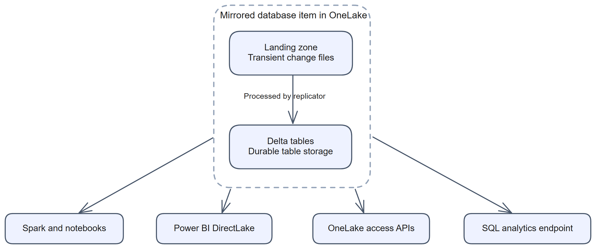
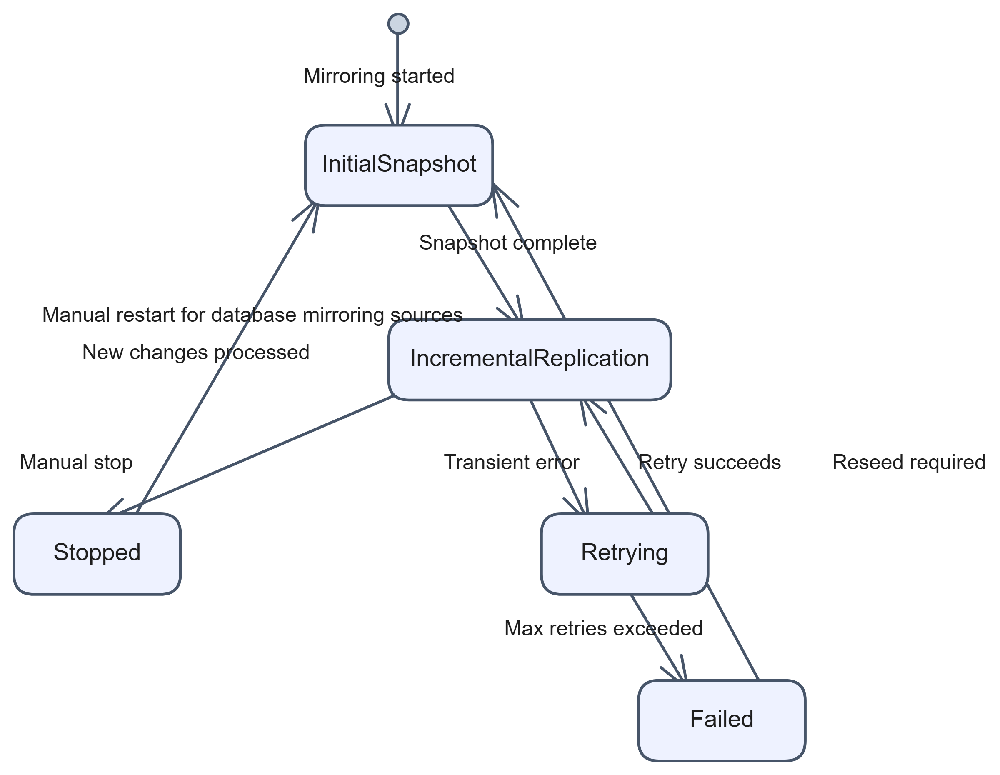
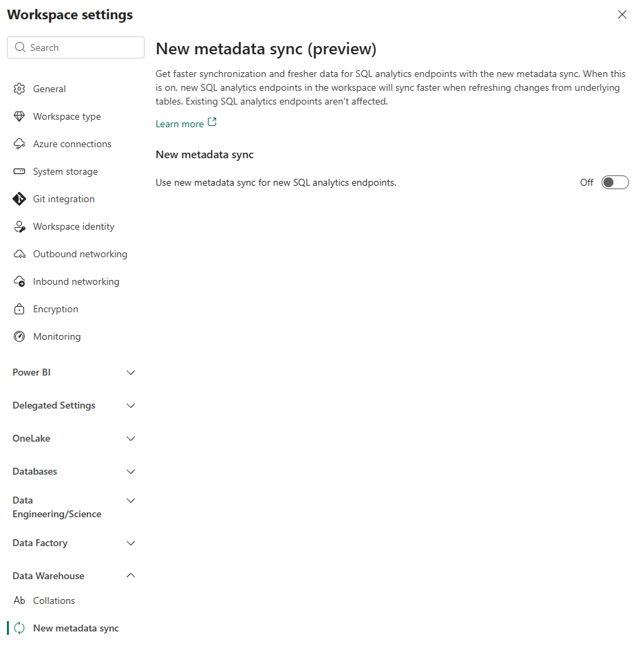
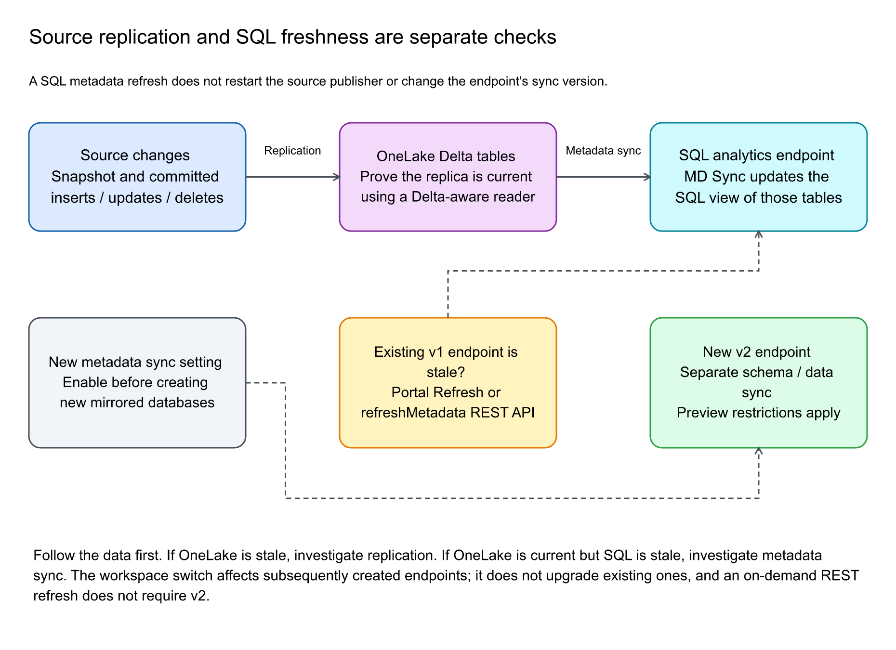
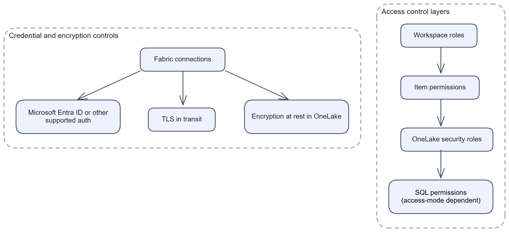
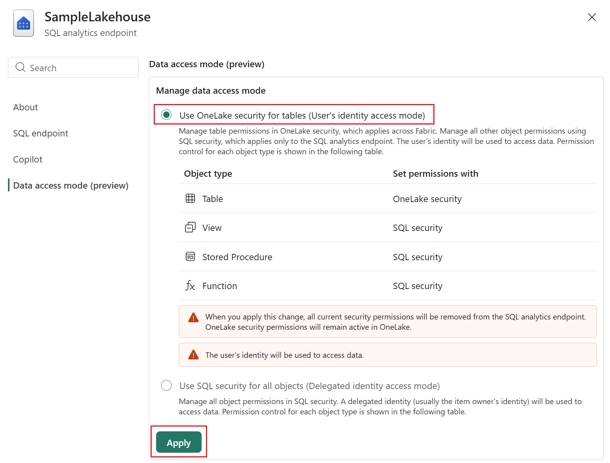

# Chapter 4: The Anatomy of a Mirrored Database

> **Part 1: Concepts and Architecture**
>
> **Purpose:** This chapter helps you understand what Fabric creates when you mirror a source, where the replicated data is stored, how the replicator behaves, and what operational details matter after setup.

**Part index:** [Chapters in Part 1](readme.md)

***

## Overview

A mirrored database in Fabric combines storage, replication state, and query surfaces inside OneLake. This chapter describes the replicated-data architecture used by database mirroring and open mirroring. Metadata mirroring uses source-specific catalog or connection items rather than this complete landing-zone pipeline.

**Scope boundary:** [Dataverse Link to Fabric](../Part%202-%20Source-Specific%20Mirroring%20Guides/28%20-%20Dataverse%20Link%20to%20Microsoft%20Fabric%20and%20Low-Latency%20Sync.md) creates a Lakehouse with shortcuts to a Dataverse-managed analytical replica. A SQL endpoint over those tables does not turn the Lakehouse into the mirrored-database item described here. The separate [SAP BDC Connect chapter](../Part%202-%20Source-Specific%20Mirroring%20Guides/29%20-%20SAP%20Business%20Data%20Cloud%20Connect%20for%20Microsoft%20Fabric.md) likewise identifies its own provider/consumer objects and sharing responsibilities.

[Business Central](../Part%202-%20Source-Specific%20Mirroring%20Guides/31%20-%20Dynamics%20365%20Business%20Central%20Mirroring.md) uses an open mirrored database as its destination, but company/table selection, synchronization runs, and connection approval remain source-side application controls.

[Fabric HorizonDB](../Part%202-%20Source-Specific%20Mirroring%20Guides/32%20-%20Microsoft%20Fabric%20HorizonDB%20Mirroring.md) adds native PostgreSQL with an automatic asynchronous mirror in Public Preview. Its operational endpoint, creator-only connection boundary, mirroring relationship, and analytical endpoint have their own contracts. Do not copy the external PostgreSQL connector's gateway/identity setup or Fabric SQL database's numerical limits into this service.

When you create a mirrored database, Fabric creates **two** items:

1. The **mirrored database item** itself, which owns the landing zone, Delta tables, replicator engine, replication settings, and monitoring state.
2. The **SQL analytics endpoint**, which exposes the mirrored tables through a read-only SQL surface.

Conceptually, you can think of the mirrored database item as the ingestion and storage layer, which can be the source of a Fabric shortcut or queried using a Delta reader, and the SQL analytics endpoint as the query layer that sits over the resulting Delta tables.

***

## 4.1 Storage Architecture: Landing Zone and Delta Tables

[](../assets/diagrams/chapter-04/diagram-01.excalidraw.png)
*Figure 4.1: Storage architecture from landing zone to Delta tables*

### The Landing Zone

The **landing zone** is a transient staging area inside the mirrored database item. Change data arrives here before Fabric applies it to the final table layer.

**Key points:**

* The landing zone is Fabric-managed. Open mirroring exposes a supported landing-zone contract for external publishers; native connectors manage their staging internally.
* The file pattern depends on the source and mirroring method.
* Retention and cleanup behaviour depend on the mirroring type and source.

For open mirroring, the [landing-zone specification](https://learn.microsoft.com/en-us/fabric/mirroring/open-mirroring-landing-zone-format) describes moving processed files into internal cleanup folders and removing them after seven days, while retaining the latest sequential file as a publisher reference. This is **landing-file cleanup**, not Delta-table VACUUM or a durable publisher checkpoint. [Chapter 37](../Part%203%20-%20Open%20Mirroring/37%20-%20Metadata%20and%20Change%20Files.md#file-names-and-delivery) explains the publication and recovery implications.

### Delta Tables

After Fabric processes the landing zone files, the replicated data is written into **Delta tables** in OneLake.

**Key points:**

* The table layer is stored in **Delta** format.
* Delta transaction logs preserve table state and change application order.
* This is the main queryable data layer for SQL, Spark, and Direct Lake scenarios.
* A compatible Delta reader can query the data if it supports the table's Delta features and has the required access.
* Delta change data feed (CDF) is an optional paid capability for supported sources; see [Chapter 9](09%20-%20Extended%20Capabilities.md).
* The mirrored database item owns these tables even though users often access them through the SQL analytics endpoint.
* Treat the output tables as read-only. Direct changes to the mirrored Delta files are unsupported; use the source or an open mirroring publisher to change the data. See [Explore mirrored data directly](https://learn.microsoft.com/en-us/fabric/mirroring/explore-data-directly).

### Delta Table Retention and VACUUM

Mirroring automatically runs Delta **VACUUM** on mirrored tables to remove obsolete files that are no longer needed within the configured retention window. The retention setting is an age threshold for eligible files, not a schedule promising that VACUUM runs at a particular time.

**Key points:**

* The retention period is configurable, from 1 to 30 days.
* Mirrored databases created through the Fabric portal after mid-June 2025 default to a **1-day** retention period. Older mirrored databases, and any mirror created through the REST API without an explicit value, default to **7 days**.
* A longer retention period keeps historical files available to compatible Delta time-travel readers, at the cost of extra mirrored storage. It does not enable Warehouse T-SQL time travel on the SQL analytics endpoint or create a permanent audit archive.
* Configure it in the Fabric portal from the mirrored database's **Settings** > **Delta table management** tab, or set `properties.target.typeProperties.retentionInDays` in the definition through the [mirrored database REST API](https://learn.microsoft.com/en-us/fabric/mirroring/mirrored-database-rest-api#configure-data-retention). Set it explicitly when consistent retention across deployments matters.

Fabric manages the replicated tables' **V-Ordered file layout and maintenance**. Do not schedule your own `OPTIMIZE` or `VACUUM` writes against these managed output tables. The documentation does not publish a fixed optimisation or VACUUM cadence. Metadata mirrors are different: Fabric does not maintain the source files behind their shortcuts. See [Optimise mirrored data](https://learn.microsoft.com/en-us/fabric/fundamentals/table-maintenance-optimization#optimize-mirrored-data). Maintenance of a separate lakehouse table that you own is also a different operation.

See [Retention for mirrored data](https://learn.microsoft.com/en-us/fabric/mirroring/overview#retention-for-mirrored-data) for the current official description.

***

## 4.2 The Replicator

The **replicator** is the managed processing that turns incoming changes into Delta tables. Native database connectors also coordinate source extraction and delivery. For open mirroring, those source-side responsibilities belong to the external publisher.

### Replicator Responsibilities

1. **Source connectivity:** Native connectors use a Fabric connection or supported source-side integration; open mirroring publishers manage their own source connections.
2. **Change extraction:** The connector or publisher reads data through the source's supported mechanism.
3. **Change position tracking:** Source offsets, such as LSNs, are connector-specific. Open mirroring publishers must retain their own extraction checkpoints.
4. **Landing zone writes:** The connector or publisher delivers captured changes into the landing zone.
5. **Delta application:** Applies inserts, updates, and deletes into the Delta table layer.
6. **Retry management:** Handles transient failures and backoff behaviour.

### Replicator Lifecycle

[](../assets/diagrams/chapter-04/diagram-02.excalidraw.png)
*Figure 4.2: Replicator state machine and lifecycle*

This is a conceptual model of what the replicator does internally. It does not map one-to-one to the replication status values returned by the Fabric portal or the REST API, covered in Chapter 5.

* **Initial snapshot:** Fabric performs a full load of the selected objects.
* **Incremental replication:** Fabric switches to change processing after the snapshot completes.
* **Retrying (backoff):** Fabric waits and retries after transient issues, without leaving incremental replication.
* **Stopped:** Replication has been halted by an operator.
* **Failed:** Replication cannot continue without intervention.

> **Note:** Stop/start behaviour is source-specific and can trigger a **full reseed**. Do not use it as a harmless refresh. It is also distinct from **Resume replication** after a capacity pause, which can continue from the paused position if the retained source changes are still available. See [Mirroring troubleshooting](https://learn.microsoft.com/en-us/fabric/mirroring/troubleshooting#changes-to-fabric-capacity).

***

## 4.3 Configuration Screens and Management

Mirrored databases are created and managed in the Fabric portal, REST API or via the deployment process.

### Create a Mirrored Database in the Portal

1. Open the target workspace.
2. Select **New item** and choose the relevant mirrored database source.
3. Select or create the required Fabric connection.
4. Choose the schemas or tables to mirror.
5. Start mirroring to begin the initial snapshot.

### Common Configuration Options

| Option               | Description                                              |
| -------------------- | -------------------------------------------------------- |
| **Connection**       | The Fabric connection that stores source access details. |
| **Tables to mirror** | The selected tables or schemas included in the mirror.   |
| **Start mirroring**  | Starts the initial snapshot or reseed process.           |
| **Stop mirroring**   | Stops active replication.                                |

### Management Notes

* You can monitor table status, lag, and errors from the mirrored database item.
* You can add or remove mirrored tables, subject to connector support.
* Before using **Stop mirroring** and **Start mirroring**, check the connector's reseed behaviour and the impact of a new snapshot.

***

## 4.4 SQL Analytics Endpoint

A database or open mirrored database also creates a **SQL analytics endpoint**. This is the read-only SQL surface over the mirrored Delta tables. Metadata connectors have their own item and query-surface arrangements, described in their source chapters.

**Key points:**

* The endpoint is created automatically with the mirrored database item.
* It exposes the mirrored tables through T-SQL.
* It is read-only for mirrored data.
* It can be used from SQL Server Management Studio, Visual Studio Code with the MSSQL extension, Power BI, and other supported SQL clients.
* The mirrored database item and the SQL analytics endpoint are separate Fabric items, even though users often move between them during normal work.

The SQL analytics endpoint uses the same compute engine as Fabric Data Warehouse, but its autogenerated mirrored tables remain read-only.

**Metadata synchronisation (MD Sync)** is separate from mirroring replication. The replicator applies source changes to Delta tables in OneLake; MD Sync makes those committed changes available through the SQL analytics endpoint. It reads Delta transaction logs to discover tables, detect schema changes, and update the SQL engine's view of the data. A change can therefore be present in OneLake before a SQL query returns it.

The following sections use **MD Sync v1** for the legacy implementation and **MD Sync v2** for **New metadata sync**. Originally reviewed 5 November and updated **18 November 2026**: the [Ignite summary](https://community.fabric.microsoft.com/blog/fbc_fabricupdatesblogs/fabric-november-2026-feature-summary/5414311) announces the new architecture **GA**, while migration of existing endpoints has separately published **Preview APIs**. The [conceptual guide](https://learn.microsoft.com/en-us/fabric/data-engineering/sql-analytics-endpoint-metadata-sync) still carries older Preview/new-endpoints-only wording; that documentation discrepancy is retained rather than hiding either source.

### MD Sync v1: Background Metadata Discovery

MD Sync v1 keeps the endpoint current through background discovery and synchronisation. It detects new or removed tables, changes to table definitions, and committed data changes that SQL queries need to see. It does not create another physical copy of the mirrored data.

Background discovery takes time. Workload, the number of items and table changes in a workspace, and Delta-log/file metadata can affect when a change becomes visible through SQL. The performance guide describes discovery running while the SQL endpoint is active and stopping after **15 minutes without query activity**. This concerns SQL metadata discovery, not the source replicator: mirroring can continue delivering changes to OneLake while SQL discovery is inactive.

An existing endpoint does not need to be replaced simply because its SQL results lag behind OneLake. An **on-demand metadata refresh** can bring the endpoint up to date using its existing MD Sync implementation; the REST procedure below does not require an upgrade to v2.

For mirrored tables, Fabric manages the Delta layout and maintenance. Do not copy the performance guide's user-managed Lakehouse `OPTIMIZE`/`VACUUM` examples onto mirrored output tables; see [Section 4.1](#41-storage-architecture-landing-zone-and-delta-tables).

### MD Sync v2: New Metadata Sync

MD Sync v2 introduces an external-table-based architecture with separate detection of schema and data changes. It combines periodic background checks with an on-demand data refresh when an incoming read query finds that the SQL view of the data is not current. The aim is faster query availability after data reaches OneLake, not a guaranteed end-to-end latency or a faster source replication service.

Ignite announces the new architecture as the default for new workspaces/endpoints. For an existing workspace that still exposes the opt-in setting, enable it for **subsequently created mirrored databases**:

1. Open the target Fabric workspace and select **Workspace settings**.
2. Under **Warehouse settings**, turn on **New metadata sync**.
3. Create the mirrored database after enabling the setting. Its newly created SQL analytics endpoint uses **MD Sync v2**.



*Figure 4.2a: Where to enable the new metadata-sync implementation for subsequently created endpoints. This setting does not upgrade an existing endpoint. Microsoft screenshot, reproduced unchanged from [SQL analytics endpoint metadata sync](https://learn.microsoft.com/en-us/fabric/data-engineering/sql-analytics-endpoint-metadata-sync#enable-new-metadata-sync); [original image](https://learn.microsoft.com/en-us/fabric/data-engineering/media/sql-analytics-endpoint-metadata-sync/workspace-settings-new-metadata-sync.png). Credit: Microsoft, [CC BY 4.0](https://creativecommons.org/licenses/by/4.0/) under the [Fabric documentation licence](https://github.com/MicrosoftDocs/fabric-docs/blob/main/LICENSE), including its warranty disclaimer. The preview label is retained; follow the current feature restrictions, not a screenshot alone.*

**The workspace setting is not the in-place upgrade mechanism.** Existing endpoints are not converted just by changing it. The separate Preview migration workflow below can upgrade an eligible existing endpoint; ordinary SQL freshness troubleshooting still does not require migration, deletion, or mirror recreation.

**Lifecycle and compatibility discrepancy:** the 17 November [Warehouse announcement](https://community.fabric.microsoft.com/blog/fbc_fabricupdatesblogs/fabric-data-warehouse-at-ignite-built-for-ai-era-analytics/5414274) announces GA and SQL endpoint LOB, time-travel, and Delta checkpoint V2 improvements. The conceptual guide still labels new sync Preview, excludes **workspace Private Link**, and excludes deprecated multi-part checkpoints. The migration API contracts do not explicitly lift the networking restriction or promise zero downtime/rollback. Confirm the applicable environment and [limitations](https://learn.microsoft.com/en-us/fabric/data-engineering/sql-analytics-endpoint-metadata-sync#limitations-of-the-new-metadata-sync); do not infer support for every checkpoint shape or source data type from the architecture announcement.

Endpoints created with v2 also expose `sys.dm_db_external_tables_log_status` for table-level update times, processed Delta-log/checkpoint versions, and blocked-update status. The table-level T-SQL refresh procedure `sys.sp_dw_refresh_ext_table` is likewise a **v2-only** option; it is not the manual-refresh method for an existing v1 endpoint.

### Upgrade an Existing Endpoint: Separate Preview Workflow

The three [migration APIs](https://learn.microsoft.com/en-us/rest/api/fabric/sqlendpoint/items/get-sql-endpoint-metadata-sync-migration-status) change the endpoint's synchronisation **architecture**, not its OneLake permissions or source replication. Use the **SQL analytics endpoint ID** for `{itemId}`, not the parent mirrored database/Lakehouse ID.

| Operation | Exact route under `https://api.fabric.microsoft.com` | Required item permission |
|---|---|---|
| [Read architecture/migration status](https://learn.microsoft.com/en-us/rest/api/fabric/sqlendpoint/items/get-sql-endpoint-metadata-sync-migration-status) | `GET /v1/workspaces/{workspaceId}/sqlEndpoints/{itemId}/metadataSyncMigrationStatus` | Read on the endpoint |
| [Assess compatibility](https://learn.microsoft.com/en-us/rest/api/fabric/sqlendpoint/items/preflight-sql-endpoint-metadata-sync-upgrade) | `POST /v1/workspaces/{workspaceId}/sqlEndpoints/{itemId}/preflightMetadataSyncUpgrade` | Write on the endpoint |
| [Convert V1 tables to V2](https://learn.microsoft.com/en-us/rest/api/fabric/sqlendpoint/items/upgrade-sql-endpoint-metadata-sync) | `POST /v1/workspaces/{workspaceId}/sqlEndpoints/{itemId}/upgradeMetadataSync` | Write on the endpoint |

These are **Preview APIs on `/v1/` routes**. No request body or query parameters are documented for these operations; do not invent `preview=true`, `targetVersion`, `force`, table filters, or a preflight token. Acquire a Fabric API token. Delegated status calls accept one of `Item.Read.All`, `Item.ReadWrite.All`, `SQLEndpoint.Read.All`, or `SQLEndpoint.ReadWrite.All`; the POSTs require one of the two ReadWrite scopes.

Users, service principals, and managed identities are supported. These OAuth scopes describe **delegated access**, not required Entra application permissions for app-only calls. SP/MI callers instead need the applicable Fabric tenant setting and item access. Preflight requires **Write** even though it does not convert tables; do not replace the API's item-permission contract with an unsupported Admin-only rule.

Use the following controlled sequence:

1. Retain the endpoint/workspace IDs, table inventory, SQL object definitions, and representative freshness/security tests.
2. Read migration status. `syncArchitectureVersion` distinguishes `V1` regular tables from `V2` external tables. Do not start a competing migration while `itemMigrationDirection` is present. No prior-attempt field is expected on a never-migrated endpoint.
3. Run preflight and obtain the complete result. Review `evaluatedTableCount`, `eligibleTableCount`, and every `blockers` entry (`schema`, `tableName`, `correctiveAction`). **HTTP 200 means assessment completed, not that it passed.** A clean preflight is a sensible release gate, not a documented token-based prerequisite.
4. Resolve blockers through supported source/Fabric procedures and reassess. Unsupported column types or Delta writer versions are examples, not an exhaustive compatibility matrix or permission to edit managed mirrored files.
5. Explicitly approve and invoke the upgrade. For a `200` response, inspect the result immediately. For `202`, retain `Location`, `x-ms-operation-id`, and `Retry-After`, poll to a terminal operation state, then retrieve its `/result`. Polling can return HTTP 200 while the operation is still Running.
6. Inspect `itemMigrationStatus` **and all `tableStatuses`**. `PartiallySucceeded` means some tables reached V2 and others did not; endpoint-level V2 alone is not complete success. Missing successful-sync timestamps do not prove freshness.
7. Repair outstanding tables, rerun preflight, and retry only when appropriate. The documented upgrade retries tables **not yet on V2**. Do not promise automatic rollback, a public downgrade endpoint, or a force switch from the existence of a `MigratingToV1` status enum.
8. Re-read status, validate queries/table freshness, and repeat consumer authorisation tests separately. The V2 DMV has its own Contributor-or-higher requirement; a status-GET reader is not automatically entitled to query it.

Both POSTs can encounter `LockConflict`; all three document `429`/`Retry-After`. Use bounded polling/backoff and inspect server state after a lost response before blindly resubmitting. A successful architecture migration does not prove that OneLake security sync is correct or make an ordinary metadata refresh unnecessary forever.

### Refresh an Existing Endpoint Without Upgrading

**If mirrored data is current in OneLake but SQL queries still return an older state, you do not need to upgrade to MD Sync v2.** Request an on-demand refresh of the existing SQL analytics endpoint through the [Refresh SQL endpoint metadata REST API](https://learn.microsoft.com/en-us/rest/api/fabric/sqlendpoint/items/refresh-sql-endpoint-metadata). This refreshes the SQL endpoint's metadata; it does not restart mirroring, reseed the source, or change the endpoint's MD Sync version.

First, distinguish **source replication lag** from **SQL metadata-sync lag**. Check the mirror's table status and, where necessary, compare the Delta table through a Lakehouse shortcut/Spark. A metadata refresh cannot make source changes appear before they have arrived in OneLake. See [Mirroring troubleshooting](https://learn.microsoft.com/en-us/fabric/mirroring/troubleshooting#data-doesnt-appear-to-be-replicating).

Use the **SQL analytics endpoint ID**, not the mirrored database item's ID, in the request:

```http
POST https://api.fabric.microsoft.com/v1/workspaces/{workspaceId}/sqlEndpoints/{sqlEndpointId}/refreshMetadata
Authorization: Bearer <fabric-access-token>
Content-Type: application/json

{
  "recreateTables": false
}
```

The caller needs **Contributor or higher** in the workspace; delegated calls require **`Item.ReadWrite.All`**. The API also supports service principals and managed identities with the required permissions. Acquire a token for the **Fabric API**, not an Azure Storage/OneLake token, and never store a real token in scripts or runbooks.

Omitting `tables` refreshes all tables in the endpoint. Keep `recreateTables` **false** for an ordinary refresh; setting it to true requests a drop/recreation of SQL endpoint tables and is a deliberate repair operation, not a routine freshness setting.

If the API returns **`202 Accepted`**, the refresh is still running. Follow the returned `Location` and `Retry-After` headers using Fabric's [long-running-operation procedure](https://learn.microsoft.com/en-us/rest/api/fabric/articles/long-running-operation), then inspect the per-table results for failures before querying again. Even a completed HTTP request is not proof that every table refreshed successfully. Honour `Retry-After` if the API returns `429`; do not repeatedly restart the mirror or issue unbounded refresh requests.

For an interactive check, **Refresh** in the SQL endpoint editor's **Explorer** toolbar also requests on-demand metadata synchronisation. This is different from refreshing the browser or a Power BI report. For v2 data-only, single-table refreshes, Microsoft recommends the T-SQL procedure; the REST API remains the documented item-level refresh path, including for existing endpoints.



*Figure 4.2b: Diagnose the freshness boundary before changing the implementation. Dashed arrows show a refresh request or a future-creation setting, not another copy of the source data. The separate existing-endpoint migration workflow is described above, not depicted by the workspace-setting arrow. Original explanatory diagram by this book, based on [SQL metadata sync](https://learn.microsoft.com/en-us/fabric/data-engineering/sql-analytics-endpoint-metadata-sync) and the [refreshMetadata API](https://learn.microsoft.com/en-us/rest/api/fabric/sqlendpoint/items/refresh-sql-endpoint-metadata). [Editable Excalidraw source](../assets/diagrams/chapter-04/walkthrough-replication-and-sql-freshness.excalidraw) · [SVG](../assets/diagrams/chapter-04/walkthrough-replication-and-sql-freshness.svg).*

***

## 4.5 Security of a Mirrored Database

**Security guidance reviewed: 17 November 2026.** A mirrored database creates a new analytical access surface. Replicating rows does not automatically reproduce the operational source's users, row filters, column permissions, masking, or sensitivity labels. Define the approved analytical audience and access paths before sharing the replica.

Microsoft manages Fabric's service infrastructure, authentication integration, and built-in encryption. You remain responsible for identities, permissions, source credentials, network policy, and the business rules that decide who can see which data. The [Fabric security overview](https://learn.microsoft.com/en-us/fabric/security/security-overview) describes the platform controls; the [OneLake data access model](https://learn.microsoft.com/en-us/fabric/onelake/security/data-access-control-model) and [SQL endpoint access-mode reference](https://learn.microsoft.com/en-us/fabric/onelake/security/sql-analytics-endpoint-onelake-security) define the more specific data-access behaviour.

[](../assets/diagrams/chapter-04/diagram-03.excalidraw.png)
*Figure 4.3: Security control families for a mirrored database. The right-hand chain is conceptual, not a claim that every SQL request evaluates both the reader's OneLake roles and SQL table grants. The SQL endpoint's selected identity mode determines which data policies are authoritative, as described below.*

### Workspace and Item Access

Separate **permission to use an item** from **permission to read its data**:

| Boundary | What to decide |
|---|---|
| **Source and publishing identities** | Who can connect to the operational source, and which identity can publish into the mirrored destination? Keep ingestion identities and their privileges separate from the intended end-user reader audience. |
| **Workspace and item access: control plane** | Who can create, configure, share, or open Fabric items? Workspace roles apply across the workspace; item sharing can grant access to one mirror and its endpoint without workspace membership. |
| **OneLake access: data plane** | Which tables, folders, rows, and columns may the effective reading identity access through supported OneLake paths? |
| **SQL endpoint access** | Does the endpoint enforce OneLake policies using the caller's identity, or SQL permissions using a delegated owner identity? |
| **Consumer and network controls** | Which identity does a semantic model, notebook, application, or shortcut actually use, and is that route permitted by network policy? |

For the SQL analytics endpoint, the reader needs **Fabric Read on the associated item**, whether granted through a workspace role or item sharing. A SQL `GRANT` alone cannot make an otherwise inaccessible item connectable. Conversely, **Read** permits item access but is not a blanket grant to every table. The effects of **ReadData** and **ReadAll** are qualified in [Section 4.6](#46-sharing-and-managing-permissions).

Use **Viewer** or item-level read access for consumers who need restricted data. **Admin, Member, and Contributor** are collaboration/authoring roles with broad access, not substitutes for a narrowly scoped reader role. Their ability to administer an item also does not make direct edits to Fabric-managed mirrored Delta tables supported.

**Special storage-item exception:** the new **Azure Databricks Storage** item has its own explicit OneLake-role model; workspace roles alone do not grant its data access. This is not the ordinary mirrored database's permission inheritance. Follow [Chapter 14's native-OneLake branch](../Part%202-%20Source-Specific%20Mirroring%20Guides/14%20-%20Azure%20Databricks%20%28Unity%20Catalog%29.md#november-2026-object-and-storage-updates).

### OneLake Security for Mirrored Databases

OneLake security defines data access on the **Fabric item containing the analytical data**, not on the original operational database. The current supported-item list includes **mirrored databases**, **mirrored catalogs**, and **Azure Databricks mirrored catalogs**. These mirrored items support **Read** roles. A Lakehouse's separate **ReadWrite** role capability is not permission to modify a mirrored replica.

A role specifies its **permission**, its **type**, the **data in scope**, and its **members**. Members can be supported Microsoft Entra users, groups, or nonuser identities. Roles can select tables, schemas, or folders, with **object-level security (OLS)** defining the accessible objects and **row-level security (RLS)** and **column-level security (CLS)** narrowing eligible table data. Folder grants inherit to children; the ability to traverse a parent to reach an authorised child does not grant access to sibling data.

**OneLake roles are Grant-only.** Without a grant, reader access is denied by default; there is no OneLake Deny role that cancels a grant from another role. This is different from SQL's `DENY` statement.

The [Mirrored Databases Preview announcement](https://community.fabric.microsoft.com/blog/fbc_fabricupdatesblogs/manage-onelake-security-for-mirrored-databases-preview/5172384) introduced roles directly on mirrored items. Treat that historical label separately from current component availability: the [secured-reader reference](https://learn.microsoft.com/en-us/fabric/onelake/security/read-secured-data) now lists the supported Fabric filtering paths as GA, while authorised third-party engine integration and the Table Read API retain Public Preview labels. Neither a broad announcement nor the existence of a security pane establishes support for every engine, identity, or query path.

#### DefaultReader and Multiple-Role Access

Inspect **DefaultReader** before adding a restricted role. Its default membership differs by item:

| Item | DefaultReader's default members |
|---|---|
| Mirrored database or Lakehouse | Identities with **ReadAll** on that item |
| Mirrored catalog, including an Azure Databricks mirrored catalog | Identities with **Read** on that item |

On an item with OneLake security enabled, **ReadAll is not an independent data-access override**: readers normally obtain its data access through DefaultReader. If that role is removed or narrowed, ReadAll alone does not recreate the missing grant. Assign another approved OneLake role where needed. A catalog's Read-based default membership also means that seemingly modest item sharing can expose more data than intended unless DefaultReader is reviewed.

Permissions are evaluated across **all** relevant roles and groups, not just the role you most recently edited:

* Within one role, object, row, and column restrictions all apply.
* Across roles, object grants combine, and RLS predicates for the same table combine with **OR**. An additional unrestricted grant can therefore defeat the intended row restriction.
* **SQL endpoint CLS is a documented exception:** its allowed-column lists intersect across roles, whereas the general OneLake model combines column access. Do not assume that overlapping CLS roles behave identically in every engine.
* Keep RLS and CLS that must operate together in the **same role**. The access-model reference excludes combinations where overlapping roles expose different column sets and either applies RLS to that table.

Virtual membership, such as DefaultReader membership derived from ReadAll, cannot necessarily be removed one person at a time. Review the permission group, the role, and the underlying item grants rather than assuming that removing one explicit membership revokes access.

#### Configure a Least-Privilege Reader Role

Follow [Create and manage OneLake security roles](https://learn.microsoft.com/en-us/fabric/onelake/security/create-manage-roles), using an approved administrator and a small representative dataset:

1. Inventory workspace roles, direct item grants, group membership, existing OneLake roles, DefaultReader, SQL endpoint mode, and actual consumer identities.
2. Open the **mirrored item**, then **Manage OneLake security**. Role administration requires the documented Write or Reshare permissions; the normal workspace-role model assigns security management to Admins/Members, not ordinary readers.
3. Select **New**, give the role a descriptive alphanumeric name, and choose **Grant / Read**. For roles that must synchronise to SQL, stay within the SQL endpoint's documented **124-character** name limit rather than relying on the general role editor's 128-character limit.
4. Choose **Selected data** and the approved tables/folders. **All data** and parent-folder scope can include future children; approve that future exposure explicitly.
5. Add any RLS and CLS restrictions together on the selected table. Use the supported OneLake RLS syntax, not an arbitrary T-SQL security policy or dynamic user lookup.
6. Add the intended Entra security group or supported principal. The SQL endpoint reference excludes mail-enabled security groups and distribution lists. Check that DefaultReader or another role does not still provide broader access, then save/create the role.
7. Grant the appropriate Fabric item access and, if SQL should enforce OneLake rules, configure **user identity mode** as described below. Do not grant Contributor merely to fix a reader's permission error.
8. Use **Members** to inspect a principal's roles/accessible data and **Data** to inspect a table's roles/readers, then test both authorised and unauthorised readers through every approved engine. These tabs were [announced GA in September 2026](https://community.fabric.microsoft.com/blog/fbc_fabricupdatesblogs/fabric-september-2026-feature-summary/5325825#community-5325825-mcetoc_1k3kj91s5_19); bulk assignment/removal does not change the underlying grant-combination rules.

For example, a role for a regional sales group could select only a synthetic `dbo.Orders` table, filter it to UK rows, and hide `CustomerEmail`. In the **OneLake role's row-security editor**, an illustrative static filter is:

```sql
SELECT * FROM [dbo].[Orders]
WHERE [SalesRegion] = 'UK'
```

Replace the schema, table, column, and value with the approved dataset. This statement defines the role's filter; it is **not** a command to install a SQL `CREATE SECURITY POLICY` on the endpoint. OneLake RLS currently uses a [documented SQL subset](https://learn.microsoft.com/en-us/fabric/onelake/security/row-level-security-syntax), without dynamic or multitable rules. Use the table's column-security editor for the separate column restriction.

OneLake reader roles are not an administrative isolation boundary: workspace Admins, Members, and Contributors retain elevated item/data powers. Avoid the absolute claim that they bypass every rule in every engine, however. The SQL endpoint reference documents RLS enforcement in user identity mode and shortcut/security-sync cases that can also restrict privileged queries. Validate the real route with a least-privilege identity, not only an administrator.

### SQL-Layer Security

The [Fabric Warehouse security overview](https://learn.microsoft.com/en-us/fabric/data-warehouse/security) is useful background for SQL protection, but a **Warehouse** and a **mirrored database's SQL analytics endpoint** are not interchangeable. Mirrored tables remain read-only, and the endpoint's **data access mode** decides which policy system governs table reads.

| Question | User identity mode | Delegated identity mode |
|---|---|---|
| **Who reads OneLake?** | The signed-in reader's identity is passed through. | The endpoint/item owner's delegated identity reads the files. |
| **Who authorises table data?** | OneLake roles and policies. | SQL permissions and SQL security policies. |
| **Do SQL table grants define reader access?** | No. Do not use table `GRANT`/`REVOKE` as the authoritative OneLake access policy. | Yes. Use supported SQL `GRANT`, `REVOKE`, `DENY`, and database roles. |
| **Where are RLS and CLS defined?** | In OneLake roles. | In SQL security policies and object/column permissions. |
| **Is Dynamic Data Masking a OneLake capability?** | No; OneLake DDM is not supported. | SQL DDM is available where supported by the endpoint feature. |
| **What about views, procedures, and functions?** | SQL permissions still govern these nondata objects; they do not override the caller's required OneLake access. | SQL permissions govern the exposed SQL objects. |
| **Is Fabric Read still required?** | Yes. | Yes. |

**New SQL analytics endpoints start in delegated identity mode.** Creating OneLake roles alone does not switch an existing endpoint to caller-based enforcement. Likewise, the **New metadata sync** workspace setting in Section 4.4 is a freshness implementation choice, not a security-mode switch.

#### Select or Change the Endpoint's Access Mode

As an Admin or Member, open the **SQL analytics endpoint**, then **Security > View data access mode > Data access mode settings**. Select **User's identity access mode** for OneLake-governed table reads, or **Delegated identity access mode** for SQL-governed table reads, then **Apply > Continue** to confirm.



*Figure 4.3a: The SQL endpoint's security-mode choice is separate from defining OneLake roles or enabling new metadata sync. Microsoft documentation screenshot, reproduced unchanged from [OneLake security for SQL analytics endpoints](https://learn.microsoft.com/en-us/fabric/onelake/security/sql-analytics-endpoint-onelake-security#change-the-onelake-access-mode); [original image](https://learn.microsoft.com/en-us/fabric/onelake/security/media/sql-analytics-endpoint-onelake-security/use-onelake-security.png). Credit: Microsoft, [CC BY 4.0](https://creativecommons.org/licenses/by/4.0/) under the [Fabric documentation licence](https://github.com/MicrosoftDocs/fabric-docs/blob/main/LICENSE), including its warranty disclaimer. Captured labels may differ from the current portal; follow the linked procedure and change-impact warnings.*

**Treat a mode change as a planned security migration, not a harmless troubleshooting toggle.** The setting is selected per endpoint, but changing it temporarily interrupts **all SQL analytics endpoints in the workspace**, cancelling their running and queued queries. The current reference also warns that switching to user identity mode deletes existing SQL roles and that changing modes in either direction removes inline metadata objects, including TVFs and scalar functions. The OneLake data files are not removed.

Before switching, retain scripts for affected SQL objects, roles, memberships, and grants; prepare the target access model; identify dependent reports/apps; and agree an outage and recovery plan. Do not assume that switching back restores deleted definitions. In delegated mode, the owner's continuing OneLake access is also an operational dependency.

#### Choose the Appropriate SQL Control

For **delegated-mode SQL reads**, use the endpoint's supported SQL controls deliberately:

| Control | Purpose and boundary |
|---|---|
| **Object permissions and database roles** | Restrict access to approved schemas, tables, views, or procedures. Avoid broad ReadData when the reader should use only selected objects. |
| **SQL RLS** | Apply a supported SQL security policy that filters the rows returned by SQL queries. It does not install a OneLake row policy for file/Spark readers. |
| **SQL CLS** | Grant access to approved columns. Test explicit column lists; SQL `SELECT *` can fail when it requests a denied/hidden column. |
| **Dynamic Data Masking** | Obscure values in query results for nonprivileged readers. It does not change the stored value, encrypt the column, or replace access control; users with suitable elevated/UNMASK rights see the original data. |

The [SQL granular-permissions guide](https://learn.microsoft.com/en-us/fabric/data-warehouse/sql-granular-permissions) applies to Warehouse and SQL analytics endpoints, subject to the endpoint mode above. It explicitly excludes manual `CREATE USER` in those analytical experiences: supported `GRANT`/`DENY` operations create the database principal as required, while Fabric item access remains a separate prerequisite. Do not copy the transactional SQL database's user-creation procedure into this endpoint.

For a read-only diagnostic, connect as the actual consumer to the **SQL analytics endpoint**, substitute an existing object, and inspect its SQL permission view:

```sql
SELECT *
FROM sys.fn_my_permissions('dbo.Orders', 'OBJECT');
```

SQL catalog views and this diagnostic are not a complete Fabric/OneLake effective-access report. They do not enumerate all workspace/item grants, and SQL table permissions are not authoritative in user identity mode. Pair them with the item's Manage permissions and OneLake role/member/data views.

**SQL-only rules stop at the SQL execution boundary.** A Warehouse SQL RLS/CLS policy is not translated into OneLake policy when someone reads Warehouse data through a shortcut. Similarly, an endpoint view or a restricted Power BI report does not protect an independently authorised raw-file path. Review every granted route. [Dynamic masking](https://learn.microsoft.com/en-us/fabric/data-warehouse/dynamic-data-masking) is useful for reducing accidental exposure, not for preventing a query-capable reader from inferring sensitive values.

> **Important:** Replicating table data does not itself reproduce source row-level security, column-level security, or masking policies. Configure and review access in Fabric. Optional source-specific security mirroring has a separate scope and setup; see [Chapter 9](09%20-%20Extended%20Capabilities.md) and the source guide rather than assuming full policy parity. For SQL controls, see [SQL granular permissions](https://learn.microsoft.com/en-us/fabric/data-warehouse/sql-granular-permissions).

### Shortcuts and the Effective Identity

**The query engine's identity and the shortcut's authentication mode are separate settings.** A passthrough OneLake-to-OneLake shortcut normally checks the effective calling identity at both its containing path and its target. A SQL endpoint in delegated mode can still supply an owner identity to that path; the word *passthrough* on the shortcut does not undo the engine's delegation.

External shortcuts, including Dataverse, ADLS, and S3, use a configured source connection credential. OneLake controls access to the Fabric shortcut surface on top of that credential; it does not impersonate each reader back through the source application's business rules.

For a **SQL endpoint consuming a shortcut to OneLake-secured data**:

* Use user identity mode when the producer's RLS/CLS must be evaluated for the consumer. Delegated mode requires unrestricted source-table access and the current reference blocks shortcut access to tables with producer OneLake RLS/CLS; a SQL grant on the consumer shortcut is not a workaround.
* The SQL endpoint's hub-and-spoke procedure requires an **exact principal match**: the user or group named in the producer's OneLake role must also receive Fabric Read on the consumer item. If the role names `GroupA`, grant that same group consumer Read rather than relying on a different group or indirect/nested membership to satisfy the match.
* Validate the reader at the shortcut location and the target. A visible shortcut name is not proof of permission to read its data, and a view/procedure must not be used to assume that owner permissions replace required producer authorisation.

These are source- and engine-aware checks, not a requirement to duplicate every policy everywhere. Keep the approved policy on the item that owns the data, then verify the consumer's route against the [OneLake shortcut model](https://learn.microsoft.com/en-us/fabric/onelake/security/data-access-control-model#shortcuts) and the [SQL-specific shortcut rules](https://learn.microsoft.com/en-us/fabric/onelake/security/sql-analytics-endpoint-onelake-security#shortcuts-behavior-with-security-sync).

### Validate Access and Plan Security Changes

OneLake filtering is not available through every generic file reader. [Supported engines](https://learn.microsoft.com/en-us/fabric/onelake/security/read-secured-data), with their required configuration, can return only allowed rows/columns. A direct OneLake file call or nonauthorised external engine is **blocked** if it cannot safely return the whole table to that reader; OneLake does not hand out unrestricted Parquet files as a substitute for filtering.

Use synthetic records and test at least the following before sharing production data:

| Test | Expected evidence |
|---|---|
| Authorised nonadministrator, SQL | Connection succeeds through Fabric Read, and explicit approved columns/rows match the endpoint's chosen policy model. |
| Same principal, configured supported Spark/OneLake path | The permitted subset is returned without exposing unapproved rows/columns. A blocked positive test needs diagnosis, not a broader permission grant. |
| Restricted principal, direct file/unsupported engine path | A reader without whole-table entitlement cannot retrieve unfiltered table files. |
| Unauthorised principal and unapproved table/column | Access fails or the data is absent as designed. A successful administrator query is not this negative test. |
| Multiple groups/roles and DefaultReader | Effective access matches the approved combination, including SQL's CLS exception and any virtual default membership. |
| Shortcut and Power BI consumer | Producer/consumer identities, endpoint mode, model identity, and source credential produce the intended result, not merely a report that looks filtered. |
| Membership removal and schema change | Revocation and updated policies are observed after propagation; renamed/dropped fields do not leave a stale or invalid access contract. |

Allow for **security propagation**, not just data freshness. The access-model reference gives approximately **five minutes** for role-definition changes and about **an hour** for group-membership changes, with possible additional engine caching. The SQL endpoint reference also documents delegated owner-token caching, typically **30-60 minutes** until expiry when the owner's permissions change. Saving a role is not proof that every client has already changed access; verify the result and plan time-sensitive revocation with the security owner.

The SQL endpoint's **security sync** translates OneLake policies into its managed `OLS_` roles. It is not the MD Sync v1/v2 setting from Section 4.4. Do not hand-edit `OLS_` roles or change ownership on shortcut-backed SQL objects to repair access. Fix the originating OneLake role, the identity mapping, or the source schema, then verify synchronisation.

Repeated security-sync errors can trigger retry backoff. Correct the invalid policy or unsupported principal in the item where the role was defined; a supported role modification can trigger a new attempt. Capture persistent errors for support rather than repeatedly toggling modes. The Section 4.4 metadata-refresh API is not a substitute for repairing an invalid security policy.

Treat table/column renames, drops, and type changes as **security changes as well as schema changes**. RLS/CLS references can become invalid, block queries or metadata sync, and require policy updates; table-role associations do not automatically migrate on rename, which can leave unintended access until policies are reapplied. The current SQL endpoint guide also documents transitional enforcement and privileged-user exceptions. Do not promise that every such change is instantly applied or always fails in the same way. Retain policy definitions, coordinate the deployment, and re-run positive and negative tests.

**Metadata visibility is not the same as data access.** Schema names and some column metadata can remain visible even when the reader cannot select the corresponding data. Conversely, a report hiding a field is not CLS on a separately accessible table.

### Credentials and Identity

* Source credentials are stored in **Fabric connections**.
* Authentication paths may use **Microsoft Entra ID**, service principals, or other connector-specific methods.
* End users of the mirrored database do not need direct access to the stored source credentials.
* A source publishing identity, a deployment/API identity, a SQL delegated owner, and an analytical consumer can be different principals. Record and minimise each one's privileges. A publisher granted Write already has broad item/data powers; do not reuse that credential as a restricted reader identity.

#### Connection policies and administration

The September feature summary announces **authentication allowlists** and **tenant allowlists** for data connections as **GA**. These govern new and existing **cloud connections**; do not generalize their scope to every gateway connection. A policy change can take up to an hour to propagate and can put a previously working, noncompliant connection **Offline** with **Policy Evaluation Failure**. Check these policies when a mirror loses its connection without a source-side change. The [setup guide](https://learn.microsoft.com/en-us/fabric/data-factory/data-connection-policies) still labels them Preview and limits the tenant allowlist to 100 tenant GUIDs. Source: [authentication announcement](https://community.fabric.microsoft.com/blog/fbc_fabricupdatesblogs/fabric-september-2026-feature-summary/5325825#community-5325825-mcetoc_1k3kj91s5_168) and [tenant announcement](https://community.fabric.microsoft.com/blog/fbc_fabricupdatesblogs/fabric-september-2026-feature-summary/5325825#community-5325825-mcetoc_1k3kj91s5_169).

**Admin connection APIs** were [announced GA for cloud connections in September](https://community.fabric.microsoft.com/blog/fbc_fabricupdatesblogs/fabric-september-2026-feature-summary/5325825#community-5325825-mcetoc_1k3kj91s5_170). On **4 November 2026**, the newer [administration guide](https://learn.microsoft.com/en-us/fabric/data-factory/data-source-management#manage-connections-tenant-wide-with-the-admin-apis) explicitly covers **cloud, on-premises gateway, and VNet gateway connections**, while that guide and the [Admin List Connections API](https://learn.microsoft.com/en-us/rest/api/fabric/admin/connections/list-connections) still label tenant-admin management **Preview**. Record that status conflict rather than limiting the new scope to cloud connections or assuming every admin operation is GA.

The admin API's tenant-wide inventory is different from the normal Connections page and owner-scoped List Connections API, which show only connections available to the caller. Gateway **Admin/Connection creator** roles, connection **Owner/User** roles, workspace roles, and the source credential's rights are separate. Inventory dependent mirrors, connection and gateway IDs, ownership, authentication, and credential expiry before rotating, rebinding, deleting, or reassigning a connection; an admin inventory result does not itself grant source-data access. See [gateway and connection roles](https://learn.microsoft.com/en-us/data-integration/vnet/manage-vnet-security-roles).

The [4 November connection-governance post](https://community.fabric.microsoft.com/blog/fbc_fabricupdatesblogs/govern-fabric-connections-with-admin-apis-and-data-connection-policies-preview/5383656) still explicitly labels these administration APIs and policies **Preview**, preserving the earlier announcement/implementation status discrepancy. Ownership transfer does not transfer or refresh OAuth credentials. The List Connections API documents **10 requests per minute per tenant/caller identity type**, including continuation pages; inventory jobs need paging and backoff rather than assuming a tenant-wide result fits in one call.

### Network Boundaries

Treat these as separate controls rather than using "private connectivity" as a single yes/no setting:

* **Source networking:** The source firewall, public or private endpoint, and any required data gateway determine how the connector reaches the source. Source-published changes can also need a separate outbound path to OneLake.
* **Fabric private link:** Tenant or workspace private link controls access to Fabric endpoints. A connector's support for a gateway does not automatically establish support for Fabric private link.
* **Workspace outbound access protection:** For supported mirrored-database connectors, configure **data connection rules** that permit the required connections. This is separate from granting source permissions or opening its firewall.

**Azure SQL Database NSP is another source-side boundary.** The [6 November Network Security Perimeter Preview guidance](https://learn.microsoft.com/en-us/fabric/mirroring/azure-sql-database-how-to-data-security#network-security-perimeter-preview) defines its own inbound/outbound requirements, including the actual OneLake destination FQDN. It is not a new gateway mode, workspace outbound policy, or OneLake resource-instance rule, and it does not apply to SQL Managed Instance. Follow [Chapter 11](../Part%202-%20Source-Specific%20Mirroring%20Guides/11%20-%20Azure%20SQL%20Database.md#network-and-connectivity) for the documented configuration and any specifically scoped transition-mode requirement; do not weaken an approved perimeter as a generic troubleshooting step.

**Gateway review, 4 November 2026:** source-private access and Fabric-private access are different support questions. The [on-premises gateway installation guide](https://learn.microsoft.com/en-us/data-integration/gateway/service-gateway-install#related-considerations) records restrictions on registration/recovery when Fabric/Power BI Private Link is enabled. Its ability to reach a private **source** does not establish compatibility with every tenant/workspace Private Link setting. Do not disable an approved tenant network policy as a routine repair; agree a documented topology with the network owner. Likewise, a supported VNet gateway does not override a catalog's public-network requirement or an Iceberg-virtualization Private Link exclusion.

For VNet gateways, the [certificate/proxy GA announcement](https://blog.fabric.microsoft.com/en-us/blog/certificate-and-proxy-support-for-vnet-data-gateway-generally-available) and [current management guide](https://learn.microsoft.com/en-us/data-integration/vnet/manage-data-gateways#certificate--proxy-support) document enterprise certificate and proxy configuration. The guide requires **individual certificate files**, not multi-certificate CA bundles. This is gateway communication/routing support, not blanket client-certificate authentication for every mirrored source or an alternative to connector-specific OAuth/SQL credentials. For self-hosted gateways, use the separate [on-premises proxy configuration](https://learn.microsoft.com/en-us/data-integration/gateway/service-gateway-proxy), including the actual service/worker processes in use.

See [Outbound access protection for mirrored databases](https://learn.microsoft.com/en-us/fabric/security/workspace-outbound-access-protection-mirrored-databases) and the relevant source chapter. The separate [11 November mirrored-catalog/Snowflake database guide](https://learn.microsoft.com/en-us/fabric/security/workspace-outbound-access-protection-mirrored-catalogs-snowflake-database) now documents additional **Preview** item coverage:

| Item family | Outbound data connection rule | Important boundary |
|---|---|---|
| **AWS Glue, Azure Monitor, Dremio, and Google Lakehouse runtime mirrored catalogs** | Allow or block the provider's cloud connection **type as a whole**. Endpoint exceptions are not supported. | Only the catalog connection needs a data connection rule; no separate rule is required for its underlying S3/GCS storage in this flow. Storage credentials, permissions, and public reachability still apply. |
| **Snowflake database item** | Allow all Snowflake connections, or leave the type **Blocked** and add approved account-endpoint exceptions. | Exceptions narrow access only while the type is Blocked. Setting it to Allowed permits all Snowflake endpoints, regardless of listed exceptions. |
| **Mirrored database from Snowflake** | Follow the separate mirrored-database guide. | This is not the Snowflake database item in the preceding row. |
| **Mirrored Azure Databricks catalog** | Use its own documented network/shortcut contract. | The new catalog guide explicitly excludes this item type; support for the four listed catalogs does not establish Databricks parity. |

Configure these controls under **Workspace settings > Outbound networking > Data connection rules**, following the [allow-list procedure](https://learn.microsoft.com/en-us/fabric/security/workspace-outbound-access-protection-allow-list-connector). A broad provider-type allow rule is not a per-account destination restriction. These controls do not establish private networking: the reviewed catalog guide still requires public catalog/storage reachability, and Snowflake database connectivity to OneLake uses the public network.

The [September GA announcement for OneLake outbound access protection with external shortcuts](https://community.fabric.microsoft.com/blog/fbc_fabricupdatesblogs/fabric-september-2026-feature-summary/5325825#community-5325825-mcetoc_1k3kj91s5_17) covers approved external and cross-workspace shortcut targets, including the OneLake File Connector. Same-workspace shortcuts are unaffected. Follow [OneLake outbound access management](https://learn.microsoft.com/en-us/fabric/onelake/onelake-manage-outbound-access) as well as the source-connection rules above. Enforcement follows request direction, not simply the direction data moves; this control alone is not comprehensive exfiltration prevention.

### Fabric Policies and Data Loss Prevention

**Policies in Fabric** were [announced in Preview](https://community.fabric.microsoft.com/blog/fbc_fabricupdatesblogs/fabric-september-2026-feature-summary/5325825#community-5325825-mcetoc_1k3kj91s5_2). Policy Set items can govern item creation, sensitive workspace settings, and external sharing. Existing workspace/item permissions still apply. Git synchronization is not policy activation: the appropriate tenant or capacity administrator must activate the policy separately. Evaluate the policy's default and matching rules rather than assuming that every unmatched request is denied. The summary lists external-sharing policies, while its OneLake companion describes them as coming soon; confirm that policy type's availability before depending on it. See [Fabric policies](https://learn.microsoft.com/en-us/fabric/governance/fabric-policies-overview).

**DLP Restrict Access** was [announced GA](https://community.fabric.microsoft.com/blog/fbc_fabricupdatesblogs/fabric-september-2026-feature-summary/5325825#community-5325825-mcetoc_1k3kj91s5_4), although the [Purview setup guide](https://learn.microsoft.com/en-us/purview/dlp-powerbi-get-started) still labels this action Preview. Mirrored databases are supported DLP items: a policy can restrict guests or all users when supported sensitive data is detected, while workspace administrators retain remediation access. Review supported Delta data, classifiers, and exclusions; this is not universal inspection of every source payload. Diagnose a DLP restriction before granting broader SQL or OneLake roles to bypass an access error.

The [29 October workspace-settings editing policy](https://community.fabric.microsoft.com/blog/fbc_fabricupdatesblogs/using-allow-workspace-settings-editing-policy-in-fabric-preview/5377845) is **Preview** follow-up guidance. Its [advanced mode](https://learn.microsoft.com/en-us/fabric/governance/fabric-policies-edit-workspace-settings) is an allowlist: unmatched governed edits are blocked. It restricts which **existing** workspace administrators may edit selected CMK/outbound-network settings; it neither grants administrator rights nor supplies the setting values or network route.

### Encryption Notes

* Data in transit uses TLS.
* Data at rest in OneLake is encrypted by Fabric.
* **Azure Cosmos DB mirroring does not support customer-managed keys on OneLake.** Refer to the [Azure Cosmos DB mirroring limitations](https://learn.microsoft.com/en-us/fabric/mirroring/azure-cosmos-db-limitations) for current guidance.

Encryption, Conditional Access, source/gateway connectivity, Private Link, and sensitivity labels complement authorisation; none is a substitute for the correct table/row/column policy. A broad platform or Warehouse CMK capability is not confirmation that every mirrored source supports it.

### Audit and Security References

Retain evidence for both **permission changes** and **data use**. Fabric activity/audit records cover control-plane operations such as sharing and role changes. [OneLake diagnostics](https://learn.microsoft.com/en-us/fabric/onelake/onelake-diagnostics-overview) captures OneLake data access and, for Fabric workloads, grants of access that may require correlation with engine-specific logs. It is not a record of every SQL statement or a replacement for replication monitoring.

The [Warehouse security guide](https://learn.microsoft.com/en-us/fabric/data-warehouse/security) links SQL audit capabilities and Purview activity tracking. Check the actual workload scope before configuring them: the [SQL audit-settings walkthrough](https://learn.microsoft.com/en-us/fabric/data-warehouse/configure-sql-audit-logs) is labelled **Warehouse** and uses Warehouse API routes, not a generic mirrored-endpoint configuration API. Apply approved retention and restrict access to diagnostic data itself.

The [17 November Warehouse post](https://community.fabric.microsoft.com/blog/fbc_fabricupdatesblogs/fabric-data-warehouse-at-ignite-built-for-ai-era-analytics/5414274) also lists SQL endpoint user mapping/auditing, group/column propagation, and private client-to-compute connectivity improvements without a separate lifecycle label for each. These are dated release claims, not permission to reuse a Warehouse-only API blindly, skip endpoint-mode tests, or assume every mirror/source/metadata-sync network restriction has been removed.

The main references for this section are the [Fabric security overview](https://learn.microsoft.com/en-us/fabric/security/security-overview), [OneLake roles/permissions/scopes](https://learn.microsoft.com/en-us/fabric/onelake/security/data-access-control-model), [SQL endpoint identity modes](https://learn.microsoft.com/en-us/fabric/onelake/security/sql-analytics-endpoint-onelake-security), and [Warehouse/SQL security overview](https://learn.microsoft.com/en-us/fabric/data-warehouse/security). The supplied [mirrored-item Preview announcement](https://community.fabric.microsoft.com/blog/fbc_fabricupdatesblogs/manage-onelake-security-for-mirrored-databases-preview/5172384) returned HTTP 403 during this review; it is retained as historical context, not treated as a reverified current implementation specification. Where the general role editor and the engine-specific reference differ, follow the current engine-specific requirement and validate the deployed behaviour.

***

## 4.6 Sharing and Managing Permissions

Sharing gives a person or group access to the mirrored item and its SQL analytics endpoint without making them a member of the whole workspace. The default **Read** grant lets them open the items; it is not a blanket data-read grant.

| Sharing option | Permission and effect |
|---|---|
| **Read all SQL analytics endpoint data** | **ReadData** on the endpoint, in addition to the connection's Read access. Supplies broad SQL read entitlement in delegated identity mode, subject to applicable SQL policies; it is not the table-policy source in user identity mode. Use granular SQL grants instead when broad access is not intended. |
| **Read all OneLake data** | **ReadAll** and **SubscribeOneLakeEvents**. On OneLake-secured items, reader data access is mediated by DefaultReader or another suitable OneLake role; ReadAll alone does not restore access after DefaultReader is removed. Review the event-subscription access too. |
| **Read and write** | **Write** on the mirrored database. Allows configuration changes and landing-zone access, not supported editing of the managed output Delta tables. |

Use **Share** or **Manage permissions** on the item to grant, inspect, and revoke access. The sharing guide requires a workspace Admin or Member to share; a holder of **Share** permission can also manage grants through **Manage permissions**.

For Azure SQL Database, Azure SQL Managed Instance, Azure Database for PostgreSQL, Azure Database for MySQL, and SQL Server 2025, the source's managed identity needs **Read and write** on the mirrored database. Portal creation grants it automatically. For API-created mirrors, grant it explicitly before starting replication.

See [Share your mirrored database and manage permissions](https://learn.microsoft.com/en-us/fabric/mirroring/share-and-manage-permissions). Grant only the access required by the recipient or publisher, and check the SQL access mode as well as the item permission.

Revocation means checking every applicable grant: direct sharing, workspace membership, Entra groups, OneLake default/custom roles, SQL grants, and delegated owner/model identities. Removing one item grant is not proof that all alternative access has been removed.

**Item ownership is not connection ownership.** The current [Mirroring troubleshooting guide](https://learn.microsoft.com/en-us/fabric/mirroring/troubleshooting#take-ownership-of-a-mirrored-database) does not support changing a mirrored database item's owner and prescribes recreating the mirror if its owner becomes invalid. Plan that replacement, permissions, consumer dependencies, and any reseed deliberately; changing a connection owner through an administration API is not the same repair. Native parent database/application items retain their own ownership contracts.

### IQ Sharing Is a Different Cross-Tenant Boundary

The [4 November IQ Share announcement](https://community.fabric.microsoft.com/blog/fbc_fabricupdatesblogs/share-data-and-context-across-organizations-with-iq-share-preview/5378764), expanded at Ignite, introduces **Preview whole-item cross-tenant sharing**, including supported mirrored items. Acceptance creates a Share Subscription and read-only **OneLake Mirrored Items** backed by shortcuts. This is not a new database-replication source, source writeback, or the ordinary item Share dialog.

Read the [current sharing contract](https://learn.microsoft.com/en-us/fabric/onelake/iq-share/onelake-share-overview) before approval: **source OneLake security rules are not honoured through this preview**. Do not extend the earlier in-tenant shortcut/identity rules into an assurance that source row/column filters survive IQ Sharing. Share only an independently approved whole item or suitably prepared dataset, and test the actual consumer boundary.

The implementation requires an expiry even though the earlier post describes it as optional. Added/deleted tables within a shared item propagate; changing the set of whole shared items requires subscription refresh. Check region availability (the reviewed exclusion list includes **UK South**), both tenants' permissions, and withdrawal/expiry behaviour. Consumers use an intermediate Lakehouse for supported notebooks, models, and data agents. There is no separate share-management fee, but consumer capacity/data access is not thereby free.

Ontology/context sharing has an additional announcement discrepancy: the OneLake Ignite post presents Preview availability, while the [IQ deep dive](https://community.fabric.microsoft.com/blog/fbc_fabricupdatesblogs/bringing-trusted-fabric-iq-context-to-wherever-people-and-agents-work/5423049) says coming soon to Preview. The current sharing overview does not establish that setup path. Do not equate approval of a whole-item data share with proven sharing/security behaviour for every semantic or ontology artifact.

### External Shortcut Filters Need Separate Approval

The [Salesforce Data 360 shortcut Preview](https://community.fabric.microsoft.com/blog/fbc_fabricupdatesblogs/salesforce-data-360-integration-with-onelake-preview/5384626) supports shared DLOs ending `_dll`, not DMOs, CIOs, or schema-level shortcuts. Its [current limitations](https://learn.microsoft.com/en-us/fabric/onelake/shortcuts/create-salesforce-data-360-shortcut) explicitly say **DLO filters are not honoured**. Approve the complete exposed object rather than assuming the operational application's filter is reproduced in Fabric. Organizational-account and service-principal authentication are supported; follow the certificate guidance rather than embedding secrets.

***

## Summary

A mirrored database in Fabric consists of a mirrored database item, a SQL analytics endpoint, a landing zone, Delta Parquet tables, and the replicator state that keeps those layers moving. Understanding these parts makes it easier to plan retention, diagnose reseeds, manage endpoint visibility, and apply security correctly inside Fabric.

**Contents:** [Table of Contents](../index.md) | **Previous:** [Chapter 3: Methods of Mirroring: Push, Pull or Polling, and Shortcuts](03%20-%20Methods%20of%20Mirroring%20-%20Push%2C%20Pull%20or%20Polling%2C%20and%20Shortcuts.md) | **Next:** [Chapter 5: Monitoring a Mirrored Database](05%20-%20Monitoring%20a%20Mirrored%20Database.md)
