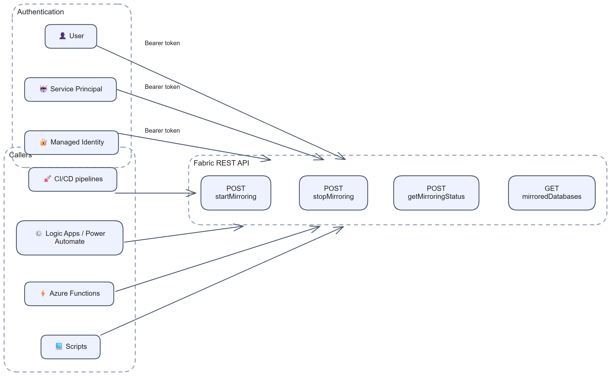
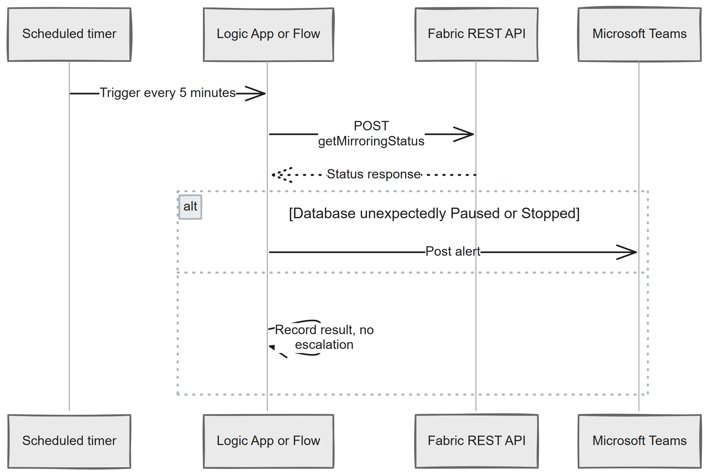
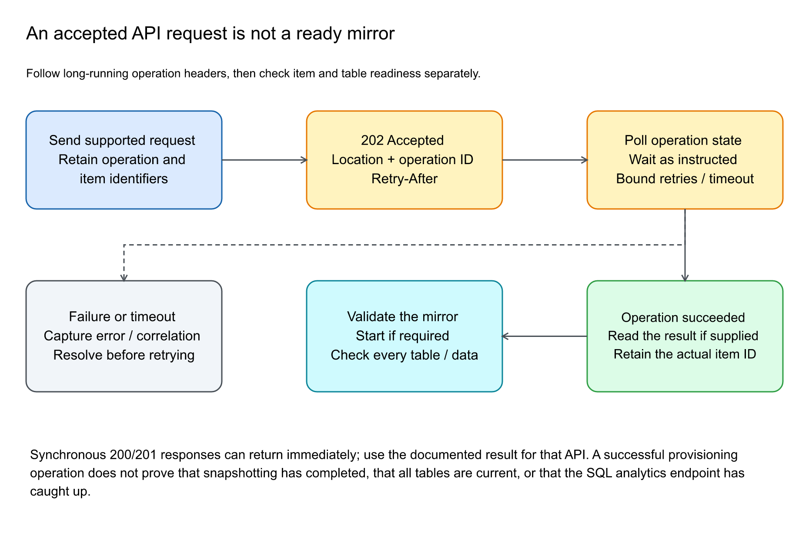

# Chapter 6: Using the Fabric REST API

> **Part 1: Concepts and Architecture**
>
> **Purpose:** Use this chapter to automate mirrored database operations, status checks, and operational workflows through the Fabric REST API.

**Part index:** [Chapters in Part 1](readme.md)

---

## Overview

> **Note:** The Mirrored Database REST API operations covered in this chapter apply to **database mirroring** sources and **open mirroring** items. They do **not** apply to Azure Databricks mirrored catalogs (metadata mirroring). Databricks catalog mirroring is managed differently. See Chapter 14.

They also do not manage the source-side link behind a [Dataverse-linked Lakehouse](../Part%202-%20Source-Specific%20Mirroring%20Guides/28%20-%20Dataverse%20Link%20to%20Microsoft%20Fabric%20and%20Low-Latency%20Sync.md). Do not call `startMirroring` or `stopMirroring` against that Lakehouse ID. For [SAP BDC Connect](../Part%202-%20Source-Specific%20Mirroring%20Guides/29%20-%20SAP%20Business%20Data%20Cloud%20Connect%20for%20Microsoft%20Fabric.md), require its documented sharing/administration interface rather than inferring native Mirrored Database API support from the term "mirroring-like."

For [Business Central](../Part%202-%20Source-Specific%20Mirroring%20Guides/31%20-%20Dynamics%20365%20Business%20Central%20Mirroring.md), the destination is an open mirrored database, but these lifecycle calls do not configure the application's companies, tables, synchronization schedule, or privacy approval. Coordinate operations with its source-side publisher.

Likewise, a [Fabric HorizonDB](../Part%202-%20Source-Specific%20Mirroring%20Guides/32%20-%20Microsoft%20Fabric%20HorizonDB%20Mirroring.md) PostgreSQL item's ID is not a generic MirroredDatabase API ID. Use the documented contract for the related mirror and parent item rather than assuming that a shared architecture gives every artifact the same create/lifecycle API.

[](../assets/diagrams/chapter-06/diagram-01.excalidraw.png)

*Figure 6.1: Fabric REST API usage patterns*

---

## Prerequisites

Before using the Fabric REST API for mirroring operations, make sure the following are in place.

### 1. Authentication Setup

Fabric REST API calls require a valid **Microsoft Entra ID** bearer token. You can authenticate as:

- **A user** with delegated permissions, suitable for interactive scripts and development
- **A service principal**, suitable for CI/CD, scheduled jobs, and other automation
- **A managed identity**, where the automation host supports it

Service principals and managed identities require the **Service principals can use Fabric APIs** tenant setting and the appropriate workspace or item permissions. Delegated OAuth scopes apply to user tokens, not app-only tokens. See [Fabric API identity support](https://learn.microsoft.com/en-us/rest/api/fabric/articles/identity-support).

**Obtaining a token (service principal example):**

```bash
# Using Azure CLI
az login --service-principal \
  --username <app-id> \
  --password <client-secret> \
  --tenant <tenant-id>

TOKEN=$(az account get-access-token \
  --resource https://api.fabric.microsoft.com \
  --query accessToken -o tsv)
```

### 2. Required Permissions

The calling identity must have at least:

| Operation | Required Role |
|---|---|
| Read mirroring status | Workspace Viewer or item Read permission |
| Start or stop mirroring | Workspace Contributor or higher, or item Read and Write permissions |
| Create mirrored database | Workspace Contributor or higher |
| Get or update the item definition | Workspace Contributor or higher, or item Read and Write permissions |

For delegated user tokens, status calls accept `MirroredDatabase.Read.All`, `MirroredDatabase.ReadWrite.All`, `Item.Read.All`, or `Item.ReadWrite.All`. Create, start, stop, and definition operations require `MirroredDatabase.ReadWrite.All` or `Item.ReadWrite.All`. Even `getDefinition` requires **Read and Write**, not just Read.

**Source managed identity nuance:** the source server's managed identity is separate from the identity calling the API. Azure SQL Database, Azure SQL Managed Instance, Azure Database for PostgreSQL, Azure Database for MySQL, and SQL Server 2025 require their source managed identity to have **Read and Write** permission on the mirrored database. Portal creation grants this automatically; API or deployment-pipeline creation requires you to grant it separately. See [Share and manage permissions](https://learn.microsoft.com/en-us/fabric/mirroring/share-and-manage-permissions).

### 3. Fabric Workspace and Item IDs

Item-specific calls require the **Workspace ID** and **Mirrored Database Item ID**. Create and list calls need only the Workspace ID. You can get IDs from the Fabric portal URL or list workspaces first:

```http
GET https://api.fabric.microsoft.com/v1/workspaces
```

---

## Create and Update a Mirrored Database

[Create an item](https://learn.microsoft.com/en-us/rest/api/fabric/mirroreddatabase/items/create-mirrored-database) with `POST /v1/workspaces/{workspaceId}/mirroredDatabases`. The request requires `displayName` and a `definition`; creating an empty mirrored database without a definition is not supported.

```json
{
  "displayName": "Sales Database Mirror",
  "definition": {
    "parts": [
      {
        "path": "mirroring.json",
        "payload": "<base64-encoded-definition>",
        "payloadType": "InlineBase64"
      }
    ]
  }
}
```

The decoded `mirroring.json` contains a `properties` object with `source`, `target`, and optional `mountedTables`. Omit `mountedTables` to mirror all supported tables, including newly added tables. For connection-based sources, create the Fabric connection first and use its ID in the definition; credentials do not belong in the payload. Use the [item definition reference](https://learn.microsoft.com/en-us/rest/api/fabric/articles/item-management/definitions/mirrored-database-definition) for source-specific properties.

A successful create returns **201 Created**. The SQL analytics endpoint can still be provisioning, so wait for `getMirroringStatus` to return `Initialized` before starting replication.

**17 November API-reference update:** the [current Create contract](https://learn.microsoft.com/en-us/rest/api/fabric/mirroreddatabase/items/create-mirrored-database) also accepts optional **`folderId`** and **`sensitivityLabelSettings`**. Omitted/null folder placement means the workspace root. Apply the documented label settings and permissions explicitly; do not retry an unsuccessful labelled creation by silently dropping the label. These are top-level request settings, not fields inside the Base64 `mirroring.json`.

Mirror initialisation and SQL endpoint provisioning are separate readiness checks. `Initialized` allows the lifecycle transition; it does not prove that the generated endpoint is queryable or its first table is current.

Two update paths serve different purposes:

| Operation | Method and workspace-relative path | Purpose |
|---|---|---|
| Update item metadata | `PATCH /mirroredDatabases/{mirroredDatabaseId}` | Change `displayName` or `description` |
| Get definition | `POST /mirroredDatabases/{mirroredDatabaseId}/getDefinition` | Retrieve the Base64-encoded definition parts |
| Update definition | `POST /mirroredDatabases/{mirroredDatabaseId}/updateDefinition` | Replace the configuration using a `definition.parts` request |

For a configuration change, get the current definition, decode `mirroring.json`, change only the required properties, and re-encode it locally. `updateDefinition` replaces the definition; it is not a partial JSON patch. Preserve existing configuration, including the table selection.

The [mirroring REST guide](https://learn.microsoft.com/en-us/fabric/mirroring/mirrored-database-rest-api#update-mirrored-database-definition) documents adding or removing tables through `mountedTables`. It allows changes to the connection ID, database name, and default schema only when status is `Initialized` or `Stopped`. Plan any required stop/start as a potential reseed, not a routine configuration refresh.

The general portal troubleshooting page separately says changing a source database is unsupported and recommends a new mirror. Do not turn the state-gated REST statement into an unrestricted source-switch procedure for every connector. Confirm source/item support, target lineage, credentials, permissions, and reseed/redeployment impact before an approved change. Use the formal **`defaultSchema`** spelling and keep definition encoding/decoding local rather than uploading configuration to a public converter.

`getDefinition` and `updateDefinition` can return **202 Accepted**. Follow the `Location` operation URL and `Retry-After` header until the long-running operation completes; a 202 response is not completion. See [Get definition](https://learn.microsoft.com/en-us/rest/api/fabric/mirroreddatabase/items/get-mirrored-database-definition) and [Update definition](https://learn.microsoft.com/en-us/rest/api/fabric/mirroreddatabase/items/update-mirrored-database-definition).

For `getDefinition`, retrieve the operation result after it succeeds to obtain the definition payload. The final `Location` header points to that result. See [Long-running operations](https://learn.microsoft.com/en-us/rest/api/fabric/articles/long-running-operation).

---

## Start Mirroring

To start replication on a mirrored database:

```http
POST https://api.fabric.microsoft.com/v1/workspaces/{workspaceId}/mirroredDatabases/{mirroredDatabaseId}/startMirroring
Authorization: Bearer {token}
Content-Type: application/json
```

**Request body:** empty

**Response:** `200 OK` on success

**Notes:**

- If mirroring has never been started, the API initiates the initial snapshot and then ongoing replication.
- Check status first. Do not call `startMirroring` while the item is `Initializing`, or issue repeated start requests while it is `Starting`.
- **Important:** For sources such as Azure SQL Database and Snowflake, stopping mirroring and then restarting it triggers a **full reseed**, not a resume from a watermark. All selected tables are fetched again. Use stop/start only when full re-replication is acceptable. See the [Azure SQL Database FAQ](https://learn.microsoft.com/en-us/fabric/mirroring/azure-sql-database-mirroring-faq), [Snowflake FAQ](https://learn.microsoft.com/en-us/fabric/mirroring/snowflake-mirroring-faq), and the relevant source chapter.
- An open mirrored database also restarts from the beginning after stop/start. Do not use this database-wide operation to recover one table. Follow the table-specific recovery procedure in [Open mirroring best practices](https://learn.microsoft.com/en-us/fabric/mirroring/open-mirroring-best-practices#plan-for-recovery).

---

## Stop Mirroring

To stop replication without deleting the mirrored database item:

```http
POST https://api.fabric.microsoft.com/v1/workspaces/{workspaceId}/mirroredDatabases/{mirroredDatabaseId}/stopMirroring
Authorization: Bearer {token}
Content-Type: application/json
```

**Response:** `200 OK` on success

**Notes:**

- Poll `getMirroringStatus` until the item is `Stopped` before a change that requires a stopped item.
- Stopping mirroring does not delete the Delta tables in OneLake. Existing data remains queryable.
- A later `startMirroring` call can trigger a full reseed, as documented for Azure SQL Database and Snowflake above.
- Treat stop/start as an operational reset only when full re-replication is acceptable.

---

## Get Mirroring Status

To query the current replication status:

```http
POST https://api.fabric.microsoft.com/v1/workspaces/{workspaceId}/mirroredDatabases/{mirroredDatabaseId}/getMirroringStatus
Authorization: Bearer {token}
```

The database status can be **Initializing**, **Initialized**, **Starting**, **Running**, **Paused**, **Stopping**, or **Stopped**.

**Sample response:**

```json
{
  "status": "Running"
}
```

Call `getTablesMirroringStatus` with `POST` when you need per-table states and metrics. Table states include **Initialized**, **Snapshotting**, **Replicating**, **Reseeding**, **Stopped**, and **Failed**. Read every page using `continuationUri` or `continuationToken`, and inspect optional `error` fields. Database `Running` alone does not prove that every table is healthy.

---

## List Mirrored Databases in a Workspace

To enumerate mirrored databases in a workspace:

```http
GET https://api.fabric.microsoft.com/v1/workspaces/{workspaceId}/mirroredDatabases
Authorization: Bearer {token}
```

**Sample response:**

```json
{
  "value": [
    {
      "id": "xxxxxxxx-xxxx-xxxx-xxxx-xxxxxxxxxxxx",
      "displayName": "Sales Database Mirror",
      "type": "MirroredDatabase"
    }
  ]
}
```

Follow the continuation information when the list spans multiple pages.

---

## Integration with Automation

### Logic Apps or Power Automate

Use an HTTP action to call Fabric REST API endpoints in scheduled or event-driven workflows.

[](../assets/diagrams/chapter-06/diagram-02.excalidraw.png)

*Figure 6.2: Automated status check pattern*

Common patterns:

- **Scheduled status checks**: call `getMirroringStatus` for lifecycle state and `getTablesMirroringStatus` for failed tables or latency thresholds.
- **Operational gating**: verify mirroring status before downstream data jobs run.
- **Controlled restart workflows**: use `stopMirroring` and `startMirroring` only when a full reseed is acceptable.

### Azure Functions

An Azure Function can poll the Fabric REST API and forward the result to a workflow, dashboard, or incident system.

```python
import requests

def get_mirroring_status(workspace_id: str, database_id: str, token: str) -> dict:
    url = (
        f"https://api.fabric.microsoft.com/v1/workspaces/{workspace_id}"
        f"/mirroredDatabases/{database_id}/getMirroringStatus"
    )
    headers = {"Authorization": f"Bearer {token}"}
    response = requests.post(url, headers=headers, timeout=30)
    response.raise_for_status()
    return response.json()
```

### CI/CD Pipelines

Pipelines can call the REST API after deployment to:

- start mirroring on a newly deployed item
- confirm that the item exists and is reachable
- check status before promoting downstream configuration

Be careful with automated stop/start steps for database mirroring sources, because restart can trigger a full reseed.

---

## API Rate Limits and Best Practices

- **Rate limiting**: Fabric REST API calls are subject to throttling.
- **Polling frequency**: choose an interval that meets your monitoring needs, for example 30 to 60 seconds. This is an operational starting point, not a published per-item rate limit.
- **Error handling**: honour `Retry-After` on `429 Too Many Requests`, and use bounded retries with backoff for transient failures such as `503 Service Unavailable`.
- **State-aware operations**: check status before repeating start or stop requests. Do not assume retrying a stop/start sequence is harmless; it can trigger full re-replication.
- **Token expiry**: refresh tokens using the expiry returned by your authentication library rather than assuming a fixed lifetime.



*Figure 6.3: Provisioning completion and data readiness are different gates. Original explanatory diagram by this book, based on [Fabric long-running operations](https://learn.microsoft.com/en-us/rest/api/fabric/articles/long-running-operation) and [the Mirroring REST lifecycle](https://learn.microsoft.com/en-us/fabric/mirroring/mirrored-database-rest-api). The failed-operation branch is not an instruction to repeat create/start blindly; inspect the error and current state first. [Editable Excalidraw source](../assets/diagrams/chapter-06/walkthrough-api-completion-and-readiness.excalidraw) · [SVG](../assets/diagrams/chapter-06/walkthrough-api-completion-and-readiness.svg).*

## September 2026: Discovery and Automation Interfaces

These [FabCon announcements](https://community.fabric.microsoft.com/blog/fbc_fabricupdatesblogs/fabric-september-2026-feature-summary/5325825) complement the mirroring lifecycle API; they do not replace its permissions or source-specific setup.

| Interface | Announced status | Use and limits |
|---|---|---|
| OneLake Catalog Search API enhancements | Preview | Standalone table discovery explicitly includes mirrored databases, with table/column/description searches and richer filters. Discovery follows **Read on the parent item**, not OneLake data-plane roles. The tenant's **Users can find objects in search** setting can disable object results. |
| Fabric Core MCP Server | GA | Entra-authenticated discovery and item/workspace administration at `https://api.fabric.microsoft.com/v1/mcp/core`, respecting Fabric RBAC and auditing. This is not the Open Mirroring Python SDK and does not grant an agent unrestricted table access. |
| Fabric Actions pipeline activity | Preview | Invoke supported Fabric REST actions through a managed connection and use responses downstream. The caller still needs operation-specific permissions; do not assume every Mirroring action is available in the picker. |

The [Catalog Search API reference](https://learn.microsoft.com/en-us/rest/api/fabric/core/catalog/search) documents `POST /v1/catalog/search`, delegated `Catalog.Read.All`, supported identities, and continuation tokens. Its response/filter reference still trails parts of the announced table-discovery schema. Use the documented request format rather than inventing table filters or response fields from the announcement.

For the other interfaces, see [Core MCP Server setup](https://learn.microsoft.com/en-us/rest/api/fabric/articles/mcp-servers/core-remote/get-started-core) and [Fabric Actions activity](https://learn.microsoft.com/en-us/fabric/data-factory/fabric-actions-activity). For the separate **OneLake Table Read API Preview**, which returns table data rather than managing a mirror, see [Chapter 8](08%20-%20Using%20a%20Mirrored%20Database.md#onelake-table-read-api-preview).

---

## November 2026 API and Tooling Updates

The [3 November OneLake tooling post](https://community.fabric.microsoft.com/blog/fbc_fabricupdatesblogs/onelake-the-file-system-for-agent-first-data-engineering/5383035) demonstrates an Open Mirror with **Preview hosted OneLake MCP, endpoint discovery, and catalog search**. These complement the Fabric management API; they do not grant an agent unrestricted data access or replace the publisher's delivery/recovery contract.

Use the [endpoint-discovery specification](https://learn.microsoft.com/en-us/fabric/onelake/table-apis/endpoint-discovery-api), including the **`/endpoints` suffix** in `GET /api/v2/{workspaceId}/{itemId}/endpoints`. The adapted blog request omits that suffix. This OneLake API needs an **Azure Storage-audience token**, not the Fabric management token used earlier in the chapter. Discovery is not authorisation and does not prove a listed engine is ready. The [hosted OneLake MCP](https://learn.microsoft.com/en-us/fabric/onelake/onelake-hosted-mcp) is a data-plane service, distinct from the Core MCP management interface.

The [November summary](https://community.fabric.microsoft.com/blog/fbc_fabricupdatesblogs/fabric-november-2026-feature-summary/5414311) also announces removal of the **Preview Create/Get/List/Update Domain API versions**. Requests explicitly selecting Preview now fail; Domains and their [GA administration APIs](https://learn.microsoft.com/en-us/rest/api/fabric/admin/domains) are not retired. Since August, omitting the historical Boolean `preview` parameter selects GA. The current documented contract omits that switch; preserve legitimate filters such as `nonEmptyOnly` rather than stripping the whole query string. No universal error code or failure of legacy `preview=false` is established. Preview clients must adopt the GA payload/response differences, not merely remove `preview=true`.

For SQL endpoint automation, distinguish **metadata refresh**, **Preview MD Sync migration**, and **OneLake security sync**. They have different purposes and completion conditions; [Section 4.4](04%20-%20The%20Anatomy%20of%20a%20Mirrored%20Database.md#44-sql-analytics-endpoint) contains the refresh and upgrade procedures. A status request, preflight success, or accepted long-running operation is not final table-level success.

## Summary

The Fabric REST API gives you practical control over mirrored database operations: create, update, start, stop, list, and check status. Use Microsoft Entra ID for authentication, handle definition permissions and long-running operations, and grant source managed identities access in automated deployments. Treat stop/start as a potential full reseed.

**Contents:** [Table of Contents](../index.md) | **Previous:** [Chapter 5: Monitoring a Mirrored Database](05%20-%20Monitoring%20a%20Mirrored%20Database.md) | **Next:** [Chapter 7: Deploying a Mirrored Database Using CI/CD](07%20-%20Deploying%20a%20Mirrored%20Database%20Using%20CI-CD.md)
