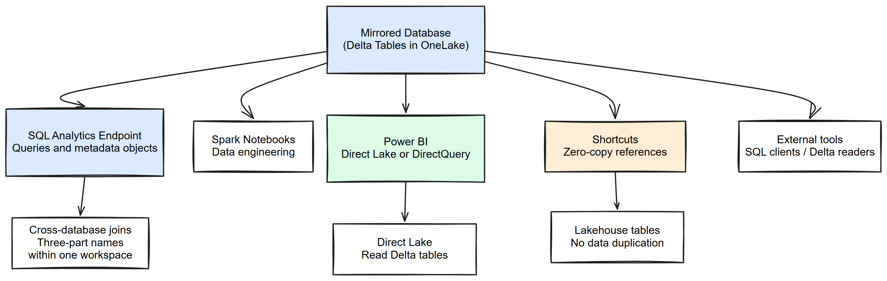
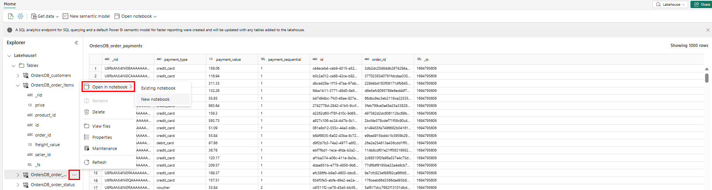
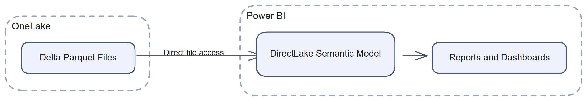

# Chapter 8: Using a Mirrored Database

> **Part 1: Concepts and Architecture**
>
> **Purpose:** Use this chapter to query, secure, and combine mirrored data after replication is running.

**Part index:** [Chapters in Part 1](readme.md)

***

## Overview

Mirrored data is a read-only analytical asset that you can query, join to other Fabric data, and expose to reporting tools.

[](../assets/diagrams/chapter-08/diagram-01.excalidraw.png)
*Figure 8.1 - Analytics capabilities powered by a mirrored database*

> **Important:** Replicating rows does not automatically reproduce source row-level security, column-level security, or data masking in Fabric. Configure and validate equivalent controls separately. The announced Snowflake security-role replication Preview has a narrower, optional scope; it is not a promise of complete policy parity. See [Chapter 9](09%20-%20Extended%20Capabilities.md#95-snowflake-security-roles-replication-preview) for the announcement boundary and the [Snowflake security-role discussion](../Part%202-%20Source-Specific%20Mirroring%20Guides/22%20-%20Snowflake.md#snowflake-security-roles-replication-preview). For SQL controls, see [Row-level security](https://learn.microsoft.com/en-us/fabric/data-warehouse/row-level-security), [Column-level security](https://learn.microsoft.com/en-us/fabric/data-warehouse/column-level-security), and [Dynamic data masking](https://learn.microsoft.com/en-us/fabric/data-warehouse/dynamic-data-masking).

Review the **effective reader identity and policy system for each access path**, not just the item's Share dialog. Fabric **Read** allows item/endpoint access but is not a blanket table grant. **ReadData** supplies broad SQL read entitlement in delegated identity mode; in user identity mode, OneLake roles govern table data. On OneLake-secured mirrored items, **ReadAll** normally gives reader access through **DefaultReader**, not an independent override after that role is removed.

SQL-defined policies do not automatically secure Spark or raw-file access. OneLake policies can govern SQL table reads too, but only when the endpoint uses the corresponding **user identity mode**. Follow [Section 4.5's security setup, identity-mode comparison, and validation procedure](04%20-%20The%20Anatomy%20of%20a%20Mirrored%20Database.md#45-security-of-a-mirrored-database) and [Section 4.6's sharing-permission matrix](04%20-%20The%20Anatomy%20of%20a%20Mirrored%20Database.md#46-sharing-and-managing-permissions) before adding consumers.

### Choose Security for Each Read Path

| Consumer path | Security decision |
|---|---|
| **SQL endpoint: delegated identity mode** | Fabric Read permits connection; SQL grants/policies authorise the reader; an owner identity reads OneLake. The reader's OneLake row filters do not automatically become SQL filters. |
| **SQL endpoint: user identity mode** | Fabric Read still permits connection; OneLake roles authorise table data using the signed-in identity. SQL permissions remain relevant to views/procedures/functions. |
| **Spark or OneLake file access** | Check the actual execution identity and its data roles. Supported engines can filter RLS/CLS; a generic file reader without whole-table entitlement is blocked rather than given an unfiltered copy. |
| **Lakehouse shortcut** | Check shortcut-side and target-side access, shortcut credentials, and the consuming engine's identity. A SQL consumer of protected shortcuts also needs the documented producer/consumer principal mapping. |
| **Power BI semantic model** | Check Direct Lake variant, SSO versus a configured identity, semantic-model permissions, and any model-level RLS/OLS. A filtered report alone does not protect another data-access route. |

Use separate nonadministrator test users for allowed and denied access. Selecting the right mode is a prerequisite, not a routine repair action: a SQL endpoint mode change can interrupt the whole workspace's SQL endpoints and remove SQL role/function definitions. Plan it using [the mode-change precautions](04%20-%20The%20Anatomy%20of%20a%20Mirrored%20Database.md#select-or-change-the-endpoints-access-mode).

***

## SQL Analytics Endpoint

Every mirrored database exposes a **SQL analytics endpoint** for querying mirrored tables with T-SQL.

### Key Behaviours

* Mirrored tables are **read-only** through the SQL analytics endpoint.
* `INSERT`, `UPDATE`, and `DELETE` statements against mirrored tables are not supported.
* You **can** create SQL views and stored procedures on the SQL analytics endpoint. These are metadata-only objects and do not write to the mirrored tables.
* Metadata synchronisation can lag behind the underlying Delta tables. If a newly mirrored table does not appear, use **Refresh** in the SQL analytics endpoint editor's **Explorer** toolbar.

> **Note:** Query freshness through the SQL analytics endpoint depends on **metadata sync**, not only on mirroring replication speed. This separate process detects tables, schema changes, and row-level data changes in Delta. A change can therefore be visible in OneLake before it appears through SQL. Query the Delta table through Spark to distinguish replication delay from SQL sync delay. Direct Lake on SQL also depends on the endpoint for discovery and framing, so it is not a general bypass for metadata sync.

**Ignite update, 18 November 2026:** new metadata sync (**MD Sync v2**) is **GA-announced**, while existing-endpoint migration has separate **Preview APIs**. The conceptual guide retains older Preview wording and compatibility restrictions. New defaults or the **New metadata sync** workspace setting do not themselves convert a legacy endpoint: use [the status/preflight/upgrade workflow](04%20-%20The%20Anatomy%20of%20a%20Mirrored%20Database.md#upgrade-an-existing-endpoint-separate-preview-workflow) when a deliberate migration is appropriate. **An upgrade is still not required for on-demand metadata refresh:** the [existing-endpoint refresh procedure](04%20-%20The%20Anatomy%20of%20a%20Mirrored%20Database.md#refresh-an-existing-endpoint-without-upgrading) remains separate. `sys.sp_dw_refresh_ext_table` is v2-only, not the v1 refresh method.

### String Column Size Boundary

The mirrored SQL analytics endpoint supports `varchar(max)` up to **16 MB**, but source-specific limits can be lower: **1 MB** for mirrored SQL Server, Azure SQL Database, and Azure SQL Managed Instance, and **2 MB** for mirrored Azure Cosmos DB. Older tables can still map strings to `varchar(8000)` and may need to be recreated. Check the actual column metadata and the [Fabric Mirroring troubleshooting guidance](https://learn.microsoft.com/en-us/fabric/mirroring/troubleshooting#some-of-the-data-in-my-column-appears-to-be-truncated).

A Lakehouse shortcut does not carry the mirrored endpoint's larger string limit into the Lakehouse SQL endpoint. The [Lakehouse SQL endpoint limitations](https://learn.microsoft.com/en-us/fabric/data-engineering/lakehouse-sql-analytics-endpoint#limitations) still document 8 KB truncation there, including shortcuts to mirrored items.

### September 2026 Query-Language Previews

The [FabCon feature summary](https://community.fabric.microsoft.com/blog/fbc_fabricupdatesblogs/fabric-september-2026-feature-summary/5325825) announces analytical SQL enhancements relevant to endpoint consumers: `MEDIAN`, `QUANTILE`, their approximate variants, and aggregate forms of the percentile functions; `GROUP BY ALL`, `ORDER BY ALL`, `QUALIFY`, and `FROM ... SELECT`; and additional scalar-UDF inlining scenarios. These are **Preview query capabilities**, not changes to source capture or permission to modify mirrored base tables.

Use the [aggregate-function reference](https://learn.microsoft.com/en-us/sql/t-sql/functions/aggregate-functions-transact-sql?view=fabric), [QUALIFY](https://learn.microsoft.com/en-us/sql/t-sql/queries/select-qualify-clause-transact-sql?view=fabric), [GROUP BY](https://learn.microsoft.com/en-us/sql/t-sql/queries/select-group-by-transact-sql?view=fabric), [ORDER BY](https://learn.microsoft.com/en-us/sql/t-sql/queries/select-order-by-clause-transact-sql?view=fabric), and [FROM-first syntax](https://learn.microsoft.com/en-us/sql/t-sql/queries/from-select-transact-sql?view=fabric) for supported forms. Expanded [scalar-UDF inlining](https://learn.microsoft.com/en-us/fabric/data-warehouse/how-to-inline-udf) does not mean every data-access UDF or query shape is supported.

**October-November SQL follow-up:** the [20 October language](https://community.fabric.microsoft.com/blog/fbc_fabricupdatesblogs/t-sql-language-enhancements-in-microsoft-fabric-data-warehouse-preview/5375433) and [analytical-function](https://community.fabric.microsoft.com/blog/fbc_fabricupdatesblogs/new-analytical-functions-in-microsoft-fabric-data-warehouse-preview/5375432) posts expand the earlier Preview coverage; [28 October scalar-UDF guidance](https://community.fabric.microsoft.com/blog/fbc_fabricupdatesblogs/more-ways-to-use-scalar-udfs-in-microsoft-fabric-data-warehouse-preview/5376708) adds further procedural/MAX-type inlining scenarios. The [5 November regex Preview](https://community.fabric.microsoft.com/blog/fbc_fabricupdatesblogs/regular-expression-functions-in-microsoft-fabric-data-warehouse-preview/5382375) supports five scalar functions on SQL analytics endpoints/Warehouse, **not regex table-valued functions**. Follow the [regex contract](https://learn.microsoft.com/en-us/fabric/data-warehouse/regular-expressions). These are query capabilities, not source-capture or mirrored-table write features.

The separate [19 October Fabric User Data Functions integration](https://community.fabric.microsoft.com/blog/fbc_fabricupdatesblogs/fabric-data-warehouse-integration-with-fabric-user-data-functions-preview/5375137) is **Warehouse-only Preview** invocation of published Python logic, not the scalar T-SQL UDF inlining above or newly supported external-function/DML execution against mirrored SQL endpoint tables.

***

## Openness of the Delta Format

Mirrored data is stored as **Delta** tables in OneLake.

**What this means in practice:**

* Use a Delta-aware reader that supports the table's Delta features. Reading individual Parquet files without the Delta transaction log can return obsolete rows or miss changes.
* OneLake exposes [ADLS Gen2-compatible APIs](https://learn.microsoft.com/en-us/fabric/onelake/onelake-access-api), so compatible tools such as Azure Databricks and Apache Spark can read it with Microsoft Entra authentication and appropriate permissions. File-format/API compatibility does not establish support for OneLake row/column filtering; check the [secured-reader requirements](https://learn.microsoft.com/en-us/fabric/onelake/security/read-secured-data).
* You do not need to export mirrored data into another format before analysing it.
* The format remains open even though the mirrored tables themselves stay read-only.

### OneLake Table Read API (Preview)

The [September Table Read API announcement](https://community.fabric.microsoft.com/blog/fbc_fabricupdatesblogs/fabric-september-2026-feature-summary/5325825#community-5325825-mcetoc_1k3kj91s5_18) offers another application read path: Delta or Iceberg table data returned as **Apache Arrow**, with OneLake security including row/column restrictions. Follow the [API prerequisites and authentication](https://learn.microsoft.com/en-us/fabric/onelake/table-apis/table-apis-overview); the token audience is **Azure Storage**, not the Fabric management API audience used in Chapter 6.

The [read protocol](https://learn.microsoft.com/en-us/fabric/onelake/table-apis/read-table-data-rest-api) starts a snapshot read with `POST .../tables/{table}/read`, then returns streams downloaded through `GET .../readStream/{id}`. Read **every** returned stream before the 60-minute expiry. Streams belong to the same snapshot and can be downloaded in parallel, but row order is not guaranteed and cross-region shortcuts are unsupported. This is parallel **consumption**, not a new mirroring replication-throughput feature.

### Native Iceberg Writes Are Not Mirrored-Table Writeback

The [4 November table-API post](https://community.fabric.microsoft.com/blog/fbc_fabricupdatesblogs/onelake-table-apis-now-with-iceberg-writes-plus-richer-table-metadata-preview/5391262) and [17 November OneLake announcement](https://community.fabric.microsoft.com/blog/fbc_fabricupdatesblogs/onelake-the-unified-foundation-for-data-context-governance-and-ai/5423035) distinguish **native Iceberg read/write with credential vending, GA-announced at Ignite**, from the separate **Preview additional-metadata API**. The [Iceberg contract](https://learn.microsoft.com/en-us/fabric/onelake/table-apis/iceberg-table-apis-overview) excludes commits through shortcuts and virtual Iceberg metadata over Delta. It does not authorise changing Fabric-managed mirrored output.

The [additional table-metadata API](https://learn.microsoft.com/en-us/fabric/onelake/table-apis/additional-table-metadata) manages descriptions/tags, not replicated rows. Its `POST` replaces existing additional metadata rather than patching individual fields; through internal shortcuts it affects the target's metadata. Read and retain the existing definition, verify target ownership, and avoid accidentally overwriting another team's metadata.

### Find Tables Before Choosing a Read Path

September's OneLake Catalog object browsing and enhanced Global Search make supported schemas/tables discoverable without opening every parent item. The **Catalog Search API enhancements are Preview** and explicitly include mirrored-database tables. Table discoverability depends on Read access to the parent item, not OneLake data-plane roles; discovering metadata does not establish permission to query the data. See [OneLake Catalog](https://learn.microsoft.com/en-us/fabric/governance/onelake-catalog-overview) and [Chapter 6's discovery interfaces](06%20-%20Using%20the%20Fabric%20REST%20API.md#september-2026-discovery-and-automation-interfaces).

***

## Cross-Database Queries

The SQL analytics endpoint supports **cross-database queries** within the same workspace, so you can join mirrored data with warehouses and Lakehouse SQL endpoints using three-part names. For data in another workspace, use OneLake shortcuts where supported rather than assuming the same naming convention crosses workspace boundaries. See [Write a cross-database query](https://learn.microsoft.com/en-us/fabric/data-warehouse/query-warehouse#write-a-cross-database-query).

### Joining Mirrored and Warehouse Data

```sql
SELECT
    m.OrderID,
    m.OrderDate,
    m.TotalAmount,
    w.CustomerSegment
FROM
    [SalesMirror].[dbo].[Orders] AS m
INNER JOIN
    [SalesWarehouse].[dbo].[CustomerSegments] AS w
    ON m.CustomerID = w.CustomerID
WHERE
    m.OrderDate >= '2024-01-01';
```

### Three-Part Naming Convention

Cross-database queries use the form `[database].[schema].[table]`. The database name is the Fabric item name, whether that item is a mirrored database, warehouse, or lakehouse SQL endpoint.

***

## Shortcuts to Mirrored Data

Fabric **Shortcuts** let you reference mirrored tables from a Lakehouse without copying the data.

### Creating a Shortcut to Mirrored Data

1. Open a Fabric Lakehouse.
2. In **Tables**, select **+ New shortcut**.
3. Choose **Microsoft OneLake** as the source.
4. Browse to the mirrored database path and select the required table.

The shortcut then appears as a Lakehouse table that Spark and the Lakehouse SQL endpoint can query.

**Keep the producer's security boundary.** Check both the shortcut path and the mirrored target using the identity actually supplied by the consuming engine. For OneLake-protected SQL shortcuts, the same principal named in the producer role must receive consumer-item Read; overlapping/nested group membership alone does not satisfy that mapping. A consumer SQL endpoint in delegated mode cannot read a shortcut target protected by producer OneLake RLS/CLS. See [Shortcuts and the effective identity](04%20-%20The%20Anatomy%20of%20a%20Mirrored%20Database.md#shortcuts-and-the-effective-identity) before sharing the Lakehouse.

### Use Cases for Shortcuts



*Figure 8.1a: Inspect mirrored Delta data through a Lakehouse shortcut and notebook when separating OneLake freshness from SQL metadata lag. The shortcut reads the replica, not the operational source. Microsoft screenshot, reproduced unchanged from [Explore mirrored data with notebooks](https://learn.microsoft.com/en-us/fabric/mirroring/explore-onelake-shortcut#create-a-shortcut); [original image](https://learn.microsoft.com/en-us/fabric/mirroring/media/explore-onelake-shortcut/create-notebook-lakehouse-spark-query.png). Credit: Microsoft, [CC BY 4.0](https://creativecommons.org/licenses/by/4.0/) under the [Fabric documentation licence](https://github.com/MicrosoftDocs/fabric-docs/blob/main/LICENSE), including its warranty disclaimer.*

* Reading mirrored data in Spark notebooks
* Combining mirrored tables with Lakehouse-managed tables
* Preparing downstream transformations without duplicating storage

***

## Tool Ecosystem

Mirrored databases can be consumed through the SQL analytics endpoint and through OneLake. Mirrored tables remain read-only to consumers. Direct edits to their Delta files are unsupported; update the source instead, or publish changes through the landing zone for open mirroring.

### SQL-Based Tools

| Tool                                    | Connection Method           | Notes                                    |
| --------------------------------------- | --------------------------- | ---------------------------------------- |
| **SQL Server Management Studio (SSMS)** | TDS / SQL Server connection | Read-only access to mirrored tables      |
| **Visual Studio Code with MSSQL**       | TDS / SQL Server connection | SQL querying and development              |
| **DBeaver**                             | JDBC / SQL Server driver    | Community tool with broad compatibility  |
| **Power BI Desktop**                    | DirectQuery or Import       | Uses Fabric and SQL connectivity options |
| **Excel**                               | Get Data -> SQL Server      | Can read mirrored tables directly        |
| **Tableau**                             | SQL Server connector        | Read-only analytics on mirrored data     |

Azure Data Studio is retired and no longer receives security fixes. Use [Visual Studio Code with the MSSQL extension](https://learn.microsoft.com/en-us/sql/tools/whats-happening-azure-data-studio?view=sql-server-ver17) or SSMS for supported Microsoft desktop tooling.

### Spark / Notebook Tools

| Tool                 | Connection Method      | Notes                           |
| -------------------- | ---------------------- | ------------------------------- |
| **Fabric Notebooks** | Native OneLake / Spark | Read Delta data directly        |
| **Azure Databricks** | OneLake ABFS connector | Reads Delta tables from OneLake |
| **Apache Spark**     | ADLS Gen2 API          | Direct Delta table access       |

***

## Power BI Integration

Power BI is a common way to consume mirrored data in Fabric.

### Direct Lake Mode

Power BI **Direct Lake** loads data from Delta tables in OneLake into the semantic model's engine without a full Import-mode copy. There are two paths:

* **Direct Lake on OneLake** accesses Delta tables without SQL endpoint discovery or DirectQuery fallback.
* **Direct Lake on SQL** uses the SQL analytics endpoint for discovery and permission checks. It can fall back to DirectQuery, for example for SQL views or SQL row-level security.

[](../assets/diagrams/chapter-08/diagram-02.excalidraw.png)
*Figure 8.2 - Direct Lake data-reading path, excluding SQL-based discovery and any DirectQuery fallback*

Direct Lake still needs a metadata refresh, called **framing**, to reference updated table files. Automatic updates can keep the model current without a scheduled full import, but mirroring a change does not guarantee that every report immediately sees it. See the [Direct Lake overview](https://learn.microsoft.com/en-us/fabric/fundamentals/direct-lake-overview).

**Freshness and security are different settings.** With SSO, Direct Lake on OneLake evaluates the viewer's OneLake access; with SSO disabled on a fixed-identity connection, it uses that configured identity's access instead. Merely configuring a fixed identity does not disable SSO. Direct Lake on SQL also involves the endpoint's permissions and possible fallback path. Review the model's actual identity and RLS/OLS design, then test as the intended viewer and as someone who must be denied; do not infer security from the model creator's successful preview.

The semantic model owner also needs the documented source-table access for **framing**, even when a different principal triggers refresh. A model can therefore have separate query-time and refresh-time permission dependencies. Follow [Integrate Direct Lake security](https://learn.microsoft.com/en-us/fabric/fundamentals/direct-lake-security-integration), including its shortcut and fixed-identity guidance, rather than treating ReadAll as a universal repair.

### Creating a Power BI Semantic Model from a Mirrored Database

1. Open the mirrored database item in Fabric.
2. Select **Create semantic model**.
3. Choose the tables to include.
4. Let Fabric create the semantic model in the same workspace.
5. Build reports on top of that model.

### DirectQuery Mode

If Direct Lake is unsuitable for a particular model, Power BI can use **DirectQuery** through the SQL analytics endpoint. In that case, queries are executed by the SQL engine rather than directly against OneLake files.

### Refreshing Imported Models

If you choose **Import** mode, schedule refreshes as needed. Mirroring does not need to stop for an import refresh to succeed.

***

## October-November 2026 Consumer Integrations

The following are downstream consumers or sharing patterns, not newly supported native replication sources:

| Consumer | Snapshot and important boundary |
|---|---|
| **Semantic views, Preview** | [Ignite introduces reusable semantic definitions](https://community.fabric.microsoft.com/blog/fbc_fabricupdatesblogs/bringing-trusted-fabric-iq-context-to-wherever-people-and-agents-work/5423049). The [current contract](https://learn.microsoft.com/en-us/fabric/fundamentals/semantic-views-overview) is Lakehouse-only and publishes a **read-only Direct Lake on OneLake model**; published metrics require DAX. Expose eligible mirrored data through the consuming Lakehouse rather than assume authoring inside a mirror. Reused shortcuts require republishing the consuming view. Git/deployment CI/CD and workspace-Private-Link publishing are not supported. Review generated `Context`/TMDL metadata because it does not inherit OneLake's row/column data protection. |
| **Fabric Apps / Rayfin, GA** | The [17 November GA announcement](https://community.fabric.microsoft.com/blog/fbc_fabricupdatesblogs/build-governed-data-apps-with-microsoft-fabric-apps-generally-available/5423011) follows the 2/4 November distribution/connector posts. The [connector contract](https://learn.microsoft.com/en-us/fabric/apps/connectors) keeps Lakehouse SQL endpoint access read-only; Warehouse/Fabric SQL database CRUD does not make mirrors writable. Semantic-model queries are delegated-only, while the SQL connector's app identity is currently the app item owner. Test the actual identity rather than infer end-user passthrough. Apps GA does not make HorizonDB GA or remove its preview restrictions. |
| **Eventhouse external tables, OneLake security GA** | The [4 November announcement](https://community.fabric.microsoft.com/blog/fbc_fabricupdatesblogs/eventhouse-support-for-onelake-security-generally-available/5377875) applies querying-user OLS/CLS/RLS. Creating an external table does not grant access to its target. Existing SQL/OneLake policy boundaries still apply. |
| **Eventhouse caching and transformations** | The [RTI Ignite post](https://community.fabric.microsoft.com/blog/fbc_fabricupdatesblogs/run-proactive-operations-with-real-time-intelligence-in-microsoft-fabric/5414256) announces shortcut smart caching/update policies in **Preview**, and Eventhouse CMK/outbound protection as **GA**. The older [acceleration guide](https://learn.microsoft.com/en-us/fabric/real-time-intelligence/query-acceleration-overview) still excludes update policies. Validate the enabled scenario and its premium-cache/compute charges; these Eventhouse controls do not change the original mirror's CMK/network support or freshness guarantee. |
| **IQ Sharing, Preview** | Consumer-side read-only Mirrored Items are shortcut-based cross-tenant shares, with separate whole-item approval and policy limitations. Follow [Section 4.6](04%20-%20The%20Anatomy%20of%20a%20Mirrored%20Database.md#iq-sharing-is-a-different-cross-tenant-boundary), not the ordinary in-tenant shortcut assumptions. |

### Data Agents and Search: Lifecycle and Permission Checks

The [19 October Advanced NL2SQL/DAX announcement](https://community.fabric.microsoft.com/blog/fbc_fabricupdatesblogs/advanced-nl2sql-and-advanced-dax-generation-in-fabric-data-agents-generally-avai/5374654) calls those capabilities **GA** with standard-runtime rollout on 2-10 November, while current [runtime](https://learn.microsoft.com/en-us/fabric/data-science/data-agent-runtime) and [SQL-source](https://learn.microsoft.com/en-us/fabric/data-science/data-agent-sql-sources) pages retain Preview wording. November adds Preview topics/query-template capabilities and up to **1,000-row Fabric-UI previews on standard runtime**. Do not apply that limit or availability to every API/integration; semantic query-template announcements also exceed the older example-query guide's scope.

The old Foundry data-agent custom connection became **unsupported on 6 November**, following the [19 October retirement notice](https://community.fabric.microsoft.com/blog/fbc_fabricupdatesblogs/retiring-the-fabric-data-agent-custom-tool-in-microsoft-foundry-move-to-fabric-i/5374418). Follow the [Preview Fabric IQ/OneLake Catalog migration](https://learn.microsoft.com/en-us/fabric/data-science/data-agent-foundry-fabric-iq), using published agents and delegated-user permissions. Review where prompts/results are processed before crossing Fabric geographic/compliance boundaries.

Keep the [Ignite IQ integration claims](https://community.fabric.microsoft.com/blog/fbc_fabricupdatesblogs/bringing-trusted-fabric-iq-context-to-wherever-people-and-agents-work/5423049) scoped: the summary calls data agents in Copilot GA while the deep dive says **GA coming soon**; ChatGPT/Claude support is **Preview coming soon**. Neither is a blanket current-client availability promise.

Likewise, new permission-aware OneLake/Azure AI Search announcements do not establish direct permission-preserving indexing of every mirror. The [documented OneLake Files indexer](https://learn.microsoft.com/en-us/azure/search/search-how-to-index-onelake-files) excludes Tables/Delta Parquet, and [permission preservation](https://learn.microsoft.com/en-us/azure/search/search-indexer-onelake-permissions) excludes shortcut-derived content. Indexing and revocation also have freshness boundaries; an index is not a transactionally current SQL query.

**Application governance is not a kill switch.** The current [block/unblock guide](https://learn.microsoft.com/en-us/fabric/governance/block-unblock-fabric-apps) remains Preview despite the broader Apps GA announcement, and blocking does not terminate all existing sessions, background execution, or independently accessible backend APIs/resources. Apply source/consumer permission revocation separately.

## Summary

A mirrored database in Fabric is primarily a read-only analytical asset. You can query it through the SQL analytics endpoint, reference it through shortcuts, join it across databases, and use it in Power BI, while keeping source security and Fabric-side security responsibilities clearly separated.

**Contents:** [Table of Contents](../index.md) | **Previous:** [Chapter 7: Deploying a Mirrored Database Using CI/CD](07%20-%20Deploying%20a%20Mirrored%20Database%20Using%20CI-CD.md) | **Next:** [Chapter 9: Extended Capabilities](09%20-%20Extended%20Capabilities.md)
