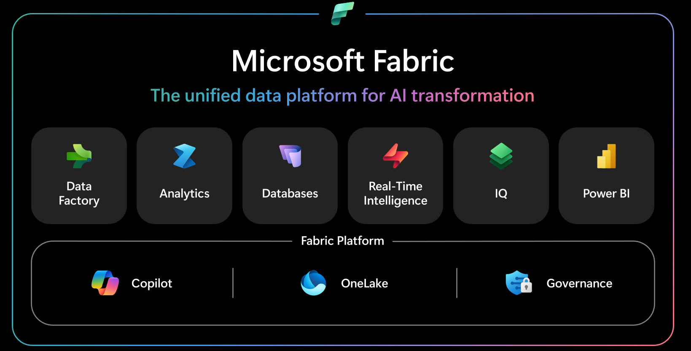
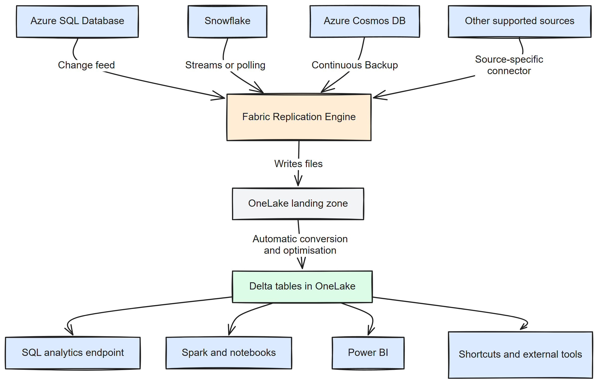

# Chapter 1: Introduction to Fabric Mirroring

> **Part 1: Concepts and Architecture**
>
> **Purpose:** This chapter explains what Fabric Mirroring is, the problem it solves, how it works, and how mirrored storage costs are calculated so you can decide whether it fits your workload.

**Part index:** [Chapters in Part 1](readme.md)

***

Fabric Mirroring makes supported operational and analytical data available to Fabric workloads. Database mirroring replicates source data into Delta tables in OneLake. Metadata mirroring exposes data in place through shortcuts, while open mirroring accepts changes supplied by a custom or partner integration.

For database mirroring, you configure a supported source and Fabric manages replication. You can then use the replicated data from SQL, Spark, Power BI, and other Fabric workloads.

This book also covers application-managed integrations whose documentation sits elsewhere: [Business Central's Open Mirroring publisher](../Part%202-%20Source-Specific%20Mirroring%20Guides/chapter-31.md) and [Dataverse Link to Fabric with low-latency sync](../Part%202-%20Source-Specific%20Mirroring%20Guides/chapter-28.md). The latter is included as related managed replication, not relabelled as a native Mirroring connector.

> I avoid treating "near real-time" as a latency promise. The useful question is how fresh the data needs to be for your workload, and whether your chosen source and query path can meet that requirement.

## 1.1 What Is Microsoft Fabric?

**Microsoft Fabric** is a **Software as a Service (SaaS)** platform for working with data from ingestion through to analysis and reporting. Rather than assembling a separate service for every stage, teams use integrated workloads for data movement, engineering, warehousing, operational databases, real-time processing, data science, and business intelligence.

Microsoft manages the underlying service infrastructure. Your organisation still needs to choose capacity, configure access and networking, prepare source systems, and operate its data solutions. SaaS reduces infrastructure management; it does not remove architecture, governance, or cost decisions.

### One Platform, Several Workloads

Microsoft's architecture diagram places the workloads above a shared platform layer. Different tools and engines serve different jobs, but they can work with data through **OneLake** rather than requiring an independently exported copy for each consumer.

*Figure 1.1: Microsoft Fabric's workloads and shared platform. Microsoft documentation image, reproduced unchanged. Source: [What is Microsoft Fabric?](https://learn.microsoft.com/en-us/fabric/fundamentals/microsoft-fabric-overview#microsoft-fabric-architecture); [original image](https://learn.microsoft.com/en-us/fabric/fundamentals/media/microsoft-fabric-overview/fabric-architecture.png#lightbox). Credit: Microsoft, [CC BY 4.0](https://creativecommons.org/licenses/by/4.0/) under the [Fabric documentation licence](https://github.com/MicrosoftDocs/fabric-docs/blob/main/LICENSE), including its warranty disclaimer.*

| Workload or group in the diagram | What it provides |
|---|---|
| **Data Factory** | Ingestion, transformation, and orchestration through tools such as pipelines and Power Query. |
| **Analytics** | Data Engineering for Spark and notebooks, Data Science for analytical and machine-learning work, and Data Warehouse for SQL-based analytics. |
| **Databases** | Transactional database experiences and Mirroring integrations that bring existing source data into the Fabric analytical environment. |
| **Real-Time Intelligence** | Ingestion, exploration, analysis, and actions over event and streaming data, including logs and telemetry. |
| **Fabric IQ (Preview)** | Capabilities for connecting data with business meaning and relationships, so applications and analytical tools can use a shared business context. |
| **Power BI** | Semantic models, interactive reports, dashboards, and business-facing analysis. |

These are complementary capabilities, not a requirement to use every workload. A SQL-focused team can begin with mirrored data and the SQL analytics endpoint, while another team uses notebooks or Power BI over the same analytical data.

### OneLake and the Shared Platform

**OneLake** is Fabric's tenant-wide logical data lake, built on Azure Data Lake Storage Gen2. It provides a common storage namespace and access layer for Fabric data. A **workspace** groups related items such as lakehouses, warehouses, mirrored databases, notebooks, and reports; it is not a separate product installation.

Open formats allow compatible engines to work with the same underlying data. **Shortcuts** can also reference eligible data in another location without first copying all its files into a new Fabric item. This is different from database mirroring, which deliberately maintains an analytical replica in OneLake. A shared data foundation does not mean that no copies exist anywhere or that every query has identical freshness.

The other platform services in Figure 1.1 support that shared environment. **Copilot** provides AI assistance within supported workloads, subject to the applicable permissions and feature requirements. **Governance** includes administration, discovery, security, and auditing: **OneLake Catalog** helps users find, explore, and govern Fabric items, while **Microsoft Purview** supplies supported information-protection and compliance capabilities. Source permissions do not automatically become equivalent analytical permissions simply because the data is in Fabric.

### Where Mirroring Fits

Mirroring is one way of making existing data available to those workloads. With **database mirroring**, a supported source is replicated into managed Delta tables in OneLake. **Metadata mirroring** instead exposes eligible source data through catalog integration and shortcuts. **Open Mirroring** lets a custom or partner publisher deliver changes for Fabric to process.

For example, after a supported database has been mirrored, an engineer can explore its analytical replica with Spark, an analyst can query it through the SQL analytics endpoint, and a report author can build a Power BI model. These consumers share access to the analytical data rather than each building a separate extraction pipeline against the operational system. Transformations, authorisation, SQL metadata synchronisation, and report/model freshness still need their own design.

**Documentation reviewed: 10 November 2026.** This introduction follows Microsoft's [What is Microsoft Fabric? overview](https://learn.microsoft.com/en-us/fabric/fundamentals/microsoft-fabric-overview), including its workload, OneLake, and shared-platform descriptions. The image is a platform overview, not a Mirroring transport diagram or a feature-availability guarantee.

## 1.2 Release History

The [Book Update History](../history.md) records dated Fabric Mirroring milestones and documentation changes. Use the [appendix](../appendix.md) for the current source and availability matrix.

## 1.3 The Problem Mirroring Solves

Before mirroring, teams usually had to move operational data into an analytics platform by building ETL or ELT pipelines. Those pipelines often create a few recurring problems:

* Data arrives on a schedule rather than when changes happen.
* Source systems take extra read load from reporting and ad hoc analysis.
* Pipelines need ongoing maintenance for schema changes, failures, credentials, and retries.
* Different tools produce different storage layouts and metadata conventions.
* Analysts often need separate access paths for the same data.

Database mirroring addresses these issues by keeping a managed replica in Delta format in OneLake, available to multiple Fabric workloads without separate custom ingestion code for each consumer. It does not replace transformation pipelines, source administration, or monitoring.

## 1.4 Mirroring Compared with Custom Ingestion

This comparison applies to database mirroring. Metadata mirroring and open mirroring have different storage and operational responsibilities, covered in [Chapter 2](chapter-02.md).

| Feature        | Fabric Mirroring                                                                                                                                                                                                     | Traditional ETL                                                     |
| -------------- | -------------------------------------------------------------------------------------------------------------------------------------------------------------------------------------------------------------------- | ------------------------------------------------------------------- |
| Setup          | Guided connector setup, plus source permissions and network preparation | Pipeline design, configuration, and deployment |
| Data freshness | Continuous replication with source-dependent latency | Batch or streaming, depending on the implementation |
| Maintenance    | Fabric manages replication; you manage prerequisites, credentials, and monitoring | You own the ingestion pipeline and its operation |
| Storage format | Delta Lake in OneLake                                                                                                                                                                                                | Varies by tool and destination                                      |
| Consumption    | Native access from SQL, Spark, and Power BI                                                                                                                                                                          | Often needs extra modelling or connectors                           |
| Cost           | Replication compute is free. Mirrored storage is free up to 1 TB per purchased capacity unit (an F4 capacity includes 4 TB free mirrored storage). Querying via SQL, Spark, or Power BI is charged at standard rates. | Separate ingestion compute plus destination storage and query costs |

Mirrored storage allowance is calculated at the capacity level. The free allowance scales with purchased capacity units rather than with the number of mirrored databases. Source-side charges, networking, gateway hosting, querying, and optional extended capabilities can still incur costs. See [Chapter 10](chapter-10.md) and [Cost of mirroring](https://learn.microsoft.com/en-us/fabric/mirroring/overview#cost-of-mirroring).

## 1.5 Ideal Use Cases

Mirroring works best when you need current source data in Fabric without building a separate ingestion estate.

| Use case                       | Why mirroring fits                                                           |
| ------------------------------ | ---------------------------------------------------------------------------- |
| **Operational analytics**      | Report on current business data without querying the source directly.        |
| **Cross-system analysis**      | Combine data from multiple source systems in one Fabric workspace.           |
| **Reducing read load**         | Move reporting and analytical reads away from production databases.          |
| **Access control separation**  | Let analysts work in Fabric without direct source-system access.             |
| **Historical change analysis** | Use supported change feeds or downstream history tables; a current-state replica alone is not an archive. |
| **Validation and reconciliation** | Compare the analytical copy with the source, allowing for replication lag. |

## 1.6 High-Level Architecture and Workflow

For database mirroring, the broad pattern is an initial snapshot followed by changes, staged in a landing zone and applied to Delta tables. The source integration determines who extracts and sends those changes. Metadata mirroring does not use this row-replication pipeline, and open mirroring makes the publisher responsible for extraction.

*Figure 1.2: Database mirroring architecture*

**Key components:**

* **Source system**: The database, platform, or application being mirrored.
* **Fabric Replication Engine**: The managed processing that applies incoming changes to the mirrored tables.
* **Landing zone**: The OneLake location where mirroring writes source files before they are materialised as tables.
* **Delta tables**: The queryable tables created from mirrored data in OneLake.
* **SQL analytics endpoint**: The auto-provisioned T-SQL endpoint over the mirrored tables.

For supported database connectors, Fabric manages the replication pipeline alongside the source-specific integration. The change capture mechanism and supported schema changes depend on the source.

Fabric supports three official mirroring types:

* **Database mirroring** copies source data into OneLake.
* **Metadata mirroring** syncs metadata and uses shortcuts to data that remains in the source.
* **Open mirroring** lets a custom or partner solution write data into the mirroring landing zone.

This book also covers **related source-managed integrations**. In [Dataverse Link to Fabric](../Part%202-%20Source-Specific%20Mirroring%20Guides/chapter-28.md), Dataverse maintains an optimized Delta replica and manages shortcuts that expose it through a Fabric Lakehouse. That consumer pattern resembles metadata mirroring, but it is not a native Mirrored Database connector. The [SAP Business Data Cloud Connect chapter](../Part%202-%20Source-Specific%20Mirroring%20Guides/chapter-29.md) covers a separate announced SAP data-product sharing path and its availability boundary. These additions do not redefine Microsoft's three official mirroring types.

## What comes next

The next chapter separates the three mirroring types and shows which sources belong to each one. That distinction matters because setup, data movement, and operational responsibility differ by type.

**Contents:** [Table of Contents](../index.md) | **Next:** [Chapter 2: Types of Mirroring in Fabric](chapter-02.md)
