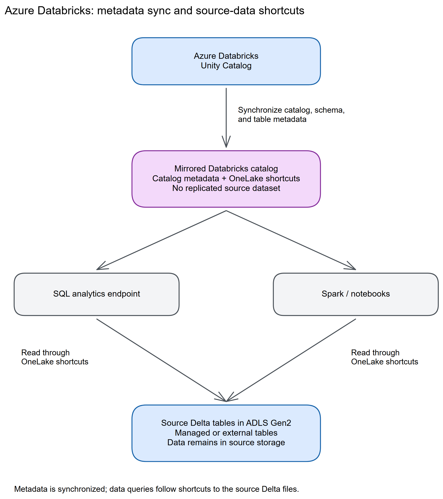
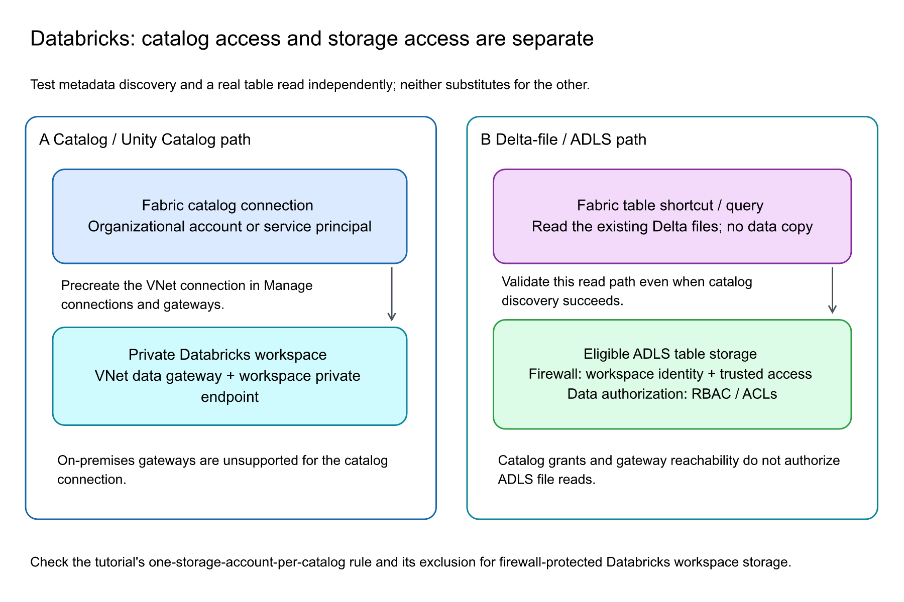
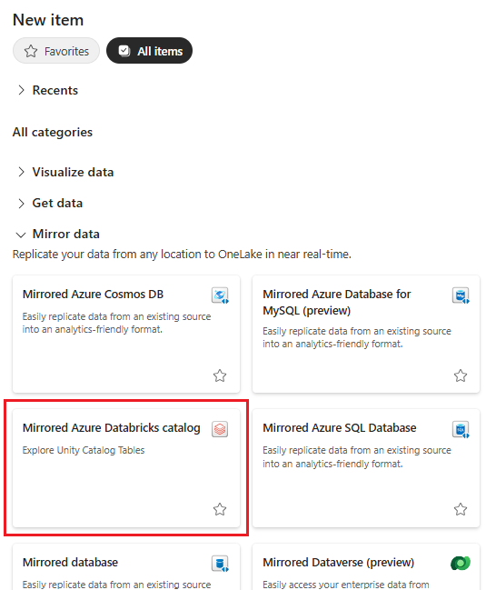
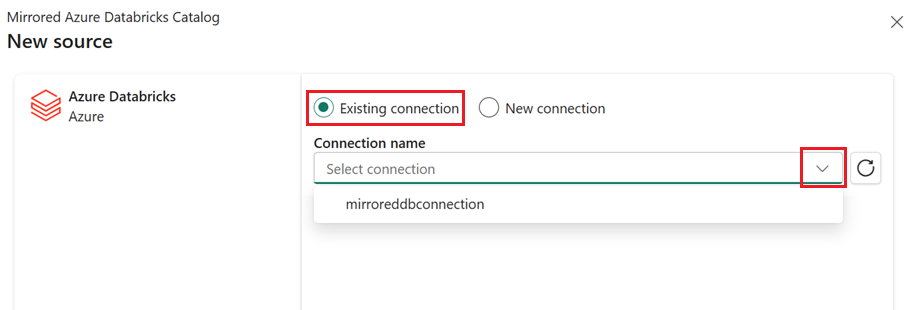
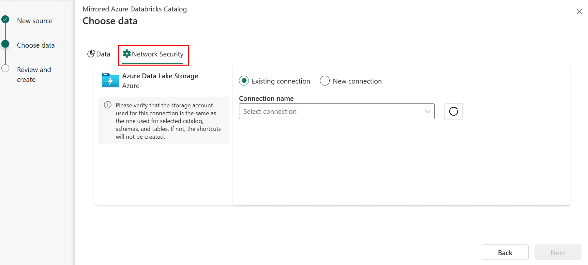

# Chapter 14: Azure Databricks (Unity Catalog)

> **Part 2: Source-Specific Mirroring Guides**
>
> **Purpose:** Use this chapter to connect Azure Databricks Unity Catalog to Fabric and understand metadata-only access, shortcuts, permissions, and query behaviour.

**Part index:** [Chapters in Part 2](readme.md)

---

## Overview of the Source System

**Azure Databricks** is an analytics platform built on Apache Spark. **Unity Catalog** provides centralised metadata management, access control, and data lineage across Databricks workspaces.

Fabric's generally available Azure Databricks integration uses **metadata mirroring**. It synchronises catalog metadata and creates OneLake shortcuts without making another row replica. The standard path reads Databricks data in ADLS Gen2; the separately announced native-OneLake storage path stores the Databricks data in OneLake already.

---

## Mirroring Type and Architecture

- **Mirroring type**: Metadata mirroring
- **Method**: Pull-based (metadata sync from Unity Catalog)
- **Metadata mechanism**: Unity Catalog metadata access and OneLake shortcuts; no row-level CDC pipeline

Unlike database mirroring, catalog mirroring does **not** copy the table rows. It mirrors the selected Unity Catalog structure and points shortcuts at the existing supported Delta data. The standard ADLS-backed setup below and the native-OneLake option described next have different storage-authorisation requirements.

**Architecture flow:**

[](../assets/diagrams/chapter-14/diagram-01.excalidraw.png)
*Figure 14.1: The standard ADLS-backed path. Native OneLake storage uses the separate storage item and permissions described below; this diagram is not that provisioning procedure.*

> **Key difference:** Metadata mirroring does not itself relocate table data. Queries follow shortcuts to the approved Databricks storage location, which can be ADLS Gen2 or the separately configured OneLake storage option.

**Compare Dataverse, not conflate it:** [Dataverse Link to Fabric](28%20-%20Dataverse%20Link%20to%20Microsoft%20Fabric%20and%20Low-Latency%20Sync.md) also exposes source-managed Delta data through shortcuts, but Dataverse creates the optimized analytical replica and manages the link. It does not require a Unity Catalog metastore or these Databricks grants. Both patterns require separate checks of producer freshness, shortcut authorization, and Fabric consumer security.

Changes in the underlying data are not necessarily visible immediately through the SQL analytics endpoint. The [overview](https://learn.microsoft.com/en-us/fabric/mirroring/azure-databricks) describes propagation ranging from seconds to several minutes.

---

## November 2026 Object and Storage Updates

### Materialized views and streaming tables

The [3 November announcement](https://community.fabric.microsoft.com/blog/fbc_fabricupdatesblogs/announcing-support-for-materialized-views-and-streaming-tables-in-mirrored-azure/5377928) explicitly adds **materialized views and streaming tables** to the existing mirrored catalog, alongside ordinary tables. These remain read-only shortcut-backed objects, not a row-replication pipeline or a new Fabric item type. The current [Fabric tutorial](https://learn.microsoft.com/en-us/fabric/mirroring/azure-databricks-tutorial) and overview include them. Ordinary SQL views and metric views remain excluded.

Apply the [external-access guide](https://learn.microsoft.com/en-us/azure/databricks/external-access/external-for-pipelines) as well as the Fabric tutorial:

- The source datasets must use Unity Catalog, **Databricks Runtime 17.3 or later**, and **default publishing mode** for external readability. The reading principal needs `EXTERNAL USE SCHEMA` and `SELECT`, in addition to the catalog/schema access below.
- Set `pipelines.externalMetadata.enabled=true` in the pipeline configuration or the object's `TBLPROPERTIES`. A table-level setting takes precedence. Run a triggered pipeline once; stop/restart a continuous pipeline. For standalone SQL objects, rerun the materialized-view or streaming-table definition with the property.
- The source guide requires an external **Delta 4.0+ client with deletion-vector support using Unity Catalog APIs**, or an Iceberg client supporting **V3**. It excludes path-based external reads, external writes, time travel, and row-filter/column-mask enforcement. Its compatibility mode creates a **full copy**, so it is not the same no-copy contract.
- **Catalog commits are incompatible with external access to these pipeline assets.** Disabling them is an owner-reviewed table-feature change, not a Fabric connection setting; the [catalog-commit guide](https://learn.microsoft.com/en-us/azure/databricks/tables/features/catalog-commits#turn-off-catalog-commits) requires **Databricks Runtime 18 LTS or later** to disable them on an existing streaming table or materialized view.

> **Unresolved documentation conflict, checked 18 November 2026:** the currently served source-side external-access guide, dated **30 October**, still explicitly says **“Reading from Microsoft Fabric is not supported.”** The [Databricks Fabric integration guide](https://learn.microsoft.com/en-us/azure/databricks/partners/bi/fabric-mirror), dated **6 October**, also still excludes materialized views and streaming tables. These conflict with the newer Fabric announcement and current Fabric tutorial. Retain both dated contracts and confirm the exact supported object/engine combination with the service owners before production use. Catalog discovery or the generic Spark 3.4/Delta 2.4 baseline alone does not settle this conflict.

### Native OneLake storage

The [5 November native-storage announcement](https://community.fabric.microsoft.com/blog/fbc_fabricupdatesblogs/use-onelake-as-native-storage-for-azure-databricks/5377939), reiterated at Ignite, is **GA on the Fabric side and Public Preview on the Azure Databricks side**. It lets Databricks use an **Azure Databricks Storage** item in OneLake. It is not a switch that converts every existing ADLS table to OneLake storage.

Follow the [Databricks OneLake external-location guide](https://learn.microsoft.com/en-us/azure/databricks/connect/unity-catalog/cloud-storage/external-locations-onelake), updated **13 November** and checked **18 November**, rather than reusing the ADLS connection wizard:

| Boundary | Required configuration |
|---|---|
| Databricks compute and administration | Unity Catalog plus **serverless compute or classic compute on Databricks Runtime 18.1+**. The creator needs `CREATE STORAGE CREDENTIAL` on the metastore, and `CREATE EXTERNAL LOCATION` on both the metastore and storage credential. The workspace admin controls the OneLake external-location Preview. |
| Fabric settings | Active workspace capacity; tenant setting **Users can create Azure Databricks Storage items**; workspace **Delegated settings > OneLake Settings > Authenticate with OneLake user-delegated SAS tokens** enabled. |
| Writer identity | The access connector's managed identity or approved service principal needs workspace **Viewer** and membership in the storage item's OneLake security role with **ReadWrite**. Workspace roles, including Administrator/Member/Contributor, do **not** themselves grant data access to this locked-by-default item. |
| Storage path | Use `abfss://<WorkspaceID>@onelake.dfs.fabric.microsoft.com/<DatabricksStorageID>/Files/`. Both identifiers are GUIDs; display-name paths are rejected. Create/test the Unity Catalog storage credential and OneLake external location before using it as catalog/schema managed storage. |
| File events | Enabled by default for new external locations and delivered through a Fabric eventstream. Automatic management requires **Contributor or higher on the workspace**; a provided eventstream requires **Member or higher on the eventstream's workspace**. Viewer alone is insufficient for these event operations. |

Keep only the approved Databricks managed identity/service principal in the storage item's ReadWrite role. Adding human readers or groups would permit direct reads/writes outside Unity Catalog governance. Fabric readers should use the **mirrored catalog**, with its separately configured reader permissions, rather than the storage item.

The same guide documents three important consumer restrictions:

- **Fabric Spark cannot read catalog-commit tables through a mirrored Databricks catalog**, including notebooks and Spark job definitions: it does not obtain the authoritative latest state from Unity Catalog. Catalog commits are enabled by default for Unity Catalog managed tables in new catalogs/schemas through automatic upgrades. The documented workaround is an approved source-side `ALTER TABLE <table-name> DROP FEATURE 'catalogManaged'`; this also disables dependent features. Follow the [runtime and downgrade requirements](https://learn.microsoft.com/en-us/azure/databricks/tables/features/catalog-commits#turn-off-catalog-commits), and do not interrupt a feature downgrade. Do not generalize this Spark exclusion into a documented ban on every SQL consumer.
- **`FILE` columns are omitted**, while the table's other columns remain mirrored. Fabric cannot use the omitted column to navigate from the row to its file.
- **Databricks-to-Open sharing** of managed tables stored on OneLake is unsupported because this sharing path relies on pre-signed file URLs, which OneLake paths do not support.

Prove the intended SQL, Direct Lake, and Spark paths separately. Neither successful catalog discovery nor support for storing an object in OneLake establishes every engine's table-feature compatibility.

## Network and Connectivity

**Connectivity documentation reviewed: 18 November 2026.** The [source-specific private-endpoint guide](https://learn.microsoft.com/en-us/fabric/mirroring/azure-databricks-private-endpoint) documents a VNet gateway for the Databricks workspace/catalog connection. The [tutorial's network-security procedure](https://learn.microsoft.com/en-us/fabric/mirroring/azure-databricks-tutorial#enable-network-security-access-for-your-azure-data-lake-storage-gen2-account) and [security guidance](https://learn.microsoft.com/en-us/fabric/mirroring/azure-databricks-security) govern the separate ADLS read path. See the [gateway support matrix and lifecycle guidance](../appendix.md#gateway-support-by-source).

| Question | Answer |
|---|---|
| **Data gateway required?** | Use a **VNet data gateway** for a private Databricks workspace; the public-workspace procedure does not require one. On-premises gateways, including **standard mode**, are explicitly unsupported for this catalog connection. |
| **Private endpoint support?** | A private Databricks workspace is supported through its reachable private endpoint and VNet gateway. Precreate the connection in **Manage connections and gateways**; the mirror creation flow cannot create it. This workspace/Unity Catalog API path does not establish that table-storage reads use the same gateway. |
| **Region and tenant bounds?** | The gateway must be in the **Databricks workspace's region**. Check both the catalog's supported regions and [VNet gateway region availability](https://learn.microsoft.com/en-us/data-integration/vnet/create-data-gateways#regions-supported-for-virtual-network-data-gateways); neither list alone establishes availability. Gateway creation across tenant boundaries and cross-tenant trusted workspace access are unsupported. |
| **Storage firewall restrictions?** | Firewall-protected ADLS Gen2 requires trusted workspace access and a Fabric workspace identity, regardless of the Databricks authentication method. The tutorial excludes Databricks workspace storage behind an Azure Storage firewall. |
| **Fabric Private Link?** | A private source endpoint is not a Fabric tenant/workspace Private Link deployment recipe. Validate Fabric inbound controls separately; the Iceberg-to-Delta virtualization exclusion is not evidence about this native Delta catalog. |
| **Fabric workspace outbound protection?** | The new [mirrored-catalog/Snowflake database OAP guide](https://learn.microsoft.com/en-us/fabric/security/workspace-outbound-access-protection-mirrored-catalogs-snowflake-database), dated 10 November, **explicitly does not cover mirrored Azure Databricks catalogs**. Its four-provider Preview and catalog-only rule recipe are not evidence of Databricks support. [OneLake shortcut outbound controls](https://learn.microsoft.com/en-us/fabric/security/workspace-outbound-access-protection-onelake) still govern relevant shortcut paths; neither those controls nor a VNet gateway establish an end-to-end Databricks OAP contract. |

**Storage documentation qualification:** the private-endpoint guide also says ADLS accounts behind private endpoints can be connected, but directs readers to the separate Network Security/trusted-workspace procedure. That tutorial explicitly excludes **Databricks workspace storage behind an Azure Storage firewall**. [Trusted workspace access](https://learn.microsoft.com/en-us/fabric/security/security-trusted-workspace-access) can allow eligible selected-network or public-network-disabled accounts through workspace-specific resource instance rules; this is not proof that ADLS reads traverse the catalog gateway or its private endpoint. Confirm the exact workspace-storage/table-storage configuration before promising an entirely private deployment.

---

## Setup Walkthrough

### 1. Administrator-owned preflight

Use the [Microsoft tutorial](https://learn.microsoft.com/en-us/fabric/mirroring/azure-databricks-tutorial) alongside this runbook. Record the Azure Databricks workspace URL, its attached Unity Catalog metastore, the **one catalog** to expose, selected schemas/tables, each table's ADLS location, and the Fabric workspace/capacity/region. A metastore can serve multiple workspaces; entering a workspace URL is not selecting every catalog in the metastore.

1. **Databricks workspace administrator:** provision or identify a Unity Catalog-enabled workspace and add the intended connection user or service principal to it. Start the ADLS-backed pilot with a small, existing managed or external **Delta** table. Evaluate newly announced streaming tables/materialized views separately using the November prerequisites and compatibility checks below; do not infer support for ordinary views, Delta Sharing, federation, or tables protected with row filters/column masks.
2. **Metastore administrator:** in a workspace attached to that metastore, open **Catalog** → the gear icon → **Metastore** → **Details**, and enable **External data access**. It is disabled by default. If the control is absent, have the metastore administrator perform this step, rather than granting broader Fabric roles.
3. **Catalog owner and data owner:** explicitly authorize the connection principal. [Databricks external-access administration](https://learn.microsoft.com/en-us/azure/databricks/external-access/admin) requires `USE CATALOG`, `USE SCHEMA`, table `SELECT`, and `EXTERNAL USE SCHEMA`. Only the parent catalog owner can grant the last privilege; neither schema ownership nor `ALL PRIVILEGES` implicitly supplies it. For example, substitute real identifiers and the Databricks principal:

   ```sql
   GRANT USE CATALOG ON CATALOG pilot_catalog TO `fabric-reader@example.com`;
   GRANT USE SCHEMA ON SCHEMA pilot_catalog.reporting TO `fabric-reader@example.com`;
   GRANT SELECT ON TABLE pilot_catalog.reporting.orders TO `fabric-reader@example.com`;
   GRANT EXTERNAL USE SCHEMA ON SCHEMA pilot_catalog.reporting TO `fabric-reader@example.com`;
   ```

   These are read-path grants, not permission to create external tables. Do not add `CREATE TABLE`, `CREATE EXTERNAL TABLE`, or `EXTERNAL USE LOCATION` merely to mirror existing tables. Catalog enumeration alone does not establish permission to read the underlying files.
4. **Fabric administrator:** provide a workspace with an active capacity and item-creation permission, check the [supported regions](https://learn.microsoft.com/en-us/fabric/mirroring/azure-databricks-limitations#supported-regions), and, for ordinary Delta-table Spark consumers, verify the published Spark 3.4/Delta 2.4 minimum in workspace environment settings. This baseline does not override the newer pipeline-asset client requirements or catalog-commit restriction above. Agree the Fabric/OneLake access model before importing a catalog structure.

### 2. Establish catalog credentials and the separate storage path

1. Choose **Organizational account** for an interactive pilot or a managed, rotated **Service principal** credential for a durable connection. Use the actual workspace URL, not a SQL warehouse HTTP path. The Fabric connector supports these two authentication choices; Databricks' general support for PATs does not establish PAT support for this Fabric connector.
2. For a private workspace, have the network owner configure a **VNet-injected Databricks workspace** and workspace private connectivity, then follow [Create VNet data gateways](https://learn.microsoft.com/en-us/data-integration/vnet/create-data-gateways): register `Microsoft.PowerPlatform`, delegate a dedicated subnet to `Microsoft.PowerPlatform/vnetaccesslinks`, and create the gateway in a supported region matching the **Databricks workspace's region**. Verify DNS/routing from that gateway network to the workspace private endpoint; placing both in the same VNet is one documented option, not the only permitted topology. In Fabric **Settings** → **Manage connections and gateways** → **New** → **Virtual network**, choose that gateway, **Azure Databricks workspace**, the workspace URL, and Organizational account or Service principal credentials. Create this connection **before** opening the mirror wizard. The [private-endpoint guide](https://learn.microsoft.com/en-us/fabric/mirroring/azure-databricks-private-endpoint) excludes the on-premises gateway.
3. Inventory the ADLS accounts separately. For firewall-protected supported ADLS storage, create the Fabric **workspace identity**, use a **purchased F capacity, not Trial**, and have the storage administrator configure a **resource instance rule for that Fabric workspace** using [trusted workspace access](https://learn.microsoft.com/en-us/fabric/security/security-trusted-workspace-access). Create the rule through the documented ARM/PowerShell procedure, not the storage portal's resource-instance picker. Trusted workspace access does not support cross-tenant requests. This rule is required even if a service principal authenticates the Databricks connection.
4. Prepare an ADLS connection to the actual container/folder, for example `https://<account>.dfs.core.windows.net/<container>/<folder>`, not just the account root. The tutorial lists Organizational account, Service principal, and Workspace identity for this storage connection. At account/container scope, grant its chosen identity **Storage Blob Data Reader**. For the recommended folder scope, grant **Read and Execute** ACLs and, for service-principal/workspace-identity access, **Execute** on the container root and every ancestor folder. Catalog grants are not substitutes for these storage permissions.
5. Keep the firewall rule and data-plane grant distinct: opening the network path does not authorize a read. The tutorial's network-security association covers **one storage account per catalog**; it creates no shortcuts for selected tables in other accounts. It also excludes **Databricks workspace storage behind an Azure Storage firewall**. Resolve these cases before creation; do not disable production firewalls as a test.

The tutorial additionally requires **Storage Blob Delegator** if that ADLS connection will be used **outside** the mirrored Databricks catalog scenario. Do not add this role to every mirroring identity by default; have the storage owner approve the separate use and its scope.

Treat catalog discovery and file access as separate checkpoints. The VNet gateway can satisfy the private catalog connection without granting the storage permissions or trusted access required for a real table read.


*Figure 14.1a: Private catalog connectivity does not establish the Delta-file read path. Original book diagram, not a Microsoft product screenshot; based on the [Databricks private-endpoint guide](https://learn.microsoft.com/en-us/fabric/mirroring/azure-databricks-private-endpoint) and [separate ADLS network-security procedure](https://learn.microsoft.com/en-us/fabric/mirroring/azure-databricks-tutorial#enable-network-security-access-for-your-azure-data-lake-storage-gen2-account), reviewed 9 November 2026. The storage qualification below the diagram is part of the design, not an all-storage private-endpoint guarantee. [Editable Excalidraw](../assets/diagrams/chapter-14/walkthrough-separate-private-paths.excalidraw) · [SVG](../assets/diagrams/chapter-14/walkthrough-separate-private-paths.svg).*

### 3. Create and scope the Fabric item

1. Open the intended Fabric workspace → **New item** → **Mirrored Azure Databricks catalog**.

   
   *Figure 14.2 — Microsoft tutorial screenshot, unchanged; the menu's generic replication text does not describe this metadata-only connector. Source: [Microsoft Learn tutorial](https://learn.microsoft.com/en-us/fabric/mirroring/azure-databricks-tutorial); [original image](https://raw.githubusercontent.com/MicrosoftDocs/fabric-docs/main/docs/mirroring/media/azure-databricks-tutorial/mirrored-item.png). © Microsoft, [CC BY 4.0](https://creativecommons.org/licenses/by/4.0/).*

2. Select the prepared connection, or create the public-workspace connection using the credentials above. On **Choose tables from a Databricks catalog**, choose the intended catalog and explicitly include the pilot schema/table.

   
   *Figure 14.3: For a private workspace, select the VNet gateway connection created earlier; do not attempt to create it in this wizard. Microsoft screenshot, unchanged. Source: [Microsoft Learn private-endpoint guide](https://learn.microsoft.com/en-us/fabric/mirroring/azure-databricks-private-endpoint#create-a-mirrored-azure-databricks-catalog-item); [original image](https://raw.githubusercontent.com/MicrosoftDocs/fabric-docs/main/docs/mirroring/media/azure-databricks-private-endpoint/existing-connection.png). Microsoft, [CC BY 4.0](https://creativecommons.org/licenses/by/4.0/).*

3. Review **Automatically sync future catalog changes for the selected schema**: it is enabled by default. Leave it enabled only when future tables in that scope have been approved for exposure; otherwise use a deliberate inclusion list. This controls metadata discovery, not a data ingestion schedule.
4. If the ADLS firewall path applies, open **Network Security** and select the prepared ADLS connection. Match its storage account to the pilot table's location.

   
   *Figure 14.4 — Separate ADLS connection in the catalog wizard. Microsoft screenshot, unchanged. Source: [Microsoft Learn tutorial](https://learn.microsoft.com/en-us/fabric/mirroring/azure-databricks-tutorial#enable-network-security-access-for-your-azure-data-lake-storage-gen2-account); [original image](https://raw.githubusercontent.com/MicrosoftDocs/fabric-docs/main/docs/mirroring/media/azure-databricks-tutorial/network-security.png). © Microsoft, [CC BY 4.0](https://creativecommons.org/licenses/by/4.0/).*

5. Select **Next**, review scope and a unique item name, then **Create**. Expect catalog metadata and a shortcut per eligible table, not a snapshot of Delta files. Empty schemas are not displayed.

### 4. Validate both discovery and a real read

1. **Catalog test:** compare the selected catalog/schema/table names with Unity Catalog. Check that deliberately excluded objects are absent. A visible table is only a successful metadata test.
2. **Storage/query test:** open the item's **SQL analytics endpoint** and query known rows, for example `SELECT TOP (10) * FROM [reporting].[orders];` after checking the actual generated schema/table names. Compare a stable key and value with the source. A `403` here can be storage authorization/firewall failure even when catalog discovery succeeded.
3. **Change test:** have the source owner append a recognizable non-sensitive test row to the pilot Delta table through the normal source write process. Requery after propagation and record the observed delay. If testing auto-discovery, create a separate approved table in the included schema and verify its shortcut appears. Data visibility and new-table discovery are different checks; neither proves replicated CDC or an ingest snapshot.
4. **Consumer test:** grant the intended Entra group appropriate Fabric/OneLake read access, then repeat the query as a non-admin consumer. Unity Catalog grants and policies are **not copied** to Fabric, and consumers use the connection's source credential rather than passing their own Unity Catalog identity through.
5. For Spark, create a Lakehouse **Tables** shortcut → **Microsoft OneLake** → this mirrored catalog → selected tables. This is a second shortcut hop, not a second data copy. Validate that consumer separately, including the catalog-commit exclusion and any omitted `FILE` columns; creating another shortcut does not remove a table-feature restriction.

For the [tutorial's explicit OneLake security mapping](https://learn.microsoft.com/en-us/fabric/mirroring/azure-databricks-tutorial#enable-onelake-security-on-the-mirrored-databricks-item), have the Databricks administrator synchronize the intended Entra group through Automatic Identity Management and grant its approved Unity Catalog permissions. In Fabric, open the mirrored item, select **Manage OneLake security**, create a data access role for the approved shortcuts, and add that same group with read access. This is an administrator-maintained mapping, not automatic policy replication. Keep it synchronized when tables or memberships change and test the actual consumer query path as described above.

### 5. Operations handoff

Record connection owner, principal IDs (not secrets), catalog scope, automatic-sync decision, storage ACL/RBAC scope, firewall rule, gateway/region where applicable, credential expiry, and test results. Rotate credentials through the connection owner and recheck **both** enumeration and data reads. Have source owners approve table renames, permission changes, and new auto-included schemas before rollout. Remove pilot rows through Databricks, not Fabric; removing a Fabric item/shortcut is not a source-data purge. Keep direct ADLS connections narrowly scoped because they bypass Unity Catalog policy enforcement.

---

## Nuances and Limitations

| Topic | Detail |
|---|---|
| **No data movement** | Catalog mirroring does not create another row copy. Data stays in its configured ADLS or native-OneLake storage; query-time reads and cross-region latency still apply. |
| **Delta format required** | Only Unity Catalog tables stored in Delta format are supported. Parquet-only or CSV external tables are not supported. |
| **Managed vs. external tables** | Both managed and external Unity Catalog tables are supported, provided Fabric can access the storage location. |
| **Unsupported table types** | Tables with row-level security or column masking policies, lakehouse-federated tables, Delta Sharing tables, ordinary views, and metric views are not supported. Treat pipeline-managed assets separately as described below. |
| **Streaming tables and materialized views: unresolved support conflict** | The 3 November Fabric announcement and current Fabric tutorial support them with external-metadata prerequisites. As checked 18 November, the source-side external-access and Fabric integration guides still explicitly exclude Fabric access to these objects. Retain both dated statements, including the Runtime/client, default-publishing, and catalog-commit constraints above; obtain confirmation for the intended production path. |
| **Native-OneLake consumer features** | Fabric Spark cannot read catalog-commit tables through the mirrored catalog. `FILE` columns are omitted, not converted to another supported type. Native storage GA on the Fabric side does not remove Databricks Preview status or these consumer restrictions. |
| **Write-back not supported** | The Fabric SQL analytics endpoint is read-only for metadata-mirrored tables. |
| **Metadata changes** | Automatic sync discovers schema and table additions and deletions. Renaming schemas or tables used in inclusion or exclusion lists is not supported. |
| **Table permissions** | Unity Catalog permissions are not copied into Fabric. Configure Fabric or OneLake security separately; direct storage connections do not enforce Unity Catalog policies. |
| **Catalog scope** | One item selects a catalog, including multiple schemas and tables. The entire catalog is selected by default, not just one schema or the entire metastore. |

---

## Source System Impact

- **Metadata synchronisation**: Catalog synchronisation calls Unity Catalog metadata APIs without copying source table data.
- **Query-time reads**: Fabric queries read the underlying Databricks storage. Scan, compute, and cross-region egress costs can apply.

---

## Troubleshooting

| Symptom | Likely Cause | Resolution |
|---|---|---|
| Storage access denied despite catalog discovery | Separate storage permission, workspace-identity firewall rule, or storage-account association is missing | Verify the actual table's ADLS account, scoped data access, and trusted workspace access, even when using a service principal. A working catalog VNet connection does not validate the storage route |
| Metadata not syncing | Connection authentication expired or Unity Catalog privileges are missing | Refresh the connection and verify external data access, `EXTERNAL USE SCHEMA`, and catalog/schema/table privileges |
| Query returns no data | Storage path in Unity Catalog is incorrect or inaccessible | Verify external location paths in Unity Catalog |
| Schema not visible | Schema not selected during mirroring setup | Edit the mirrored database to add the missing schema |
| Private gateway cannot be selected | Connection is being created inside the mirror wizard | Create the VNet connection in **Manage connections and gateways**, then select it |
| Private workspace connection fails | Gateway region, private-endpoint DNS/routing, or credentials are incorrect | Check the gateway-to-Databricks same-region requirement, private-endpoint reachability, and Organizational account/Service principal authentication separately from ADLS access |
| Streaming table or materialized view is absent or unreadable | External-metadata setting, pipeline run, Unity Catalog privileges, or table-feature/engine compatibility | Follow the 3 November support announcement and current tutorial, then validate the exact SQL/Spark path; a gateway change or visible catalog entry alone does not prove a readable object |
| Native-OneLake storage returns `403` | Writer identity lacks workspace/data-role access, capacity, or uses the wrong path | Verify workspace Viewer (or the higher file-event role), the storage item's separate ReadWrite role, active capacity, and GUID-based `/Files/` path; a workspace administrator role alone does not unlock its data |
| SQL works but a Fabric notebook cannot read a native-OneLake table | `catalogManaged` is enabled | Check table features and the documented catalog-commit/Spark limitation. Only the source owner should evaluate the supported feature downgrade and its dependencies; changing gateway or reader roles does not make Spark catalog-aware |
| A `FILE` column is missing | Documented unsupported Fabric type | Compare the source schema with the mirrored schema; other columns can still be mirrored. Do not treat successful table creation as proof of file-column support |

---

## Public issues and common pitfalls

**Setup documentation and Fabric Community report rechecked 8 October 2026.** Research started with `site:reddit.com Fabric Databricks mirroring`. Direct Reddit access was blocked; the inherited Reddit reference below is an unverified lead, not evidence that its body, dates, replies, or resolution were confirmed. Current setup requirements come from the linked Microsoft tutorial, security, external-access administration, and private-endpoint documentation.

| Evidence | What to do with it |
|---|---|
| **Documented:** `EXTERNAL USE SCHEMA` must be explicitly granted; metadata visibility and storage reads are distinct. | Check the connection principal's workspace membership, metastore switch, catalog/schema/table grants, and the ADLS path independently. Do not treat `ALL PRIVILEGES` or a successful Databricks SQL query as the whole external-read test. |
| **Unverified Reddit lead:** [Mirror Databricks UC behind a private endpoint](https://www.reddit.com/r/MicrosoftFabric/comments/1oo69op/mirror_databricks_uc_behind_a_private_endpoint/). The thread was inaccessible during this review. | Do not infer current private-workspace support from an unreadable historical thread. The independently checked [current VNet gateway procedure](https://learn.microsoft.com/en-us/fabric/mirroring/azure-databricks-private-endpoint) documents this path, including precreation of the connection. It still does not remove separate storage-access requirements. |
| **Fabric Community anecdote, opened 7 July 2026:** [Table Access Forbidden despite Unity Catalog access](https://community.fabric.microsoft.com/discussions/power-bi-web-app/power-bi--mirrored-databricks-catalog-%e2%80%94-table-access-forbidden-errors-despite-un/5275827) reports discoverable metadata but failed reads; follow-up describes `403` and object-resolution errors. | The public discussion does not establish one universal root cause or confirmed fix. Compare a failing table with a working one, check format and ADLS location, and capture sanitized error/activity IDs. Do not assume every `403` is a missing UC grant. |
| **Documented:** the tutorial limits a network-security connection to one storage account and requires the workspace-identity firewall rule even with service-principal authentication. | Check the actual storage account of each missing shortcut and both the data grant and resource instance rule before recreating the item. |

**Documentation caution:** the tutorial introduction still describes a “continuously replicated copy,” while the [overview](https://learn.microsoft.com/en-us/fabric/mirroring/azure-databricks) explicitly says no data movement/replication. This chapter follows the detailed metadata-and-shortcut architecture. A metadata refresh is not a Delta-file ingestion snapshot.

---

## Summary

Azure Databricks mirroring makes supported Unity Catalog objects accessible through Fabric without creating another row copy. Standard ADLS-backed tables and Databricks objects stored natively in OneLake have different storage setup and permissions. Validate consumer security and table features separately, and retain the unresolved dated guidance for streaming tables/materialized views. See the current [Azure Databricks mirroring overview](https://learn.microsoft.com/en-us/fabric/mirroring/azure-databricks), [tutorial](https://learn.microsoft.com/en-us/fabric/mirroring/azure-databricks-tutorial), [security guidance](https://learn.microsoft.com/en-us/fabric/mirroring/azure-databricks-security), and [limitations](https://learn.microsoft.com/en-us/fabric/mirroring/azure-databricks-limitations).

**Contents:** [Table of Contents](../index.md) | **Previous:** [Chapter 13: Azure Cosmos DB](13%20-%20Azure%20Cosmos%20DB.md) | **Next:** [Chapter 15: Azure Monitor](15%20-%20Azure%20Monitor.md)
