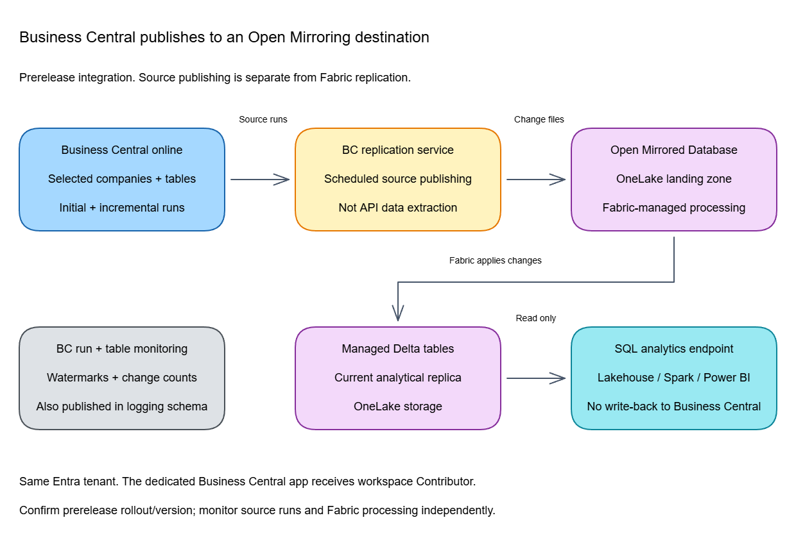
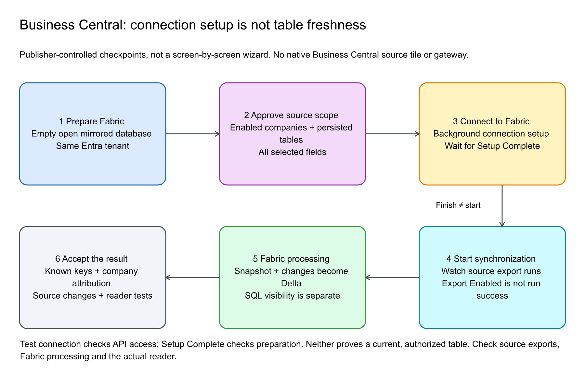

# Chapter 31: Dynamics 365 Business Central Mirroring

> **Part 2: Source-Specific Mirroring Guides**
>
> **Purpose:** Set up Business Central's application-managed Open Mirroring publisher, choose companies and tables, and operate synchronization without confusing source controls with Fabric controls.

**Part index:** [Chapters in Part 2](readme.md)

---

## Overview of the Source System

Business Central's **Microsoft Fabric Mirroring** integration replicates selected business data to a Fabric **open mirrored database**. Its documentation belongs under **Dynamics 365 Business Central administration**, not the normal Fabric Mirroring connector tree.

This is separate from [SAP Business Data Cloud Connect](29%20-%20SAP%20Business%20Data%20Cloud%20Connect%20for%20Microsoft%20Fabric.md) and [Dataverse Link to Fabric](28%20-%20Dataverse%20Link%20to%20Microsoft%20Fabric%20and%20Low-Latency%20Sync.md). The application, source publishing mechanism, Fabric destination, and operating controls are different.

Business Central does not appear as a native source in Fabric's connector picker. Create the Open Mirroring destination in Fabric, then configure the publisher in Business Central. The app requests an initial snapshot and subsequent exports from the Business Central platform rather than reading each selected business table through APIs. **Requests made by your tools to the configuration and monitoring APIs are still API calls and remain subject to Business Central limits**; API extraction-throughput estimates are not mirroring-throughput guarantees.

### Availability: Prerelease Is Not GA

**Reviewed 18 November 2026.** The [setup](https://learn.microsoft.com/en-us/dynamics365/business-central/admin-set-up-fabric-mirroring), overview, management, monitoring and [FAQ](https://learn.microsoft.com/en-us/dynamics365/business-central/fabric-faq) pages, updated 6 November 2026, consistently describe a **production-ready Preview** under supplemental Preview terms. They no longer present the earlier private-preview/public-preview-soon split or an October launch plan as the current status. Preview is not GA.

Do not infer rollout or GA from the calendar, or from Open Mirroring itself being GA. The current setup requires **Business Central online with a version compatible with the installed Microsoft Fabric Mirroring (Preview) extension**. Check the extension's compatibility requirements for the intended environment; the current procedure no longer states a universal v29 minimum. This change is not evidence that every earlier version or an on-premises deployment is supported.

---

## Mirroring Type and Architecture

- **Fabric type:** Open Mirroring, with a Microsoft product-managed source publisher.
- **Source scope:** Selected eligible normal AL tables and companies, configured separately for each Business Central environment; the app validates export eligibility.
- **Data movement:** Physical replication into OneLake Delta Parquet, not metadata-only access.
- **Consumers:** The automatically created SQL analytics endpoint, Power BI, and supported Lakehouse shortcuts/notebooks.

[](../assets/diagrams/chapter-31/diagram-01.excalidraw.png)
*Figure 31.1: Business Central owns source synchronization; Fabric processes the supplied changes into managed Delta tables.*

The source documentation says synchronization enables change tracking and exposes watermarks. It does not establish a specific SQL Change Tracking/CDC implementation, source retention window, or cross-table snapshot-consistency guarantee. The generic Open Mirroring protocol explains the destination, not every implementation detail of this publisher.

---

## Prerequisites, Permissions, and Connectivity

| Owner | Required preparation |
|---|---|
| **Business Central administrator** | Confirm online-environment and extension-version compatibility; install the **Microsoft Fabric Mirroring (Preview)** extension from Microsoft Marketplace; assign **MS Fabric Mirroring - Admin** or equivalent permissions. |
| **Entra administrator** | As **Application Administrator** or **Cloud Application Administrator**, create or find the tenant-local service principal for Microsoft's **Dynamics 365 Business Central Fabric Export** application. No customer app registration, SPA redirect URI or client secret is required by the current procedure. |
| **Fabric administrator** | Provide an active capacity and an existing target workspace in the **same Entra tenant**. The setup user must be **Member or Admin** to add the service principal. |
| **Data owner** | Approve companies, eligible table-level scope and exported field eligibility; choose a small representative pilot and the intended data/logging namespaces. |
| **Identity/network owner** | Permit the documented Fabric API/publishing path and validate **Test connection**. No Business Central-specific private endpoint or gateway recipe is established by these pages. |

Microsoft owns and manages the **Dynamics 365 Business Central Fabric Export** app registration in Microsoft's tenant. Its application (client) ID is **`dcc80069-ba40-4ad9-ba8c-60001cea3497`**. Your tenant's enterprise **service principal Object ID is different and tenant-specific**. Grant that service principal at least workspace **Contributor** access; an existing **Contributor, Member or Admin** assignment is accepted. This workspace-wide scope is broader than access to one item. No customer-managed application secret is entered in the current setup. The **Principal ID** field is needed only if Business Central will grant workspace access through **Add to workspace**.

Source roles are distinct:

| Business Central permission set | Purpose |
|---|---|
| **MS Fabric Mirroring - Admin** | Connection, selection, packages, synchronization controls, and monitoring |
| **MS Fabric Mirroring - Activate** | Activate/deactivate/reapply configuration packages |
| **MS Fabric Mirroring - Read** | Read synchronization overview and details |

The current FAQ requires an available feature and compatible extension in the intended **online** environment, with the Fabric workspace in the **same Entra tenant**. It does not establish every sovereign-cloud or private-network scenario. Also ensure the Fabric tenant setting **Service principals can call Fabric public APIs**, including any allowed security-group scope, permits the publisher. See the [management guide](https://learn.microsoft.com/en-us/dynamics365/business-central/admin-manage-fabric-export) and [connection troubleshooting](https://learn.microsoft.com/en-us/dynamics365/business-central/admin-monitor-fabric-export#troubleshoot-common-problems).

### Network and Gateway Boundary

**Gateway documentation reviewed: 18 November 2026.** The [Business Central setup](https://learn.microsoft.com/en-us/dynamics365/business-central/admin-set-up-fabric-mirroring) and [FAQ](https://learn.microsoft.com/en-us/dynamics365/business-central/fabric-faq) describe an application-managed publisher sending snapshots and changes to a Fabric **open mirrored database**. The documented baseline is **Business Central online with a compatible extension, same Entra tenant, production-ready Preview**; a gateway does not extend it to an on-premises deployment.

| Question | Documented position |
|---|---|
| **Standard-mode on-premises data gateway?** | **Not part of the documented publisher flow; not required by the setup.** Business Central uses its internal replication service, not a Fabric SQL Server pull connection or personal-mode gateway. |
| **VNet data gateway?** | **Not part of the documented publisher flow.** No Business Central-specific gateway option is published in these setup/FAQ pages; generic connector or Mirroring workload support does not establish one. |
| **Private endpoint recipe?** | **Not documented for this publisher.** Generic [Open Mirroring Private Link support](https://learn.microsoft.com/en-us/fabric/security/security-private-links-overview#mirrored-database) requires the publisher to write through the private route; it does not establish that Business Central can use that route. Do not invent endpoint overrides, a private-network allowlist, or an end-to-end private configuration. |

Use **Test connection** to check access to the **Fabric workspace-list API**, then verify background setup and synchronization separately. A successful API test alone is not proof of a private data path, completed setup or complete data delivery.

---

## Setup Walkthrough

### 1. Prepare the Microsoft-provided application's service principal

Follow the current [Business Central authentication procedure](https://learn.microsoft.com/en-us/dynamics365/business-central/admin-set-up-fabric-mirroring#set-up-authentication), not the earlier custom app/client-secret recipe.

1. Confirm the Business Central and target Fabric workspace use the same Entra tenant.
2. Have an **Application Administrator** or **Cloud Application Administrator** create or find that tenant's service principal for **Dynamics 365 Business Central Fabric Export**, application ID **`dcc80069-ba40-4ad9-ba8c-60001cea3497`**, using one of Microsoft's documented Cloud Shell, Azure CLI, Microsoft Graph PowerShell or Graph Explorer procedures. Reuse an existing service principal rather than creating a different app registration.
3. In **Microsoft Entra admin center > Enterprise applications**, clear the **Application type** filter if necessary, find the application by name or application ID, and record its tenant-local **Object ID**. Do not confuse this Object ID with the fixed application ID.
4. Choose how to grant workspace access. Either enter this Object ID as **Principal ID** and use **Add to workspace** in Business Central, or have a workspace **Member/Admin** grant the enterprise application **Contributor** through **Manage access** in Fabric.
5. If the service principal already has **Contributor, Member or Admin**, no additional grant is needed. When access is pregranted in Fabric, leave **Principal ID** blank and skip **Add to workspace**.

Microsoft manages the app registration and its authentication settings. Do not create a customer secret or SPA redirect URI for this current flow. These instructions do not prescribe how to retire an older deployment's custom application; obtain a supported migration plan before removing an existing identity or grant.

### 2. Prepare the Fabric destination

1. Open the intended capacity-backed Fabric workspace.
2. In the **Create** hub, select **Mirrored Database**, then **Other** to create an open mirrored database. Name it and select **Create**, following the current Business Central setup procedure.
3. Wait for provisioning and confirm the destination item and SQL analytics endpoint.

This is not a Warehouse or a Business Central database connection created in Fabric. Preserve the empty target for the source publisher; do not populate its landing zone with unrelated sample files.

### 3. Connect from Business Central

1. Use **Search (Alt+Q) > Assisted Setup > Connect to Microsoft Fabric (Preview)**.
2. On **Authentication**, enter the service principal's tenant-local **Object ID** as **Principal ID** only if you will use **Add to workspace**. Leave it blank if access was pregranted.
3. On **Fabric Workspace**, select the prepared workspace.
4. On **Grant Workspace Access**, select **Add to workspace** unless the service principal already has **Contributor, Member or Admin** access.
5. On **Fabric Open Mirroring Database**, select the prepared destination.
6. On **Synchronization Options**, select **Connect to Fabric** to start background connection preparation. Approve the **Microsoft Fabric Mirroring - Open Mirroring** privacy notice if prompted; it also applies to lookups. Continue with **Next**.
7. Choose **Select companies**, add at least one company and ensure it is enabled. Continue with **Next**, then **Select tables** and add at least one eligible table.
8. Select **Finish** to close the guide. **Finish does not start synchronization.**
9. Open **Microsoft Fabric Mirroring Setup (Preview)**, select **Refresh page** and wait for **Setup Complete**. Then select **Start synchronization** and inspect the first run in **Fabric Synchronization Overview**.

### 4. Verify setup and a representative table

Open **Microsoft Fabric Mirroring Setup** and verify:

| Field | Check |
|---|---|
| **Fabric Workspace Name / Fabric Open Mirroring Name** | Intended destination, not a similarly named item |
| **Fabric Data Namespace** | Default `BusinessCentral`; approve before setup completes |
| **Fabric Logging Namespace** | Default `BusinessCentral_log`; operational data also becomes an analytical access surface |
| **Setup Complete / Export Enabled** | Both are **read-only status fields**. Setup Complete confirms background connection preparation; Export Enabled reports continuous export, not that any particular table is current. Use the supported actions and Refresh page rather than editing these values. |

Namespace changes are allowed only before setup completes. Run **Test connection**, inspect initial source runs, and query a known target row through the SQL analytics endpoint using the generated entity name.

For an approved pilot table, replace both placeholders with the namespace and entity shown in your endpoint:

```sql
SELECT TOP (10) *
FROM [<data_namespace>].[<fabric_entity_name>];
```

The default data namespace is `BusinessCentral`; do not guess the table's generated name or company layout from its Business Central display caption.

For validation, use a sanctioned test company/table. Compare initial data, then an insert, update, and explicit deletion made through normal Business Central operations. Check company attribution before designing cross-company joins: the documentation does not establish a universal target company-key/naming convention.

**Screenshots:** the linked Business Central setup article does not currently supply mirroring-wizard screenshots. Figure 31.1 is this book's explanatory architecture diagram, not a capture of a released Business Central setup screen.



*Figure 31.2: Separate connection preparation, source exports, Fabric processing and authorized query results. **Finish**, **Setup Complete**, **Export Enabled** and current table data are not interchangeable acceptance signals. Original illustration for this book, not a Microsoft screenshot or wizard mock-up; based on the [Business Central setup](https://learn.microsoft.com/en-us/dynamics365/business-central/admin-set-up-fabric-mirroring#confirm-setup-and-start-synchronization) and [monitoring guide](https://learn.microsoft.com/en-us/dynamics365/business-central/admin-monitor-fabric-export), reviewed 9 November 2026. This is a conceptual checkpoint sequence, not a replacement for the current identity/setup procedure. [Editable Excalidraw](../assets/diagrams/chapter-31/walkthrough-publisher-acceptance-sequence.excalidraw) · [SVG](../assets/diagrams/chapter-31/walkthrough-publisher-acceptance-sequence.svg).*

---

## Selecting Companies, Tables, and Configuration Packages

- **Configuration > Companies > Add company:** select the required companies. Clearing **Enabled** skips a company without removing its configuration.
- **Configuration > Tables > Add table:** choose normal tables that pass the app's export validation, including eligible standard and extension tables. External, linked, virtual and certain sensitive internal tables are excluded. The same validation applies to packages and APIs.
- **DataPerCompany** tables synchronize for each enabled company; shared tables synchronize once.
- Inspect **Fabric entity name** and **Fabric Schema Type**, including the distinction between data and logging schema.
- The documented limit is **1,000 distinct selected tables across manual selections and active configuration packages**. The same table claimed by multiple packages counts once. This is not a guarantee of unlimited rows, data volume or Fabric resources.

The built-in **MS-STD / Microsoft Standard** definition lists **256 standard table IDs**; available entries depend on installed tables. **Activate** adds its selections; **Deactivate** retains tables still selected manually or by another active package. **Reapply** adds missing selections but does not remove stale ones. Deactivate/reactivate for full alignment, review the effects first, and stay within the table limit. Packages use JSON; deactivate a package before deleting it.

**Package import is version-sensitive.** Importing the same package code and version leaves it unchanged. Import a new version to apply a changed definition. For an active package, that import releases removed table claims and attempts to add the new selections; manual selections or another active package can retain a removed table. Missing table IDs are skipped. Existing selections keep their Fabric settings, and newly selected tables take their schema type from the package. Review the resulting selection and the 1,000-table limit before resuming.

Selection is table-level, **not a custom projection of individual fields**. Field eligibility is part of the app's export validation, so do not claim that every AL field is mirrored. The current pages still do not provide a complete AL type/BLOB/Media mapping. Test representative fields and follow [AL storage semantics](https://learn.microsoft.com/en-us/dynamics365/business-central/dev-itpro/developer/devenv-flowfields), not assumptions based on a table's appearance in the UI.

---

## Monitoring, Scheduling, and Recovery

Use **Microsoft Fabric Mirroring Setup > Monitoring > Fabric Synchronization Overview**, then **Details**. Source-side detail includes company/table/entity, initial versus incremental run, inserted/updated/deleted counts, start/end watermarks, and errors. **Details** in the client filters to the selected run ID. Zero-change detail rows are hidden by default; use **Show rows with no changes** when investigating missing or failed tables, because **a row with an error can also have zero change counts**. The **Errors** view filters error text, not run state. Refresh the page for asynchronous progress.

The same operational information is replicated into the logging namespace. Fabric's item-level status and [Chapter 5](../Part%201%20-%20Concepts%20and%20Architecture/05%20-%20Monitoring%20a%20Mirrored%20Database.md) diagnostics cover destination processing. Source completion is not proof that SQL endpoint metadata is already current.

| Business Central control | Effect |
|---|---|
| **Minutes Between Exports** | Sets the source run interval; changes apply on the next run. No universal numeric minimum/default is documented. |
| **Max Consecutive Failed Runs** | Range 1-5, default 2. Fix the error before restarting automatically stopped synchronization. |
| **Start synchronization** | Enables tracking and recurring work; does not start an overlapping active run. |
| **Stop synchronization** | Cancels current work and pauses recurrence while preserving connection/synchronization state. |
| **Reset** | Cancels work, removes tenant mirroring resources, clears watermarks, and deletes run/detail records. Treat as destructive reconfiguration. |
| **Reset table** | Requests a full snapshot on the next run for the selected table by clearing its latest successful end watermark per company. It preserves the connection, credentials and overall history, and is blocked while a synchronization run is active. |

Duplicate setup/enable requests are blocked for up to **15 minutes** unless the previous setup has completed. The destination cannot change while **Export Enabled** is selected; reset clears the connection for reconfiguration.

**Business Central Stop/Start is not Fabric Stop/Start.** Do not restart the Fabric mirrored database as a routine source refresh, manually delete producer-owned landing folders, or reset the whole connection merely to clear a table error. Generic Open Mirroring recovery in [Chapter 38](../Part%203%20-%20Open%20Mirroring/38%20-%20Common%20Issues%20and%20Troubleshooting.md) still requires publisher coordination.

### Request a New Snapshot for One Table

The [Business Central management procedure](https://learn.microsoft.com/en-us/dynamics365/business-central/admin-manage-fabric-export#request-a-full-snapshot-for-one-table) now documents **Reset table**:

1. Select **Stop synchronization** if a run is active and verify in the overview that it is no longer running.
2. Open **Configuration > Tables**, select the affected table, then select **Reset table** and confirm.
3. Return to the setup page and select **Start synchronization**.
4. Inspect the next run's details to verify its full-snapshot result.

The action clears the latest successful end watermark for that table in each company with a successful synchronization record. If there is no completed synchronization, the next run already needs a full snapshot. It does not remove the connection, clear credentials or delete all history. A snapshot can take longer than an incremental run, and **resetting the watermark alone does not repair an incompatible destination schema**. Investigate extension/type/key changes with the source owner and apply Fabric schema-compatibility guidance before requesting a new snapshot.

### Reconnect After Environment Configuration Cleanup

When Business Central clears environment-specific configuration, the app clears the Fabric destination and authentication values and resets **Setup Complete** and **Export Enabled**. Company/table selections, package definitions and logs remain. This cleanup does **not** disable the original environment's remote Fabric connection. Treat retained selections as configuration only, not a working connection; configure and validate the new destination/authentication before restarting synchronization.

---

## Security and Billing

Business Central permission sets, company restrictions, and security filters are **not documented as automatically propagated into Fabric**. Design and verify Fabric workspace/item, OneLake, SQL, and semantic-model access separately. Table-level replication, the validated exported fields and the logging namespace require their own data-owner approval.

The [current FAQ](https://learn.microsoft.com/en-us/dynamics365/business-central/fabric-faq#what-are-the-licensing-and-consumption-costs) requires **active Fabric capacity** and describes uncharged background mirroring compute, a capacity-based mirrored-storage allowance, and normal SQL, Power BI and Spark query charges. It no longer provides the earlier blanket statement about additional Business Central licensing/consumption charges; that omission is not evidence that a new fee has been introduced. Confirm the installed extension's licensing and applicable commercial terms, and use [Chapter 10](../Part%201%20-%20Concepts%20and%20Architecture/10%20-%20Billing%20and%20Capacity%20Management.md) for current Fabric allowances, storage overage, direct access and paused-capacity rules.

Incremental changes typically synchronize within minutes, while initial history takes longer. The configured interval, source activity, processing, and consumer metadata affect freshness. No source-specific latency SLA, change-retention/replay window, or unlimited-throughput promise is established. Replicated logical deletions also do not mean immediate physical erasure from retained Delta files.

---

## Documented Pitfalls

| Symptom | First safe check |
|---|---|
| Setup unavailable | Confirm feature availability and the installed extension's compatibility with the online environment; production-ready Preview is not GA |
| Connection or workspace lookup fails | Confirm the signed-in user's workspace access/consent, same tenant, Microsoft's Fabric Export enterprise service principal, permitted tenant API setting/security-group scope, workspace role, privacy approval and **Test connection** |
| Principal ID is missing or rejected | Use the tenant-local enterprise service principal's **Object ID**, not application ID `dcc80069-ba40-4ad9-ba8c-60001cea3497`; leave it blank if access is already granted in Fabric |
| Open mirrored database lookup is empty | Select the workspace first, then confirm that it contains a provisioned Open Mirroring destination visible to the setup user |
| The guide requests an unexpected custom secret or redirect URI | Confirm the installed extension and current setup procedure; do not apply the obsolete custom-registration recipe to the Microsoft-provided app |
| **Add to workspace** encounters an existing member | Existing **Contributor, Member or Admin** is accepted; Viewer alone is insufficient. Grant Contributor directly in Fabric if the action is unavailable or fails. |
| Setup appears stalled | Asynchronous run state, privacy approval, and duplicate-request protection; do not repeatedly reset |
| Table/company missing | Selection, company **Enabled**, package activation, per-company/shared storage, and the 1,000-table scope |
| Synchronization stops after failures | Source run/detail error and **Max Consecutive Failed Runs**; resolve the cause before **Start synchronization** |
| Source succeeded but SQL is stale | Separate source publication, Fabric processing, and SQL metadata sync |
| Schema changed after extension upgrade | Investigate source/destination compatibility, then use the documented **Reset table** sequence if a new full snapshot is required; it does not itself repair an incompatible destination schema |
| A table error appears to be missing | Select **Show rows with no changes** as well as the Errors view; failed rows can have zero change counts |

The published [monitoring API contract](https://learn.microsoft.com/en-us/dynamics365/business-central/admin-monitor-fabric-export#monitor-through-apis-or-fabric) names publisher **`microsoft`**, group **`fabric`**, version **`v1.0`**, and two **read-only** entity sets: **`fabricExportRuns`** for run IDs, operation types, states, timestamps and errors; and **`fabricExportDetails`** for company/table/entity results, export type, change counts, watermarks and errors. **The detail API does not expose the run ID**; use **Details** in the Business Central client for results scoped to a selected run, rather than inventing a run-ID API join or filter. These monitoring entity sets report integration results; they do not export the selected business tables or provide configuration writes. Keep normal Business Central API limits in mind for your tools, and do not infer undocumented payloads, writable actions or endpoint scoping from the entity-set names alone.

---

## Summary

Business Central supplies the source publisher for an Open Mirroring destination. Its company/table selection, run scheduling, monitoring, credentials, and lifecycle live in the application. Preserve its prerelease qualifications and administer Fabric analytical access independently.

**References, reviewed 18 November 2026:** [setup](https://learn.microsoft.com/en-us/dynamics365/business-central/admin-set-up-fabric-mirroring), [overview](https://learn.microsoft.com/en-us/dynamics365/business-central/admin-fabric), [management](https://learn.microsoft.com/en-us/dynamics365/business-central/admin-manage-fabric-export), [monitoring and published read-only API contract](https://learn.microsoft.com/en-us/dynamics365/business-central/admin-monitor-fabric-export), [FAQ](https://learn.microsoft.com/en-us/dynamics365/business-central/fabric-faq), and [developer extraction-method comparison](https://learn.microsoft.com/en-us/dynamics365/business-central/dev-itpro/developer/devenv-extract-data).

**Contents:** [Table of Contents](../index.md) | **Previous:** [Chapter 30: Google Lakehouse Runtime Catalog Mirroring](30%20-%20Google%20Lakehouse%20Runtime%20Catalog%20Mirroring.md) | **Next:** [Chapter 32: Microsoft Fabric HorizonDB Mirroring](32%20-%20Microsoft%20Fabric%20HorizonDB%20Mirroring.md)
