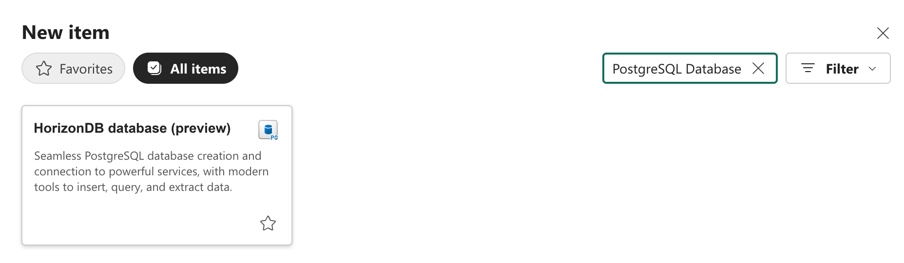

# Chapter 32: Microsoft Fabric HorizonDB Mirroring

> **Part 2: Source-Specific Mirroring Guides**
>
> **Purpose:** Understand Fabric HorizonDB's automatic analytical mirror, distinguish it from Azure PostgreSQL services, and evaluate the separate federation and reverse-ETL paths announced at Ignite.

**Part index:** [Chapters in Part 2](readme.md)

---

## Overview and Ignite Availability

**Announcement and documentation snapshot: 18 November 2026.** The [17 November HorizonDB announcement](https://techcommunity.microsoft.com/blog/adforpostgresql/horizondb-postgresql-for-enterprises-developers-and-agents-on-azure-and-fabric/4573498) makes two different availability statements: **Azure HorizonDB is generally available**, while **Microsoft Fabric HorizonDB is in Public Preview**. The [Fabric overview](https://learn.microsoft.com/en-us/fabric/database/horizondb/overview) confirms the latter. Azure GA does not make the Fabric service, its mirroring, or every announced integration GA.

The [Fabric database/app Ignite companion](https://community.fabric.microsoft.com/blog/fbc_fabricupdatesblogs/build-and-operate-intelligent-apps-with-microsoft-fabric-new-capabilities-at-ign/5423020) also identifies Fabric HorizonDB as Preview and describes automatic mirroring, translytical queries, and Synced Tables. The implementation and limitation pages below define the narrower procedure that can safely be followed at this snapshot.

Fabric HorizonDB is a native Fabric database item providing service-managed PostgreSQL. Applications use a PostgreSQL endpoint; Fabric provides a separate, asynchronous analytical copy in OneLake and a read-only SQL analytics endpoint.

| Product | Relevant boundary |
|---|---|
| **Azure Database for PostgreSQL flexible server** | The external source in [Chapter 18](18%20-%20PostgreSQL.md), with Azure source preparation, `azure_cdc`, source identities, and its own gateway requirements. |
| **Azure HorizonDB** | A separately managed Azure service, GA-announced at Ignite 2026. Its [Azure documentation](https://learn.microsoft.com/en-us/azure/horizondb/overview/overview) is not a Fabric database creation or mirroring runbook. |
| **Fabric HorizonDB** | A native Fabric item in Public Preview. The procedures in this chapter follow its own creation, mirroring, security, and integration contracts. |

Do not configure `azure_cdc`, copy Flexible Server grants, create a PostgreSQL replication role, or apply Azure HorizonDB private-endpoint/CMK instructions merely because these services share PostgreSQL compatibility. This chapter does not establish an external Azure HorizonDB connector procedure by analogy.

## Mirroring, Federation, and Data Delivery

Fabric calls the combined capabilities **Federated Analytics**. This name does not introduce a fourth Mirroring type or imply one synchronous transaction across PostgreSQL and OneLake.

| Capability | Direction and data ownership | Freshness and execution boundary |
|---|---|---|
| **Automatic database mirroring** | Eligible Fabric HorizonDB tables are copied to an analytical representation in OneLake. | Initial copy followed by asynchronous committed changes; the SQL analytics endpoint is read-only. |
| **Federated queries** | A PostgreSQL query reads supported Fabric Warehouse/SQL endpoint data through `pg_fabric_fdw` foreign tables. | Rows stay at the Fabric source. Eligible work is pushed to Fabric; other supported work can remain local. |
| **Data delivery / reverse ETL** | A Copy job loads a bounded Fabric result into PostgreSQL staging, followed by an explicit publish step. | Local serving data reflects the last successful load **and** publish, not the latest source transaction automatically. |
| **Synced Tables announcement** | Ignite describes enriched Warehouse data flowing back to HorizonDB through snapshot or continuous sync. | The implementation documentation reviewed for this chapter documents bounded **Full copy** delivery, not a continuous-sync setup contract; see the availability note below. |

The [Federated Analytics overview](https://learn.microsoft.com/en-us/fabric/database/horizondb/federated-analytics-overview) documents the first three paths and their independent failure modes. A useful design is to mirror operational orders, calculate a compact result in Fabric, then deliver that result to a **different application-facing PostgreSQL table**. This is not permission to write into Fabric-managed mirrored Delta files or an automatically conflict-resolved two-way replica.

**Announcement versus implementation:** the Ignite post describes five-minute idle pause, rapid provisioning, CPU/GPU analytical pushdown, and snapshot/continuous Synced Tables. The current [creation](https://learn.microsoft.com/en-us/fabric/database/horizondb/create), [limitations](https://learn.microsoft.com/en-us/fabric/database/horizondb/limitations), and [data-delivery](https://learn.microsoft.com/en-us/fabric/database/horizondb/load-fabric-data-copy-job) pages impose narrower preview contracts: no fixed provisioning/resume guarantee, scale-to-zero where enabled, and an insert-oriented Full copy destination without promised CDC/delete propagation/checkpoints. Treat those differences as deployment gates, not as instructions to invent a sync API or promise a five-minute timer in every environment. Recheck the documentation and enabled tenant experience as the preview evolves.

## Setup Walkthrough

### 1. Complete Preview and Data-Exposure Preflight

Use the [creation quickstart](https://learn.microsoft.com/en-us/fabric/database/horizondb/create), [mirroring overview](https://learn.microsoft.com/en-us/fabric/database/horizondb/mirroring-overview), and [current limitations](https://learn.microsoft.com/en-us/fabric/database/horizondb/limitations).

1. Select a dedicated development/test workspace with active supported Fabric capacity, the required preview enablement, and an eligible region.
2. Obtain the documented Contributor or Admin workspace access and permission to create the required database items. Do not copy another database product's creation-role requirement.
3. Decide who creates the database. **Only that Microsoft Entra identity can connect to PostgreSQL in the current preview**; other users, groups, service principals, and managed identities cannot be added as operational readers by sharing the item.
4. Approve which source data may enter the analytical copy before loading it. Automatic mirroring covers eligible tables; do not assume there is a source-selection/exclusion wizard or that every type is supported.
5. Agree owners for PostgreSQL, mirroring, SQL endpoint, capacity, and downstream consumers. Record separate acceptance checks for each.

The creator-only connection boundary is a substantial preview restriction. Do not present this as a production-ready multiuser application-authentication walkthrough or work around it by distributing the creator's token.

### 2. Create and Validate the PostgreSQL Item

In the Fabric workspace, select **+ New item**, search for **HorizonDB database**, choose **HorizonDB database (preview)**, provide an approved unique item name, and select **Create**.



*Figure 32.1: Create the native Fabric HorizonDB item, not an external PostgreSQL mirror. Microsoft documentation screenshot, reproduced unchanged from [Create a HorizonDB database](https://learn.microsoft.com/en-us/fabric/database/horizondb/create); [original image](https://learn.microsoft.com/en-us/fabric/database/horizondb/media/onboarding/create-postgresql-item.png). Credit: Microsoft, [CC BY 4.0](https://creativecommons.org/licenses/by/4.0/) under the [Fabric documentation licence](https://github.com/MicrosoftDocs/fabric-docs/blob/main/LICENSE), including its warranty disclaimer. Preview labels and availability can change.*

Creation is asynchronous. Wait for **Online/Ready** and validate the endpoint rather than creating duplicate items while an operation is pending. In the database's **New Query** editor, run:

```sql
SELECT
    current_database() AS database_name,
    current_user AS signed_in_user,
    current_setting('server_version') AS server_version,
    clock_timestamp() AS checked_at;
```

Confirm the intended creator identity and actual engine version. The current quickstart uses PostgreSQL database name **`postgres`**, not the Fabric item display name. Obtain the host, database name, released TLS guidance, and client information from the item's connection pane; never place an access token in a script, connection-option example, or book.

Use PostgreSQL SQL on this endpoint. The SQL analytics endpoint is a different T-SQL surface and is not an application write endpoint.

### 3. Prove the Automatic Mirror Separately

For a Federated Analytics-enabled preview database, [mirroring is automatic for eligible tables](https://learn.microsoft.com/en-us/fabric/database/horizondb/mirroring-overview#how-mirroring-works). There is no need to imitate the Flexible Server preparation procedure or construct an Open Mirroring publisher.

1. Follow the [synthetic table/sample-data tutorial](https://learn.microsoft.com/en-us/fabric/database/horizondb/create-table), using approved test rows rather than a business export.
2. Return to the workspace and open the mirroring-related item associated with the HorizonDB database.
3. Inspect **each table's** initial-copy/eligibility status. The operational database being Ready does not prove that its analytical copy is usable.
4. Wait for the initial copy, then open the generated SQL analytics endpoint and locate the actual schema/table names exposed there.
5. Compare a stable record key, selected values, counts, and a source update timestamp between PostgreSQL and SQL. Use dialect-appropriate queries on each endpoint.
6. Make a controlled insert/update/delete on disposable source data and observe each supported change after commit. Record the observed delay, not a fabricated end-to-end SLA.
7. Test the actual analytical reader separately from the creator/administrator before sharing the endpoint or report.

An uncommitted transaction is not an expected mirrored change. DDL, unsupported types, retention, or reseeding can delay or suspend an individual table while PostgreSQL remains healthy.

## Eligibility, Schema Changes, and Monitoring

The [HorizonDB mirroring limitations](https://learn.microsoft.com/en-us/fabric/database/horizondb/mirroring-limitations) require supported table identity, keys, types, and DDL. Use stable primary keys for analytical tables, but do not assume a key makes every table eligible. Views, foreign/temporary/unlogged tables, functions, and extension-owned objects do not become mirrored ordinary tables merely because PostgreSQL can query them.

Do not transfer Fabric SQL database's table cap, Azure HorizonDB's advertised storage size, or Flexible Server's WAL-worker settings into this preview. The current HorizonDB pages do not publish a universal numeric eligibility/type/size limit for every environment; inspect the actual table condition and released contract.

Before changing a key, moving/renaming a table, changing a type, or dropping a column, review the impact on the mirror, imported foreign-table metadata, OneLake policies, SQL objects, and reports. An incompatible change can suspend replication or require a new copy. Validate the replacement before treating it as current data.

Follow [Monitor Fabric HorizonDB mirroring](https://learn.microsoft.com/en-us/fabric/database/horizondb/mirroring-monitor):

| Symptom | First response |
|---|---|
| PostgreSQL is Ready, but a table is missing | Inspect table eligibility and initial-copy status, then verify the schema name exposed by SQL. |
| Source rows are current, but analytics is stale | Check committed source transactions, mirror progress, reseed state, and SQL endpoint visibility independently. |
| A table becomes suspended after DDL | Preserve the error, source change, last good state, and operation/correlation identifiers before repair. |
| A replacement copy is being seeded | Treat the analytical data as stale or incomplete until the new copy is validated. |
| Connections fail after idling | Check creator identity and resume state; reconnect with bounded retry only for safe operations. Do not blindly replay a transaction whose commit result is unknown. |

No numeric freshness guarantee is published. Add source timestamps to important results and define what consumers should do when their maximum acceptable data age is exceeded.

## Query Fabric Data Without Copying It Back

The service-managed **`pg_fabric_fdw`** wrapper exposes supported Fabric SQL-compatible data as read-only PostgreSQL foreign tables. `IMPORT FOREIGN SCHEMA` creates local **metadata**, not a local copy of remote rows. The default **`fabric_dw`** server targets the database's own mirrored SQL analytics endpoint; do not drop or recreate this service-managed object.

For a separate Warehouse, the [federation setup guide](https://learn.microsoft.com/en-us/fabric/database/horizondb/query-fabric-data) documents a **customer-owned foreign server** using its actual SQL connection details. The creator must be authorised to read that Fabric source. A `database_name` override neither discovers arbitrary workspaces nor grants access.

Inspect `EXPLAIN (VERBOSE)` and its **Fabric SQL** line to establish which operations push down. Full or partial analytical pushdown is not a promise that every PostgreSQL expression runs in Fabric, every query uses a GPU, or cross-engine collation/type semantics are identical. Foreign tables remain read-only; use data delivery when the result must become indexed PostgreSQL state.

## Return Analytical Results to PostgreSQL Safely

The current [Copy job delivery procedure](https://learn.microsoft.com/en-us/fabric/database/horizondb/load-fabric-data-copy-job) uses the **Azure Database for PostgreSQL destination connector**, the HorizonDB **PostgreSQL host**, database **`postgres`**, **Organizational account** authentication as the creator, and **Full copy**.

That connector name describes this documented **destination** path. It does not turn HorizonDB into the external Flexible Server Mirroring source in Chapter 18.

Use a bounded Warehouse result and a separate staging table. Validate row counts, business keys, duplicate handling, UTC timestamps, and a batch identifier before an idempotent PostgreSQL publish transaction. The Copy job is insert-oriented; a successful load into staging is not proof that the application-facing result was published.

Do not assume automatic incremental capture, delete propagation, schema evolution, conflict resolution, replay, or a continuous Synced Tables schedule from this Full copy procedure. Missing source rows need an explicit deletion policy. A failed or partial load should leave the last approved serving dataset intact.

## Security, Networking, and Cost Boundaries

**Operational and analytical access are separate.** The [HorizonDB security guide](https://learn.microsoft.com/en-us/fabric/database/horizondb/mirroring-secure) retains creator-only PostgreSQL access while requiring independent permissions for OneLake, the SQL analytics endpoint, models, and reports. Source login/role DDL and per-table PostgreSQL user permissioning are not available as a multiuser preview setup. Review [Section 4.5](../Part%201%20-%20Concepts%20and%20Architecture/04%20-%20The%20Anatomy%20of%20a%20Mirrored%20Database.md#45-security-of-a-mirrored-database) for analytical access modes, DefaultReader, and positive/negative reader tests, applying the capabilities actually released for this item.

Automatic internal mirroring is not the external PostgreSQL source-connection/gateway recipe. The current [limitations](https://learn.microsoft.com/en-us/fabric/database/horizondb/limitations#security-and-networking) require HorizonDB-specific network modes, DNS, ports, TLS, and identity guidance. Do not infer VNet gateway, on-premises gateway, Private Link, CMK, cross-region, or cross-workspace support from another PostgreSQL or Fabric database service.

The [usage-reporting guide](https://learn.microsoft.com/en-us/fabric/database/horizondb/usage-reporting) distinguishes performance telemetry from capacity consumption. Review PostgreSQL compute/storage, mirrored data, SQL/federated queries, Copy jobs, and downstream workloads separately. An idle/paused chart does not establish zero charges, and another source's free-mirroring/storage allowance is not a published HorizonDB commercial entitlement.

## Summary

Fabric HorizonDB adds a native PostgreSQL operational database with automatic asynchronous OneLake mirroring. Its read-only federation and reverse-ETL delivery paths address different data directions and failure boundaries. At this Ignite snapshot it remains Public Preview, with significant creator-only authentication and documentation/announcement differences that must be resolved for the intended deployment.

**Contents:** [Table of Contents](../index.md) | **Previous:** [Chapter 31: Dynamics 365 Business Central Mirroring](31%20-%20Dynamics%20365%20Business%20Central%20Mirroring.md) | **Next:** [Chapter 33: What is Open Mirroring and Why It's Useful](../Part%203%20-%20Open%20Mirroring/33%20-%20What%20is%20Open%20Mirroring%20and%20Why%20It%27s%20Useful.md)
