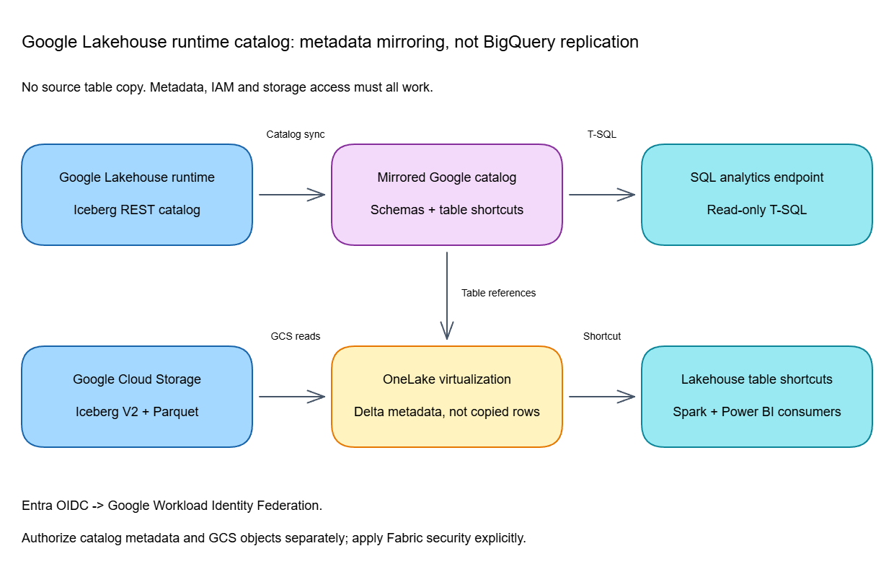
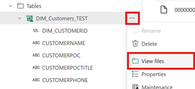
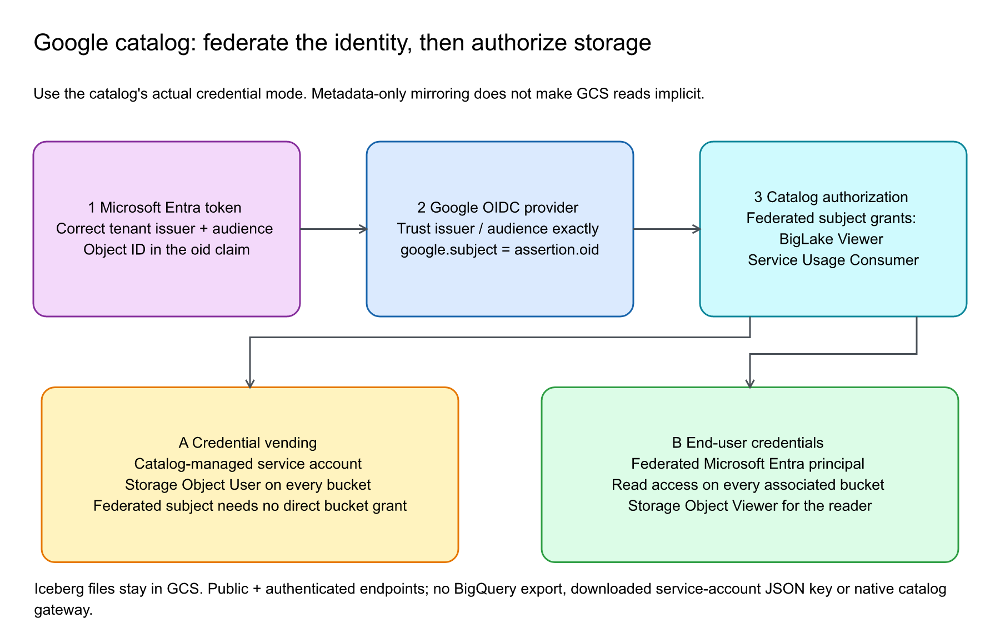

# Chapter 30: Google Lakehouse Runtime Catalog Mirroring

> **Part 2: Source-Specific Mirroring Guides**
>
> **Purpose:** Configure Google's catalog integration, keep it separate from BigQuery replication, and validate federation, storage access, Iceberg conversion, and Fabric security.

**Part index:** [Chapters in Part 2](readme.md)

---

## Overview of the Source System

**Google Lakehouse runtime catalog mirroring is Public Preview.** Fabric mirrors an Apache Iceberg REST catalog's metadata and creates OneLake shortcuts. The table data remains in **Google Cloud Storage (GCS)**; creating the mirrored catalog does not export the source rows into a second Fabric-managed replica.

The [Microsoft preview announcement](https://community.fabric.microsoft.com/blog/fbc_fabricupdatesblogs/bring-your-google-lakehouse-runtime-catalog-data-to-onelake-preview/5360492) was published on **24 August 2026**. The overview, tutorial, and limitations were reviewed again on **2 November 2026**. Their presence outside the general overview's source table is not evidence that the connector is unavailable: the source-specific documentation and Mirroring navigation include it.

### Google Catalog or Google BigQuery?

| Decision | Google Lakehouse runtime catalog | Google BigQuery database mirroring |
|---|---|---|
| Mirroring type | Metadata mirroring | Database mirroring |
| Status | Public Preview | GA |
| Data location after setup | Existing Iceberg tables in GCS | Replicated Delta tables in OneLake |
| Source mechanism | Iceberg REST catalog and storage reads | Initial exports and BigQuery change-history polling |
| Authentication | Entra OIDC through Google Workload Identity Federation | The service-account credential documented in the BigQuery tutorial |
| GCS role | Source table storage | Required export/staging storage |
| Source guide | This chapter | [Chapter 16](chapter-16.md) |

Do not reuse BigQuery's JSON-key, change-history, or staging-bucket recipe for this catalog. An ordinary [GCS shortcut](https://learn.microsoft.com/en-us/fabric/onelake/create-gcs-shortcut) is also a separate connection: its HMAC credential instructions are not the catalog's federation setup.

---

## Mirroring Type and Architecture

- **Mirroring type:** Metadata mirroring.
- **Source access:** Iceberg REST catalog metadata plus authenticated GCS reads.
- **Fabric output:** A mirrored Google catalog, a shortcut per selected eligible table, and an automatically created SQL analytics endpoint.
- **Format handling:** OneLake generates **virtual Delta metadata** over existing Iceberg Parquet files. It does not rewrite the whole dataset into OneLake.

[](../assets/diagrams/chapter-30/diagram-01.excalidraw.png)
*Figure 30.1: Catalog synchronization and storage reads are separate dependencies. The underlying table data stays in GCS.*

The source overview describes initial table availability within seconds and metadata propagation usually taking seconds to a few minutes. These are expectations, not an SLA. Source commits, format virtualization, catalog synchronization, and SQL endpoint metadata visibility can introduce different delays.

---

## Network and Connectivity

**Gateway documentation reviewed: 4 November 2026.** The [tutorial](https://learn.microsoft.com/en-us/fabric/mirroring/catalog-mirroring/google-lakehouse-runtime-tutorial), [source limitations](https://learn.microsoft.com/en-us/fabric/mirroring/catalog-mirroring/google-lakehouse-runtime-limitations), and [24 August preview announcement](https://community.fabric.microsoft.com/blog/fbc_fabricupdatesblogs/bring-your-google-lakehouse-runtime-catalog-data-to-onelake-preview/5360492) do not document a native gateway path; the tutorial and limitations explicitly require public catalog/storage reachability. See the [gateway support matrix and lifecycle guidance](../appendix.md#gateway-support-by-source).

| Question | Answer |
|---|---|
| **Data gateway required?** | Neither a **VNet** nor a **standard-mode on-premises** gateway configuration is documented for this native catalog. A generic gateway is not a documented workaround for the explicit public-reachability requirement. |
| **Private source access?** | The catalog endpoint and GCS locations must be reachable over the public internet. Firewall rules and other source-network restrictions are unsupported. |
| **Anonymous bucket access?** | Not required. Public reachability is not public bucket permission; retain authenticated access. |
| **Fabric Private Link?** | OneLake Iceberg-to-Delta virtualization excludes Private Link-enabled tenants/workspaces. Its current regional exclusions include Qatar Central and Norway West. |
| **Fabric workspace outbound protection?** | Google Lakehouse runtime catalog is not explicitly enumerated in the [mirrored-database support list](https://learn.microsoft.com/en-us/fabric/security/workspace-outbound-access-protection-mirrored-databases). [OneLake outbound rules](https://learn.microsoft.com/en-us/fabric/security/workspace-outbound-access-protection-onelake) govern shortcut reads and chains separately; an allow rule does not add native private-catalog support. |
| **Different gateway integration?** | A standalone [GCS storage shortcut](https://learn.microsoft.com/en-us/fabric/onelake/create-on-premises-shortcut) can use a **standard-mode on-premises gateway**. This is a different integration from the native federated catalog, not a gateway to its Iceberg REST endpoint, and it does not remove Iceberg virtualization exclusions. |
| **Regional Google endpoint?** | Follow Microsoft's documented endpoint. Google's support for regional REST endpoints does not establish that substituting one is supported by this Fabric connector. |

See the [connector limitations](https://learn.microsoft.com/en-us/fabric/mirroring/catalog-mirroring/google-lakehouse-runtime-limitations) and [OneLake virtualization limitations](https://learn.microsoft.com/en-us/fabric/onelake/onelake-iceberg-tables#limitations-and-considerations). Do not turn a restriction on OneLake-to-OneLake shortcut locations into an undocumented requirement that GCS and Fabric use the same region.

---

## Setup Walkthrough

This procedure follows the [Microsoft tutorial](https://learn.microsoft.com/en-us/fabric/mirroring/catalog-mirroring/google-lakehouse-runtime-tutorial), with source storage requirements from Google's [Iceberg REST catalog setup](https://docs.cloud.google.com/lakehouse/docs/set-up-lakehouse-iceberg-rest-catalog).

### 1. Administrator-owned preflight

1. **Google project/catalog owner:** confirm billing and enable the **BigLake API**. Identify a catalog containing **Iceberg V2** tables with **Parquet** data files. Start with a small pilot table and record every bucket containing its metadata and data.
2. Record the catalog warehouse path and billing **project ID**. Separately record the numeric **project number** owning federation; these identifiers are not interchangeable.
3. **IAM owner:** arrange permission to create/manage a Workload Identity Pool and OIDC provider and grant IAM roles. Obtain the Entra **tenant ID** and authorized identities' **object IDs**, not their application client IDs.
4. **Network owner:** validate the catalog and every metadata/data storage location through the documented public path while retaining bucket authentication. The native catalog has no documented VNet/on-premises gateway setup; a separately created GCS gateway shortcut does not satisfy this prerequisite.
5. **Fabric administrator:** provide an F SKU or permitted trial workspace, item-creation permissions, and **Enable new mirrored catalog items (Preview)**. The tutorial does not name a Google-specific minimum workspace role; use an authorized item creator, not a Viewer.

### 2. Configure Entra-to-Google federation

1. In Google Cloud console, select the federation project and open **IAM & Admin > Workload Identity Federation > Create Pool**.
2. Create an enabled pool in **global**, record its **Pool ID**, and add an enabled **OpenID Connect (OIDC)** provider.
3. Record the **Provider ID** and configure these exact values:

   | Setting | Required value |
   |---|---|
   | Issuer URL | `https://sts.windows.net/{TENANT_ID}/` |
   | Allowed audience | `https://analysis.windows.net/powerbi/connector/MirroredGoogleLakehouseRuntimeCatalog` |
   | Attribute mapping | `google.subject = assertion.oid` |

4. Keep the issuer's trailing slash. The issuer, audience, and token claims must match; a generic login URL or another connector's audience is not equivalent.
5. Bind each approved Entra object ID using:

   ```text
   principal://iam.googleapis.com/projects/PROJECT_NUMBER/locations/global/workloadIdentityPools/POOL_ID/subject/ENTRA_OID
   ```

6. Grant **BigLake Viewer** (`roles/biglake.viewer`) and **Service Usage Consumer** (`roles/serviceusage.serviceUsageConsumer`) at the narrowest appropriate scope.

Prefer individual subject bindings over a pool-wide `principalSet://.../*`. A wildcard authorizes every accepted identity in the pool, potentially including identities admitted through other providers. Fabric's federation does not require a downloaded Google service-account JSON key.

### 3. Authorize storage separately

Have the catalog owner identify its credential mode before changing bucket permissions:

| Catalog mode | Storage principal and grant |
|---|---|
| **Credential vending** | Grant the catalog's auto-provisioned service account **Storage Object User** (`roles/storage.objectUser`) on every associated bucket. The federated Entra identity does not need direct bucket access in this mode. |
| **End-user credentials** | Grant the federated principal read access on every associated bucket. Google's reader guidance identifies **Storage Object Viewer** (`roles/storage.objectViewer`). |

`BigLake Viewer` is a catalog grant, not an implicit GCS object-read grant. Do not generate a key for the vending service account or replace the documented vending role with a guessed alternative. Newly provisioned service-account visibility can be eventually consistent; verify its identity before granting access.

### 4. Connect and select tables in Fabric

1. Open the intended workspace and select **+ New > Mirrored Google Lakehouse runtime catalog (preview)**.
2. Select an approved connection or create one with:

   | Field | Value |
   |---|---|
   | **URL** | `https://biglake.googleapis.com/iceberg/v1/restcatalog` |
   | **Warehouse**, multiple-bucket catalog | `bl://projects/PROJECT_ID/catalogs/CATALOG_ID` |
   | **Warehouse**, single-bucket catalog | `gs://CLOUD_STORAGE_BUCKET_NAME` |
   | **Project ID** | Project billed for catalog requests |
   | **Project number** | Numeric project number owning the Workload Identity Pool |
   | **Pool ID / Provider ID** | Enabled federation resources created above |

3. Authenticate with an Entra identity already authorized in Google IAM. The tutorial does not enumerate a wider set of service-principal/workspace-identity wizard choices; do not import another connector's options.
4. On **Choose data**, choose **Catalog scope**, namespaces, and eligible tables. Review **Automatically sync future tables**, enabled by default, and approve future exposure within selected namespaces.
5. Keep individually selected and automatically included tables within the **500-table** limit. Unselecting/reselecting a namespace reselects all its tables; do not assume previous table exclusions survive.
6. Review scope and a workspace-unique name, then **Create**. Empty namespaces are not shown. Confirm shortcuts and the SQL analytics endpoint, not a GCS-to-OneLake data export.

### 5. Validate and hand over

1. **Discovery:** compare Fabric namespaces/tables with the source. Check federation and catalog scope first when objects are missing.
2. **Read:** preview a known pilot row and query it through the SQL analytics endpoint using its generated identifiers. Discovery success does not prove manifest and Parquet access.
3. **Change:** ask the source owner to commit an approved, non-sensitive test row through the normal Iceberg writer, then compare after propagation. Test new-table discovery separately.
4. **Spark:** create a Lakehouse **Tables > New shortcut > Microsoft OneLake** shortcut to the mirrored Google catalog and selected tables.
5. **Conversion:** use the shortcut's **View files** action and inspect virtual `_delta_log/latest_conversion_log.txt` for rejected source features or stale conversions. Do not edit the virtual log or source manifests.

   
   *Figure 30.2: Shared OneLake Iceberg diagnostic step, not a Google authentication screen. Microsoft screenshot, unchanged. Source: [Use Iceberg tables with OneLake](https://learn.microsoft.com/en-us/fabric/onelake/onelake-iceberg-tables#check-the-conversion-log); [original image](https://raw.githubusercontent.com/MicrosoftDocs/fabric-docs/main/docs/onelake/media/onelake-iceberg-table-shortcut/view-files.png). © Microsoft, [CC BY 4.0](https://creativecommons.org/licenses/by/4.0/). The Google tutorial supplies no source-wizard screenshots.*

6. **Security:** define and test Fabric/OneLake consumer access independently. Google row/column restrictions are not enforced on the mirrored item.
7. **Handoff:** record pool/provider IDs, subject bindings, credential mode, bucket principals, approved table scope, and owners. Revalidate after IAM changes or recreation of an Entra identity with a new object ID.



*Figure 30.3: Establish the federated subject and catalog grants, then authorize storage using the catalog's actual mode: its service account for credential vending, or the federated principal for end-user credentials. Original illustration for this book, not a Microsoft screenshot; based on the [Microsoft Google catalog tutorial](https://learn.microsoft.com/en-us/fabric/mirroring/catalog-mirroring/google-lakehouse-runtime-tutorial#configure-google-cloud-workload-identity-federation) and [Google's catalog credential-mode guidance](https://docs.cloud.google.com/lakehouse/docs/set-up-lakehouse-iceberg-rest-catalog), reviewed 9 November 2026. This is metadata-only access to GCS, not BigQuery replication. [Editable Excalidraw](../assets/diagrams/chapter-30/walkthrough-federation-storage-modes.excalidraw) · [SVG](../assets/diagrams/chapter-30/walkthrough-federation-storage-modes.svg).*

---

## Nuances and Limitations

| Topic | Detail |
|---|---|
| **Format** | This connector supports Iceberg V2 with Parquet files. Broader Google V3 Preview or partial OneLake V3 support does not establish V3 support here. |
| **Native network path** | Both the Iceberg REST endpoint and all table GCS locations require public reachability. No source firewall/private-network workaround is documented; standalone GCS shortcut gateways do not add native catalog support. Check Fabric Private Link/virtualization and outbound rules separately. |
| **Object limits** | At most 500 tables; source Iceberg `metadata.json` must not exceed 1 MB. Database, metastore, and Iceberg views are unsupported. |
| **Read-only** | No writes back to Google tables through the mirrored item. |
| **History and deletes** | OneLake conversion requires fewer than 5,000 source transactions/commits. Position deletes can become Delta deletion vectors; equality deletes fail conversion. |
| **Schema changes** | Supported additions/drops and widening conversions are subject to virtualization rules. Column renames and incompatible/narrowing changes are unsupported. A metadata-only change may need a data commit to trigger reconversion. |
| **Conversion failure** | No new Delta metadata is produced; the last successful version can remain visible. Some unsupported features/columns can instead be omitted during a successful conversion. |
| **Cadence** | Metadata generation can take 5 seconds to 2 minutes. Microsoft advises source updates less frequent than once per two minutes; faster updates can yield an inconsistent virtual view. This is not a replication SLA. |
| **Source security** | Google row/column permissions do not automatically protect the Fabric item. Review its independent analytical access surface before sharing. |

---

## Source System Impact and Billing

The catalog and GCS remain live dependencies for queries. Budget for Google catalog/storage requests, relevant egress, Fabric queries, and OneLake shortcut operations. The tutorial identifies the project billed for catalog requests; it does not promise free Google-side access.

The database/open-mirroring **1 TB per purchased CU replica allowance** is not a free GCS-storage allowance for this metadata-only integration. Similarly, the standalone GCS shortcut's caching options are not proof that the generated catalog shortcuts expose the same configuration. See [OneLake consumption](https://learn.microsoft.com/en-us/fabric/onelake/onelake-consumption).

---

## Public Issues and Troubleshooting

The **7 October 2026** community search found no verified Google-catalog-specific Reddit incident; BigQuery reports concern another connector. The August Microsoft announcement is product evidence, not evidence of a defect or fix. The **2 November 2026** documentation review supports these operational checks:

| Symptom | First checks |
|---|---|
| Federation or catalog access fails | Enabled pool/provider, numeric project number, issuer slash, exact audience, `assertion.oid`, subject bindings, and catalog roles |
| Catalog visible but table unreadable | Public reachability of every metadata/data location, correct storage principal for the credential mode, and effective object-read permissions |
| Private-only source or gateway-based workaround fails | Recheck the native public catalog/GCS requirement. A standard-mode gateway for a standalone GCS storage shortcut is not a native catalog gateway or an exemption from format-virtualization limits |
| Rejected or stale table | V2/Parquet, 1 MB metadata limit, supported deletes/schema, and `_delta_log/latest_conversion_log.txt` |
| SQL schema lags behind | Distinguish catalog/conversion failures from SQL endpoint metadata sync; a SQL refresh cannot repair failed federation |
| Unexpected exposure | Wildcard IAM bindings, automatic future-table selection, and independent Fabric/OneLake permissions |

The [conversion log guidance](https://learn.microsoft.com/en-us/fabric/onelake/onelake-iceberg-tables#check-the-conversion-log) distinguishes source `USER` errors from internal/transient `SYSTEM` errors. Retain sanitized logs and timestamps for persistent failures rather than deleting source metadata to force a refresh.

---

## Summary

Google Lakehouse runtime catalog mirroring is a preview, metadata-only path to existing GCS Iceberg tables. Prove federation, catalog discovery, authenticated file access, conversion, and consumer security separately. Use BigQuery database mirroring when the requirement is a supported BigQuery table replica in OneLake.

**References, reviewed 2 November 2026:** [overview](https://learn.microsoft.com/en-us/fabric/mirroring/catalog-mirroring/google-lakehouse-runtime), [tutorial](https://learn.microsoft.com/en-us/fabric/mirroring/catalog-mirroring/google-lakehouse-runtime-tutorial), [limitations](https://learn.microsoft.com/en-us/fabric/mirroring/catalog-mirroring/google-lakehouse-runtime-limitations), and [OneLake Iceberg virtualization](https://learn.microsoft.com/en-us/fabric/onelake/onelake-iceberg-tables).

**Contents:** [Table of Contents](../index.md) | **Previous:** [Chapter 29: SAP Business Data Cloud Connect for Microsoft Fabric](chapter-29.md) | **Next:** [Chapter 31: Dynamics 365 Business Central Mirroring](chapter-31.md)
