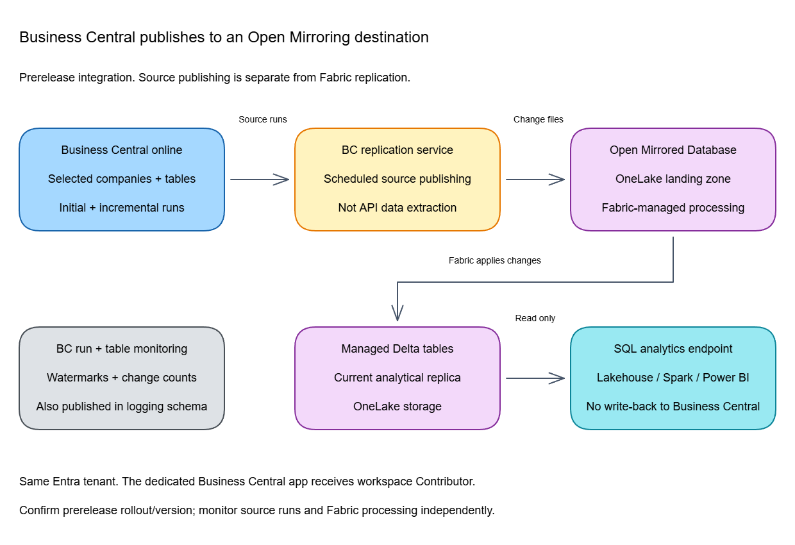
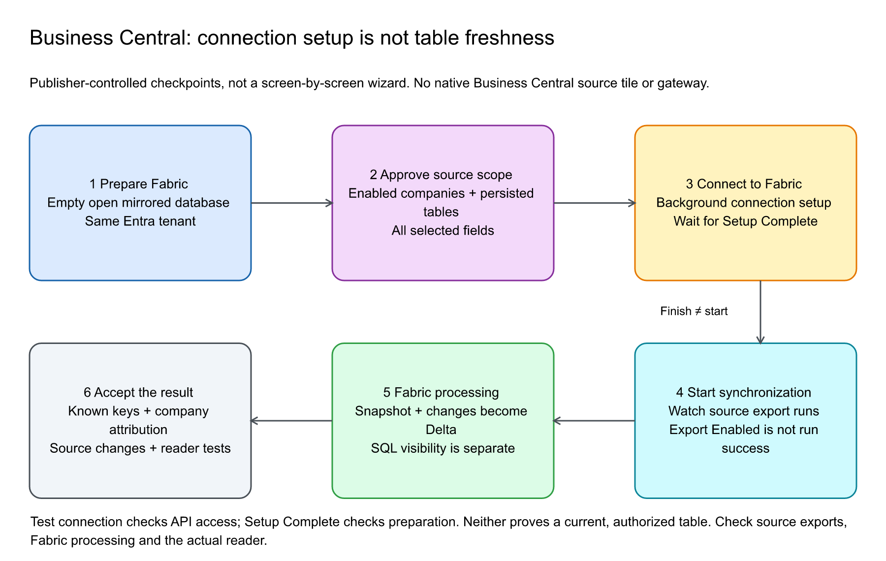

# Chapter 31: Dynamics 365 Business Central Mirroring

> **Part 2: Source-Specific Mirroring Guides**
>
> **Purpose:** Set up Business Central's application-managed Open Mirroring publisher, choose companies and tables, and operate synchronization without confusing source controls with Fabric controls.

**Part index:** [Chapters in Part 2](readme.md)

---

## Overview of the Source System

Business Central's **Microsoft Fabric Mirroring** integration replicates selected business data to a Fabric **open mirrored database**. Its documentation belongs under **Dynamics 365 Business Central administration**, not the normal Fabric Mirroring connector tree.

This is separate from [SAP Business Data Cloud Connect](chapter-29.md) and [Dataverse Link to Fabric](chapter-28.md). The application, source publishing mechanism, Fabric destination, and operating controls are different.

Business Central does not appear as a native source in Fabric's connector picker. Create the Open Mirroring destination in Fabric, then configure the publisher in Business Central. The internal replication service produces an initial snapshot and subsequent changes; it does **not** extract business data through Business Central APIs or consume their API limits.

### Availability: Prerelease Is Not GA

**Reviewed 3 November 2026.** The [setup](https://learn.microsoft.com/en-us/dynamics365/business-central/admin-set-up-fabric-mirroring), overview, management, and monitoring pages call this prerelease and describe a **production-ready preview planned for October 2026**. The [FAQ](https://learn.microsoft.com/en-us/dynamics365/business-central/fabric-faq) still says private preview with public preview expected soon.

Do not infer rollout or GA from the calendar, or from Open Mirroring itself being GA. Confirm availability for the intended Business Central environment. The setup specifies **Business Central online, 2026 release wave 2, v29.0 or later**, while the FAQ qualifies the minimum version as not finally confirmed. This chapter follows the concrete setup baseline without inventing support for older or on-premises deployments.

---

## Mirroring Type and Architecture

- **Fabric type:** Open Mirroring, with a Microsoft product-managed source publisher.
- **Source scope:** Selected persisted AL tables and companies, configured separately for each Business Central environment.
- **Data movement:** Physical replication into OneLake Delta Parquet, not metadata-only access.
- **Consumers:** The automatically created SQL analytics endpoint, Power BI, and supported Lakehouse shortcuts/notebooks.

[](../assets/diagrams/chapter-31/diagram-01.excalidraw.png)
*Figure 31.1: Business Central owns source synchronization; Fabric processes the supplied changes into managed Delta tables.*

The source documentation says synchronization enables change tracking and exposes watermarks. It does not establish a specific SQL Change Tracking/CDC implementation, source retention window, or cross-table snapshot-consistency guarantee. The generic Open Mirroring protocol explains the destination, not every implementation detail of this publisher.

---

## Prerequisites, Permissions, and Connectivity

| Owner | Required preparation |
|---|---|
| **Business Central administrator** | Confirm the documented online/version baseline and rollout; install the **Microsoft Fabric Mirroring** extension from Microsoft Marketplace; enable data encryption; assign **MS Fabric Mirroring - Admin** or equivalent permissions. |
| **Entra administrator** | Create a dedicated app registration and service principal, approve the documented API permission/consent, and arrange secure client-secret storage and rotation. |
| **Fabric administrator** | Provide an active capacity and an existing target workspace in the **same Entra tenant**. The setup user must be **Member or Admin** to add the service principal. |
| **Data owner** | Approve companies and whole-table/all-field replication; choose a small representative pilot and the intended data/logging namespaces. |
| **Identity/network owner** | Permit the documented Fabric API/publishing path and validate **Test connection**. No Business Central-specific private endpoint or gateway recipe is established by these pages. |

The application secret is kept in **encrypted isolated storage** in Business Central. The source app is granted workspace **Contributor** by the assisted setup, which is broader than access to one item. Approve that scope explicitly; do not substitute an assumed item-only permission while claiming to follow the documented procedure.

Source roles are distinct:

| Business Central permission set | Purpose |
|---|---|
| **MS Fabric Mirroring - Admin** | Connection, selection, packages, synchronization controls, and monitoring |
| **MS Fabric Mirroring - Activate** | Activate/deactivate/reapply configuration packages |
| **MS Fabric Mirroring - Read** | Read synchronization overview and details |

The FAQ describes global availability, but that does not override the same-tenant setup requirement or establish every sovereign-cloud/private-network scenario. See the [management guide](https://learn.microsoft.com/en-us/dynamics365/business-central/admin-manage-fabric-export).

### Network and Gateway Boundary

**Gateway documentation reviewed: 4 November 2026.** The [Business Central setup](https://learn.microsoft.com/en-us/dynamics365/business-central/admin-set-up-fabric-mirroring) and [FAQ](https://learn.microsoft.com/en-us/dynamics365/business-central/fabric-faq) describe an application-managed publisher sending snapshots and changes to a Fabric **open mirrored database**. The documented baseline remains **Business Central online v29.0+, same Entra tenant, prerelease**; a gateway does not extend it to an on-premises deployment.

| Question | Documented position |
|---|---|
| **Standard-mode on-premises data gateway?** | **Not part of the documented publisher flow; not required by the setup.** Business Central uses its internal replication service, not a Fabric SQL Server pull connection or personal-mode gateway. |
| **VNet data gateway?** | **Not part of the documented publisher flow.** No Business Central-specific gateway option is published in these setup/FAQ pages; generic connector or Mirroring workload support does not establish one. |
| **Private endpoint recipe?** | **Not documented for this publisher.** Generic [Open Mirroring Private Link support](https://learn.microsoft.com/en-us/fabric/security/security-private-links-overview#mirrored-database) requires the publisher to write through the private route; it does not establish that Business Central can use that route. Do not invent endpoint overrides, a private-network allowlist, or an end-to-end private configuration. |

Use **Test connection** to check the stored credential's Fabric API access, then verify synchronization separately. A successful API test alone is not proof of a private data path or complete data delivery.

---

## Setup Walkthrough

### 1. Register the application

Follow the [Business Central-specific registration procedure](https://learn.microsoft.com/en-us/dynamics365/business-central/admin-set-up-fabric-mirroring#register-an-application-in-microsoft-entra-id-for-business-central-data-mirroring).

1. In **Microsoft Entra ID > App registrations > New registration**, create a dedicated application. Use **Single tenant only** for this same-tenant deployment.
2. Set the redirect platform to **Single-Page application (SPA)** and register the Business Central web-client base URL followed by `/OAuthLanding.htm`, for example `https://businesscentral.dynamics.com/<tenant-id>/<environment>/OAuthLanding.htm`. Use the intended environment's actual URL. A token-acquisition error can identify the exact redirect URI that must be registered.
3. Register the application and record its **Application (client) ID**.
4. Under **API permissions**, add **Power BI Service > Delegated permissions > Workspace.ReadWrite.All**, then obtain tenant-admin consent.
5. Under **Certificates & secrets > Client secrets**, create a secret. Capture its **value**, not the secret's identifier, before leaving the page; keep it in the approved secret-handling process.
6. On the registration's **Overview**, follow **Managed application in local directory** to its enterprise application and copy that object's **Object ID**. This service-principal object ID is Business Central's **Principal ID**, not the client ID or the application registration's object ID.
7. Record credential ownership/expiry without placing secrets in this runbook, screenshots, configuration packages, or support messages.

The delegated permission is the registration recipe published by the Business Central team. It is not a universal application-permission prescription for every Fabric publisher; runtime workspace access is separately granted below.

### 2. Prepare the Fabric destination

1. Open the intended capacity-backed Fabric workspace.
2. Create a **Mirrored Database**, name it, and select **Open Mirroring** as its source, following the newer Business Central setup procedure.
3. Wait for provisioning and confirm the destination item and SQL analytics endpoint.

This is not a Warehouse or a Business Central database connection created in Fabric. Preserve the empty target for the source publisher; do not populate its landing zone with unrelated sample files.

### 3. Connect from Business Central

1. Use **Search (Alt+Q) > Assisted Setup > Connect to Microsoft Fabric**.
2. On **Workspace API Credentials**, enter **Client ID**, **Client Secret**, and **Principal ID** from the approved registration.
3. On **Fabric Workspace**, select the prepared workspace.
4. On **Grant Workspace Access**, select **Add to workspace**. The service principal receives **Contributor**; the grant is needed once per workspace.
5. On **Fabric Open Mirroring Database**, select the prepared destination.
6. On **Synchronization Options**, choose the interval, then **Select companies** and **Select tables**.
7. Approve the **Microsoft Fabric Mirroring - Open Mirroring** privacy notice as the administrator. Connection/synchronization cannot begin without that approval.
8. Select **Connect to Fabric** and finish the asynchronous setup. Use **Start synchronization** when the approved scope is ready.

### 4. Verify setup and a representative table

Open **Microsoft Fabric Mirroring Setup** and verify:

| Field | Check |
|---|---|
| **Fabric Workspace Name / Fabric Open Mirroring Name** | Intended destination, not a similarly named item |
| **Fabric Data Namespace** | Default `BusinessCentral`; approve before setup completes |
| **Fabric Logging Namespace** | Default `BusinessCentral_log`; operational data also becomes an analytical access surface |
| **Setup Complete / Export Enabled** | Setup and publishing state; neither alone proves that all tables are current |

Namespace changes are allowed only before setup completes. Run **Test connection**, inspect initial source runs, and query a known target row through the SQL analytics endpoint using the generated entity name.

For an approved pilot table, replace both placeholders with the namespace and entity shown in your endpoint:

```sql
SELECT TOP (10) *
FROM [<data_namespace>].[<fabric_entity_name>];
```

The default data namespace is `BusinessCentral`; do not guess the table's generated name or company layout from its Business Central display caption.

For validation, use a sanctioned test company/table. Compare initial data, then an insert, update, and explicit deletion made through normal Business Central operations. Check company attribution before designing cross-company joins: the documentation does not establish a universal target company-key/naming convention.

**Screenshots:** the linked Business Central setup article does not currently supply mirroring-wizard screenshots. Figure 31.1 is this book's explanatory architecture diagram, not a capture of a released Business Central setup screen.



*Figure 31.2: Separate connection preparation, source exports, Fabric processing and authorized query results. **Finish**, **Setup Complete**, **Export Enabled** and current table data are not interchangeable acceptance signals. Original illustration for this book, not a Microsoft screenshot or wizard mock-up; based on the [Business Central setup](https://learn.microsoft.com/en-us/dynamics365/business-central/admin-set-up-fabric-mirroring#confirm-setup-and-start-synchronization) and [monitoring guide](https://learn.microsoft.com/en-us/dynamics365/business-central/admin-monitor-fabric-export), reviewed 9 November 2026. This is a conceptual checkpoint sequence, not a replacement for the current identity/setup procedure. [Editable Excalidraw](../assets/diagrams/chapter-31/walkthrough-publisher-acceptance-sequence.excalidraw) · [SVG](../assets/diagrams/chapter-31/walkthrough-publisher-acceptance-sequence.svg).*

---

## Selecting Companies, Tables, and Configuration Packages

- **Configuration > Companies > Add company:** select the required companies. Clearing **Enabled** skips a company without removing its configuration.
- **Configuration > Tables > Add table:** select persisted AL tables, including standard and extension tables. Selected tables include **all fields**; field projection is unsupported.
- **DataPerCompany** tables synchronize for each enabled company; shared tables synchronize once.
- Inspect **Fabric entity name** and **Fabric Schema Type**, including the distinction between data and logging schema.
- The documented limit is **1,000 tables**; the FAQ calls this **per tenant**. Confirm how the service counts multi-company/environment expansions rather than assuming 1,000 destinations per company.

The built-in **MS-STD** configuration package contains **256 standard tables**. **Activate** adds its selections; **Deactivate** retains tables still selected manually or by another active package. **Reapply** adds changed package selections but does not remove stale ones. Deactivate/reactivate for full alignment, review the effects first, and stay within the table limit. Packages use JSON; deactivate a package before deleting it.

The persisted-table scope is not a promise that computed **FlowFields**, virtual tables, or temporary in-memory data are exported as ordinary stored columns/tables. The mirroring pages do not provide a complete AL type/BLOB/Media mapping or unavailable-system-table matrix. Test representative fields and follow [AL storage semantics](https://learn.microsoft.com/en-us/dynamics365/business-central/dev-itpro/developer/devenv-flowfields), not assumptions based on a table's appearance in the UI.

---

## Monitoring, Scheduling, and Recovery

Use **Microsoft Fabric Mirroring Setup > Monitoring > Fabric Synchronization Overview**, then **Details**. Source-side detail includes company/table/entity, initial versus incremental run, inserted/updated/deleted counts, start/end watermarks, and errors. Zero-change detail rows are hidden by default; use **Show rows with no changes**. Refresh the page for asynchronous progress.

The same operational information is replicated into the logging namespace. Fabric's item-level status and [Chapter 5](../Part%201%20-%20Concepts%20and%20Architecture/chapter-05.md) diagnostics cover destination processing. Source completion is not proof that SQL endpoint metadata is already current.

| Business Central control | Effect |
|---|---|
| **Minutes Between Exports** | Sets the source run interval; changes apply on the next run. No universal numeric minimum/default is documented. |
| **Max Consecutive Failed Runs** | Range 1-5, default 2. Fix the error before restarting automatically stopped synchronization. |
| **Start synchronization** | Enables tracking and recurring work; does not start an overlapping active run. |
| **Stop synchronization** | Cancels current work and pauses recurrence while preserving connection/synchronization state. |
| **Reset** | Cancels work, removes tenant mirroring resources, clears watermarks, and deletes run/detail records. Treat as destructive reconfiguration. |

Duplicate setup/enable requests are blocked for up to **15 minutes** unless the previous setup has completed. The destination cannot change while **Export Enabled** is selected; reset clears the connection for reconfiguration.

**Business Central Stop/Start is not Fabric Stop/Start.** Do not restart the Fabric mirrored database as a routine source refresh, manually delete producer-owned landing folders, or reset merely to clear an error. Generic Open Mirroring recovery in [Chapter 37](../Part%203%20-%20Open%20Mirroring/chapter-37.md) requires publisher coordination and does not establish a Business Central-specific single-table repair action.

Schema-change handling is explicitly undocumented in the current FAQ. Plan extension upgrades, type/key changes, and recovery with the source owner; do not promise automatic reseeding from the generic landing-zone contract.

---

## Security and Billing

Business Central permission sets, company restrictions, and security filters are **not documented as automatically propagated into Fabric**. Design and verify Fabric workspace/item, OneLake, SQL, and semantic-model access separately. All-field replication and the logging namespace require their own data-owner approval.

The FAQ states **no additional Business Central licensing/consumption charge for mirroring**. That does not make the underlying Business Central environment or Fabric capacity free. Because the destination is an open mirrored database, normal core replication-compute and eligible **1 TB per purchased CU** replica-storage rules apply; queries, direct OneLake requests, storage overage, paused-capacity storage, and optional extensions remain separate. See [Chapter 10](../Part%201%20-%20Concepts%20and%20Architecture/chapter-10.md).

Incremental changes typically synchronize within minutes, while initial history takes longer. The configured interval, source activity, processing, and consumer metadata affect freshness. No source-specific latency SLA, change-retention/replay window, or unlimited-throughput promise is established. Replicated logical deletions also do not mean immediate physical erasure from retained Delta files.

---

## Documented Pitfalls

| Symptom | First safe check |
|---|---|
| Setup unavailable | Confirm rollout and documented version; do not infer GA from the planned October date |
| Connection or workspace lookup fails | Client-secret value/expiry, client versus service-principal IDs, consent, same tenant, workspace role, and **Test connection** |
| Token acquisition reports a redirect mismatch | Register the exact environment-specific `/OAuthLanding.htm` URI using the documented SPA platform |
| Open mirrored database lookup is empty | Select the workspace first, then confirm that it contains a provisioned Open Mirroring destination visible to the setup user |
| Client secret cannot be stored | Enable Business Central data encryption, then enter the secret value again |
| **Add to workspace** reports an existing member | Inspect the service principal's current role; the assisted setup expects to add it as Contributor |
| Setup appears stalled | Asynchronous run state, privacy approval, and duplicate-request protection; do not repeatedly reset |
| Table/company missing | Selection, company **Enabled**, package activation, per-company/shared storage, and the 1,000-table scope |
| Synchronization stops after failures | Source run/detail error and **Max Consecutive Failed Runs**; resolve the cause before **Start synchronization** |
| Source succeeded but SQL is stale | Separate source publication, Fabric processing, and SQL metadata sync |
| Schema changed after extension upgrade | The FAQ does not document automatic recovery; preserve evidence and confirm the supported repair with the Business Central team |

The linked developer Fabric-export API page returned **404** during review. The source documentation states API availability, but this chapter does not invent endpoint schemas. Use the verified [monitoring procedure](https://learn.microsoft.com/en-us/dynamics365/business-central/admin-monitor-fabric-export) and sanitize logs/credentials before escalation.

---

## Summary

Business Central supplies the source publisher for an Open Mirroring destination. Its company/table selection, run scheduling, monitoring, credentials, and lifecycle live in the application. Preserve its prerelease qualifications and administer Fabric analytical access independently.

**References, reviewed 3 November 2026:** [setup](https://learn.microsoft.com/en-us/dynamics365/business-central/admin-set-up-fabric-mirroring), [overview](https://learn.microsoft.com/en-us/dynamics365/business-central/admin-fabric), [management](https://learn.microsoft.com/en-us/dynamics365/business-central/admin-manage-fabric-export), [monitoring](https://learn.microsoft.com/en-us/dynamics365/business-central/admin-monitor-fabric-export), and [FAQ](https://learn.microsoft.com/en-us/dynamics365/business-central/fabric-faq).

**Contents:** [Table of Contents](../index.md) | **Previous:** [Chapter 30: Google Lakehouse Runtime Catalog Mirroring](chapter-30.md) | **Next:** [Chapter 32: What is Open Mirroring and Why It's Useful](../Part%203%20-%20Open%20Mirroring/chapter-32.md)
