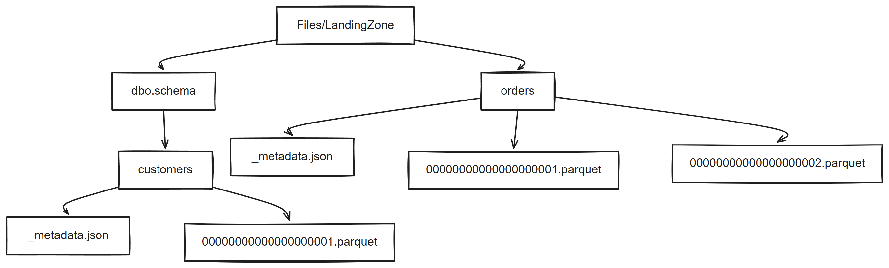
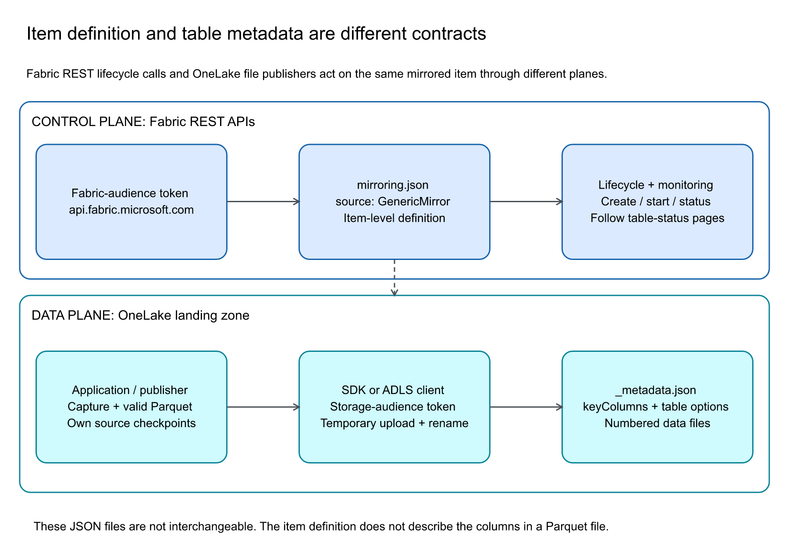

# Chapter 34: Code Samples and the Fabric Toolbox

> **Part 3: Open Mirroring**
>
> **Purpose:** Use this chapter to find official samples, APIs, SDKs, and community tools for an Open Mirroring implementation.

**Part index:** [Chapters in Part 3](readme.md)

---

## Overview

Microsoft provides code samples, tutorials, REST APIs, and SDKs for Open Mirroring. This chapter identifies the main resources and where each one fits.

[](../assets/diagrams/chapter-34/diagram-01.excalidraw.png)
*Figure 34.1: Developer toolchain for Open Mirroring implementations*

---

## Microsoft-Published Python SDK Sample

Microsoft publishes the [Open Mirroring Python SDK](https://github.com/microsoft/fabric-toolbox/tree/main/tools/OpenMirroringPythonSDK) in the Fabric Toolbox repository.

The [repository support statement](https://github.com/microsoft/fabric-toolbox#readme) describes its assets as examples with best-effort issue support. Treat this SDK as a starting point, not a production reliability guarantee or a substitute for the public landing-zone contract.

The `OpenMirroringClient` demonstrates how to:

- authenticate to OneLake with a service principal
- create schema and table folders
- create per-table `_metadata.json`
- determine the next sequential file name
- upload through a temporary name and atomic rename
- remove a table folder
- read database and table monitoring status

Review the [implementation](https://github.com/microsoft/fabric-toolbox/blob/main/tools/OpenMirroringPythonSDK/openmirroring_operations.py) before adopting it. It uses a direct REST rename and reads monitoring JSON files in OneLake; those are sample implementation choices. Its next-file lookup is not a durable sequence allocator, and its rename helper prints failures rather than raising them. Add explicit error handling, immutable publication, crash-safe batch assignments, and retry tests. Prefer the documented monitoring REST APIs for operational automation.

The separate [Open Mirroring samples](https://github.com/microsoft/fabric-toolbox/tree/main/samples/open-mirroring) are explicitly proof-of-concept code, not production-ready connectors. The collection's `GenericMirroring` project includes SQL Server Change Tracking, Excel, CSV, Access, and SharePoint Lists examples.

The dedicated [SDK walkthrough in Chapter 38](chapter-38.md) explains the actual methods, an initial-load and change-file example, and the limitations to address before connecting source checkpoints to publication. The SDK is a publishing helper, not a source connector: it does not capture CDC, generate Parquet, or provide a durable replication scheduler.

---

## Microsoft Learn Tutorials

Microsoft Learn provides structured tutorials for Fabric Mirroring:

### Recommended References

1. [Fabric Mirroring overview](https://learn.microsoft.com/en-us/fabric/mirroring/overview)
2. [Open Mirroring overview](https://learn.microsoft.com/en-us/fabric/mirroring/open-mirroring)
3. [Open Mirroring tutorial](https://learn.microsoft.com/en-us/fabric/mirroring/open-mirroring-tutorial)
4. [Landing-zone format](https://learn.microsoft.com/en-us/fabric/mirroring/open-mirroring-landing-zone-format)
5. [Publication, detection, recovery, and schema best practices](https://learn.microsoft.com/en-us/fabric/mirroring/open-mirroring-best-practices)
6. [Open Mirroring FAQ](https://learn.microsoft.com/en-us/fabric/mirroring/open-mirroring-faq)
7. [Partner ecosystem](https://learn.microsoft.com/en-us/fabric/mirroring/open-mirroring-partners-ecosystem)

---

## Open-Source Solution Directory

The following chapters examine real implementation code, not just articles or product announcements. Each separates implemented behaviour from work needed for a production deployment.

| Project or family | Source or role | Read next |
|---|---|---|
| Microsoft Python SDK | Reusable OneLake publication helper | [Chapter 38](chapter-38.md) |
| GenericMirroring | SQL Server Change Tracking, Excel, CSV, Access, SharePoint Lists | [Chapter 39](chapter-39.md) |
| Toolbox notebooks | Excel, SharePoint files/lists, MySQL trigger capture, Snowflake streams | [Chapter 40](chapter-40.md) |
| MariaDBMirroring | MariaDB binlog, MaxScale, Kafka and Python; runtime licence caveat | [Chapter 41](chapter-41.md) |
| FabricBQSync | BigQuery extraction through Fabric Spark | [Chapter 42](chapter-42.md) |
| MongoDB_Fabric_Mirroring | MongoDB initial scan and change streams | [Chapter 43](chapter-43.md) |
| mirror_postgres | PostgreSQL, Debezium and Kafka | [Chapter 44](chapter-44.md) |
| impulse_sync | PostgreSQL query-based incremental extraction | [Chapter 45](chapter-45.md) |
| fabric-mirroring-synapse | Synapse dedicated SQL pool snapshot/diff and append-only extraction | [Chapter 46](chapter-46.md) |
| File and test tools | Streamlit Excel publisher, synthetic CRUD, sink tests and benchmarking | [Chapter 47](chapter-47.md) |

Use [Chapter 48](chapter-48.md) for the source comparison, shared lessons, and a separate source-to-blog table where matching public producer code was not found. GitHub visibility alone is not an open-source licence. Conversely, the author's confirmation of customer reuse for the Synapse project is recorded explicitly rather than excluding that implementation.

Do not count archived Toolbox predecessors as new solutions. Its GenericMirroring TODO entries for Synapse Gen2, BigQuery, Redshift and ODBC are not implemented connectors; the separate Synapse and FabricBQSync projects above have their own codebases.

---

## Fabric REST API Reference

Use the [item APIs](https://learn.microsoft.com/en-us/rest/api/fabric/mirroreddatabase/items) for lifecycle operations and the [mirroring APIs](https://learn.microsoft.com/en-us/rest/api/fabric/mirroreddatabase/mirroring) for replication control and monitoring.

All paths below are relative to `https://api.fabric.microsoft.com/v1/workspaces/{workspaceId}`:

| Method and path | Purpose |
|---|---|
| `POST /mirroredDatabases` | Create an item using its definition |
| `GET /mirroredDatabases` | List items |
| `GET`, `PATCH`, `DELETE /mirroredDatabases/{id}` | Read, rename/update item metadata, or delete an item |
| `POST /mirroredDatabases/{id}/getDefinition` | Read the replication definition |
| `POST /mirroredDatabases/{id}/updateDefinition` | Update the replication definition |
| `POST /mirroredDatabases/{id}/startMirroring` | Start replication |
| `POST /mirroredDatabases/{id}/stopMirroring` | Stop replication |
| `POST /mirroredDatabases/{id}/getMirroringStatus` | Get database status |
| `POST /mirroredDatabases/{id}/getTablesMirroringStatus` | Get paginated table status and metrics |

Open Mirroring uses `GenericMirror` as its source type and does not require a source connection ID. Its `mirroring.json` item definition is distinct from the per-table `_metadata.json` files in OneLake. See the [item definition](https://learn.microsoft.com/en-us/rest/api/fabric/articles/item-management/definitions/mirrored-database-definition).


*Figure 34.2: Item definitions, table metadata, token audiences and publishing helpers occupy different parts of the toolchain. Explanatory illustration by this book, based on the [mirrored-database item definition](https://learn.microsoft.com/en-us/rest/api/fabric/articles/item-management/definitions/mirrored-database-definition), [OneLake API access](https://learn.microsoft.com/en-us/fabric/onelake/onelake-access-api), and [pinned SDK implementation](https://github.com/microsoft/fabric-toolbox/blob/b4636ef9cb3d6a26863ac5c93480b6c98e9df5a1/tools/OpenMirroringPythonSDK/openmirroring_operations.py); not an official Microsoft diagram. [Editable Excalidraw source](../assets/diagrams/chapter-34/walkthrough-item-versus-table.excalidraw).*

For example, the decoded `mirroring.json` payload for an Open Mirrored Database can be:

```json
{
  "properties": {
    "source": {
      "type": "GenericMirror",
      "typeProperties": {}
    },
    "target": {
      "type": "MountedRelationalDatabase",
      "typeProperties": {
        "defaultSchema": "dbo",
        "format": "Delta"
      }
    }
  }
}
```

Base64-encode this JSON locally and supply it as the `InlineBase64` payload of the `mirroring.json` definition part in the create request. Do not upload it as table metadata. The [create API](https://learn.microsoft.com/en-us/rest/api/fabric/mirroreddatabase/items/create-mirrored-database) requires a workspace Contributor role and returns HTTP 201 on success. Poll mirroring status separately because SQL endpoint provisioning can still be in progress.

These APIs support service principals and managed identities, subject to tenant settings and item permissions. Starting requires mirrored-item read and write permissions; status calls require read permission. Database and table status are separate: the database can return `Running`, while a table returns `Snapshotting`, `Replicating`, or `Failed`. Follow pagination and honour `Retry-After` on HTTP 429 responses. Starting is not supported while database status is `Initializing`.

---

## Recommended Development Tools

| Tool | Purpose |
|---|---|
| **Azure Storage Explorer** | Browse and inspect OneLake landing zone files and Delta table files |
| **DBeaver** | Query the SQL analytics endpoint with a free SQL client |
| **VS Code + MSSQL extension / SSMS** | Query the SQL analytics endpoint with supported Microsoft SQL tools |
| **VS Code + Jupyter extension** | Develop and test Python open mirroring pipelines locally |
| **Postman / Bruno** | Test Fabric REST API calls interactively |
| **REST client or Python `requests`** | Script Fabric item lifecycle and monitoring operations |

[Azure Data Studio is retired](https://learn.microsoft.com/en-us/sql/tools/whats-happening-azure-data-studio?view=sql-server-ver17) and no longer receives security fixes. Use VS Code with the MSSQL extension or SSMS instead.

---

## Python Package Ecosystem

The following Python packages are commonly used in open mirroring implementations:

| Package | Purpose |
|---|---|
| `azure-identity` | Microsoft Entra ID authentication (service principal, managed identity) |
| `azure-storage-file-datalake` | ADLS Gen2 / OneLake file system operations |
| `pyarrow` | In-memory columnar data and Parquet file I/O |
| `pandas` | Data manipulation and CSV/Excel reading |
| `sqlalchemy` | Source database connections (SQL Server, PostgreSQL, MySQL) |
| `requests` | HTTP calls to Fabric control-plane APIs and the OneLake rename endpoint |
| `openpyxl` | Excel workbook reading through pandas |
| `psycopg2` | PostgreSQL extraction in the Chapter 35 example |

Publishers write Parquet or delimited text, not Delta transaction logs. A Delta-writing library is not required for Open Mirroring, and must not be used to modify Fabric-managed mirrored tables.

Install the core open mirroring dependencies:

```bash
pip install azure-identity azure-storage-file-datalake pyarrow pandas requests
```

---

## Summary

Start with Microsoft Learn and the Microsoft-published samples, harden publication and recovery for your workload, and use the REST APIs for lifecycle automation and monitoring.

**Contents:** [Table of Contents](../index.md) | **Previous:** [Chapter 33: Setting Up Open Mirroring: Step-by-Step Configuration](chapter-33.md) | **Next:** [Chapter 35: Use Cases and Examples](chapter-35.md)
