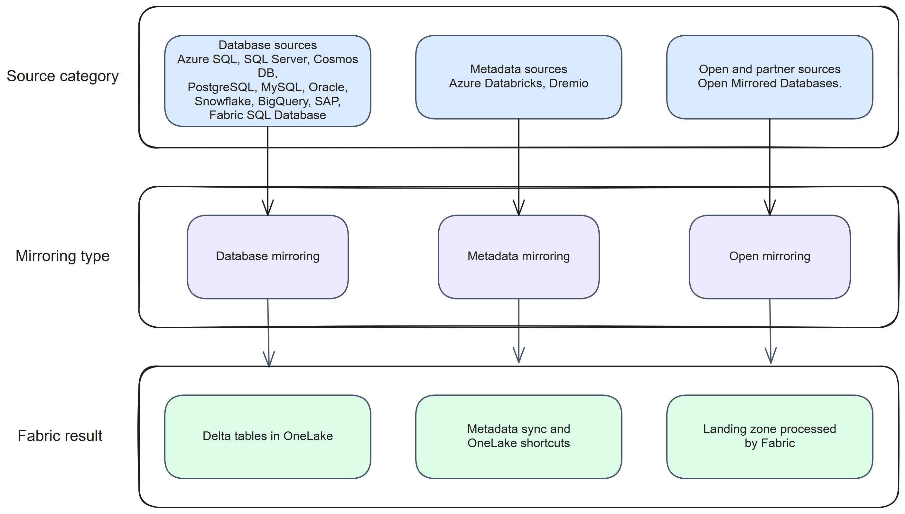

# Fabric Mirroring: A Practical Guide

This guide covers the main mirroring patterns in Microsoft Fabric, source-specific setup, and open mirroring implementations. Use Part 1 for concepts and architecture, Part 2 for source guides and related application integrations, and Part 3 for open mirroring and partner-led integrations.

Each part has its own **chapter index** in a separate `readme.md`, listing only the chapters in that part. Every chapter links back to its part's index.

**FabCon September 2026:** the [announcement coverage record](history.md#8-october-2026-fabcon-announcement-coverage) links each relevant announcement to its chapter and distinguishes GA, Preview, Coming Soon, and unresolved documentation differences.

For eligible database and open mirrored replicas, Fabric includes 1 TB of free mirrored storage per purchased CU. An F2 capacity includes 2 TB, an F4 capacity includes 4 TB, and the allowance scales with capacity. This is not a blanket storage allowance for catalog shortcuts or every application integration; check the source guide's billing boundaries.

**Latest source additions:** [Chapter 30: Google Lakehouse Runtime Catalog](Part%202-%20Source-Specific%20Mirroring%20Guides/chapter-30.md) and [Chapter 31: Business Central Mirroring](Part%202-%20Source-Specific%20Mirroring%20Guides/chapter-31.md). SAP BDC remains a separate [Chapter 29](Part%202-%20Source-Specific%20Mirroring%20Guides/chapter-29.md). The current edition has 48 consecutively numbered chapters.

* Database mirroring copies source data into Delta tables in OneLake.
* Metadata mirroring uses catalog or connection integrations and OneLake shortcuts to access source data in place.
* Open mirroring accepts developer-defined or partner-defined change data in a landing zone that Fabric processes.

## Table of Contents

### Part 1: Concepts and Architecture

**Part index:** [Chapters in Part 1](Part%201%20-%20Concepts%20and%20Architecture/readme.md)

* [Chapter 1: Introduction to Fabric Mirroring](Part%201%20-%20Concepts%20and%20Architecture/chapter-01.md)
* [Chapter 2: Types of Mirroring in Fabric](Part%201%20-%20Concepts%20and%20Architecture/chapter-02.md)
* [Chapter 3: Methods of Mirroring: Push, Pull or Polling, and Shortcuts](Part%201%20-%20Concepts%20and%20Architecture/chapter-03.md)
* [Chapter 4: The Anatomy of a Mirrored Database](Part%201%20-%20Concepts%20and%20Architecture/chapter-04.md)
* [Chapter 5: Monitoring a Mirrored Database](Part%201%20-%20Concepts%20and%20Architecture/chapter-05.md)
* [Chapter 6: Using the Fabric REST API](Part%201%20-%20Concepts%20and%20Architecture/chapter-06.md)
* [Chapter 7: Deploying a Mirrored Database Using CI/CD](Part%201%20-%20Concepts%20and%20Architecture/chapter-07.md)
* [Chapter 8: Using a Mirrored Database](Part%201%20-%20Concepts%20and%20Architecture/chapter-08.md)
* [Chapter 9: Extended Capabilities](Part%201%20-%20Concepts%20and%20Architecture/chapter-09.md)
* [Chapter 10: Billing and Capacity Management](Part%201%20-%20Concepts%20and%20Architecture/chapter-10.md)

### Part 2: Source-Specific Mirroring Guides

**Part index:** [Chapters in Part 2](Part%202-%20Source-Specific%20Mirroring%20Guides/readme.md)

**Start with the source, then its setup walkthrough.** Each guide takes you from source preparation and permissions through the Fabric connection, initial validation and operational troubleshooting. Do the source-administrator steps before opening the Fabric wizard; a successful sign-in does not prove that change capture or storage access is configured.

**Gateway review, 4 November 2026:** use the [source-by-source VNet and standard-mode on-premises gateway reference](appendix.md#gateway-support-by-source) before choosing a private-network design. It separates documented support from unpublished procedures and distinguishes gateway connection traffic from ongoing replication. The [release/operational baseline](appendix.md#gateway-releases-and-operational-baseline) covers supported versions, sign-in updates, subnet/identity requirements, diagnostics, and costs.

#### Setup and Troubleshooting Directory

Each setup link starts with the source-administrator work, not just the Fabric wizard. The common-problems sections distinguish documented behavior, public reports, and access-limited research leads.

| Source chapter | Practical setup | Common problems |
|---|---|---|
| [11: Azure SQL Database](Part%202-%20Source-Specific%20Mirroring%20Guides/chapter-11.md) | [Identity, SQL grants, networking, and first replication](Part%202-%20Source-Specific%20Mirroring%20Guides/chapter-11.md#setup-walkthrough) | [Issues and pitfalls](Part%202-%20Source-Specific%20Mirroring%20Guides/chapter-11.md#public-issues-and-common-pitfalls) |
| [12: Azure SQL Managed Instance](Part%202-%20Source-Specific%20Mirroring%20Guides/chapter-12.md) | [Choose the update-policy branch before configuring](Part%202-%20Source-Specific%20Mirroring%20Guides/chapter-12.md#setup-walkthrough) | [Issues and pitfalls](Part%202-%20Source-Specific%20Mirroring%20Guides/chapter-12.md#public-issues-and-common-pitfalls) |
| [13: Azure Cosmos DB](Part%202-%20Source-Specific%20Mirroring%20Guides/chapter-13.md) | [Continuous backup, credentials, and network path](Part%202-%20Source-Specific%20Mirroring%20Guides/chapter-13.md#setup-walkthrough) | [Issues and pitfalls](Part%202-%20Source-Specific%20Mirroring%20Guides/chapter-13.md#public-issues-and-common-pitfalls) |
| [14: Azure Databricks / Unity Catalog](Part%202-%20Source-Specific%20Mirroring%20Guides/chapter-14.md) | [External data access, UC grants, and separate ADLS access](Part%202-%20Source-Specific%20Mirroring%20Guides/chapter-14.md#setup-walkthrough) | [Issues and pitfalls](Part%202-%20Source-Specific%20Mirroring%20Guides/chapter-14.md#public-issues-and-common-pitfalls) |
| [15: Azure Monitor](Part%202-%20Source-Specific%20Mirroring%20Guides/chapter-15.md) | [Workspace, source identity, and table permissions](Part%202-%20Source-Specific%20Mirroring%20Guides/chapter-15.md#setup-walkthrough) | [Issues and pitfalls](Part%202-%20Source-Specific%20Mirroring%20Guides/chapter-15.md#public-issues-and-common-pitfalls) |
| [16: Google BigQuery](Part%202-%20Source-Specific%20Mirroring%20Guides/chapter-16.md) | [APIs, IAM, staging bucket, and source change history](Part%202-%20Source-Specific%20Mirroring%20Guides/chapter-16.md#setup-walkthrough) | [Issues and pitfalls](Part%202-%20Source-Specific%20Mirroring%20Guides/chapter-16.md#public-issues-and-common-pitfalls) |
| [17: Oracle](Part%202-%20Source-Specific%20Mirroring%20Guides/chapter-17.md) | [Archive logs, supplemental logging, grants, and gateway](Part%202-%20Source-Specific%20Mirroring%20Guides/chapter-17.md#setup-walkthrough) | [Issues and pitfalls](Part%202-%20Source-Specific%20Mirroring%20Guides/chapter-17.md#public-issues-and-common-pitfalls) |
| [18: PostgreSQL](Part%202-%20Source-Specific%20Mirroring%20Guides/chapter-18.md) | [Server parameters, identity, ownership, and replica identity](Part%202-%20Source-Specific%20Mirroring%20Guides/chapter-18.md#setup-walkthrough) | [Issues and pitfalls](Part%202-%20Source-Specific%20Mirroring%20Guides/chapter-18.md#public-issues-and-common-pitfalls) |
| [19: MySQL](Part%202-%20Source-Specific%20Mirroring%20Guides/chapter-19.md) | [Binlogs, UAMI, connection grants, and table selection](Part%202-%20Source-Specific%20Mirroring%20Guides/chapter-19.md#setup-walkthrough) | [Issues and pitfalls](Part%202-%20Source-Specific%20Mirroring%20Guides/chapter-19.md#public-issues-and-common-pitfalls) |
| [20: SAP](Part%202-%20Source-Specific%20Mirroring%20Guides/chapter-20.md) | [Extraction-route prerequisites, ADLS, and the Fabric mirror](Part%202-%20Source-Specific%20Mirroring%20Guides/chapter-20.md#setup-walkthrough) | [Issues and pitfalls](Part%202-%20Source-Specific%20Mirroring%20Guides/chapter-20.md#public-issues-and-common-pitfalls) |
| [21: SharePoint List](Part%202-%20Source-Specific%20Mirroring%20Guides/chapter-21.md) | [Site access, native connector, and supported lists](Part%202-%20Source-Specific%20Mirroring%20Guides/chapter-21.md#setup-walkthrough) | [Issues and pitfalls](Part%202-%20Source-Specific%20Mirroring%20Guides/chapter-21.md#public-issues-and-common-pitfalls) |
| [22: Snowflake](Part%202-%20Source-Specific%20Mirroring%20Guides/chapter-22.md) | [Runtime role, change tracking, retention, and Iceberg branch](Part%202-%20Source-Specific%20Mirroring%20Guides/chapter-22.md#setup-walkthrough) | [Issues and pitfalls](Part%202-%20Source-Specific%20Mirroring%20Guides/chapter-22.md#public-issues-and-common-pitfalls) |
| [23: SQL Server 2016-2022](Part%202-%20Source-Specific%20Mirroring%20Guides/chapter-23.md) | [SQL Agent, CDC, setup/runtime permissions, and gateway](Part%202-%20Source-Specific%20Mirroring%20Guides/chapter-23.md#setup-walkthrough) | [Issues and pitfalls](Part%202-%20Source-Specific%20Mirroring%20Guides/chapter-23.md#public-issues-and-common-pitfalls) |
| [24: SQL Server 2025](Part%202-%20Source-Specific%20Mirroring%20Guides/chapter-24.md) | [Azure Arc, primary identity, SQL grants, and network paths](Part%202-%20Source-Specific%20Mirroring%20Guides/chapter-24.md#setup-walkthrough) | [Issues and pitfalls](Part%202-%20Source-Specific%20Mirroring%20Guides/chapter-24.md#public-issues-and-common-pitfalls) |
| [25: Fabric SQL Database](Part%202-%20Source-Specific%20Mirroring%20Guides/chapter-25.md) | [Automatic mirroring, permissions, and both query surfaces](Part%202-%20Source-Specific%20Mirroring%20Guides/chapter-25.md#setup-walkthrough) | [Issues and pitfalls](Part%202-%20Source-Specific%20Mirroring%20Guides/chapter-25.md#public-issues-and-common-pitfalls) |
| [26: Dremio Catalog](Part%202-%20Source-Specific%20Mirroring%20Guides/chapter-26.md) | [Catalog authorization and storage credential vending](Part%202-%20Source-Specific%20Mirroring%20Guides/chapter-26.md#setup-walkthrough) | [Issues and pitfalls](Part%202-%20Source-Specific%20Mirroring%20Guides/chapter-26.md#public-issues-and-common-pitfalls) |
| [27: AWS Glue Catalog](Part%202-%20Source-Specific%20Mirroring%20Guides/chapter-27.md) | [Glue/Lake Formation grants and S3 reads](Part%202-%20Source-Specific%20Mirroring%20Guides/chapter-27.md#setup-walkthrough) | [Issues and pitfalls](Part%202-%20Source-Specific%20Mirroring%20Guides/chapter-27.md#public-issues-and-common-pitfalls) |
| [28: Dataverse Link to Microsoft Fabric](Part%202-%20Source-Specific%20Mirroring%20Guides/chapter-28.md) | [Source preparation, identity, tables, and linked Lakehouse](Part%202-%20Source-Specific%20Mirroring%20Guides/chapter-28.md#setup-walkthrough) | [Troubleshooting](Part%202-%20Source-Specific%20Mirroring%20Guides/chapter-28.md#troubleshooting) |
| [29: SAP Business Data Cloud Connect for Microsoft Fabric](Part%202-%20Source-Specific%20Mirroring%20Guides/chapter-29.md) | [Availability and readiness gates](Part%202-%20Source-Specific%20Mirroring%20Guides/chapter-29.md#readiness-checklist--not-an-executable-setup-procedure) | [Common misidentifications](Part%202-%20Source-Specific%20Mirroring%20Guides/chapter-29.md#troubleshooting-and-common-misidentifications) |
| [30: Google Lakehouse Runtime Catalog](Part%202-%20Source-Specific%20Mirroring%20Guides/chapter-30.md) | [Federation, runtime catalog, and GCS permissions](Part%202-%20Source-Specific%20Mirroring%20Guides/chapter-30.md#setup-walkthrough) | [Issues and troubleshooting](Part%202-%20Source-Specific%20Mirroring%20Guides/chapter-30.md#public-issues-and-troubleshooting) |
| [31: Dynamics 365 Business Central Mirroring](Part%202-%20Source-Specific%20Mirroring%20Guides/chapter-31.md) | [Application registration, Open Mirroring, companies, and tables](Part%202-%20Source-Specific%20Mirroring%20Guides/chapter-31.md#setup-walkthrough) | [Documented pitfalls](Part%202-%20Source-Specific%20Mirroring%20Guides/chapter-31.md#documented-pitfalls) |

> **Note:** Chapters 14, 15, 26, 27, and 30 cover metadata mirroring. Chapters 21 and 22 also describe shortcut-backed paths alongside replicated tables. Chapters 15, 19, 26, 27, and 30 cover Public Preview sources. Google Lakehouse Runtime has its own chapter and is separate from both AWS Glue and BigQuery.

Chapters 28 and 29 cover related source-managed integrations: Dataverse maintains the Delta replica and manages its Lakehouse shortcuts, while SAP BDC Connect is an announced data-product sharing path distinct from Chapter 20's Datasphere/ADLS replication. They are full source chapters, without assuming identical native Mirroring item types or operating rules. The SAP BDC chapter explicitly records the absence of a verified Fabric-specific GA/setup confirmation.

Chapter 31 follows Business Central's own assisted setup for an application-managed Open Mirroring publisher. It includes the source prerequisites, Entra registration, company/table selection, synchronization controls, monitoring, and recovery cautions. Its documentation still carries prerelease and conflicting preview-rollout wording; Open Mirroring being GA does not make the Business Central integration GA. Dataverse low-latency sync is GA-announced with station-based rollout, while its optional SQL endpoint metadata sync remains Preview.

#### Before You Start a Setup Walkthrough

| Prepare | Why it matters |
|---|---|
| Source product, version, edition and deployment type | Azure SQL Database is not SQL Server; a catalog shortcut is not database replication. Use the matching source-specific path. |
| Source administrator, Fabric implementer and identity/network owners | Source configuration, the connection credential, the publishing identity and the analyst's access can be different responsibilities. |
| Approved change window and recovery plan | Enabling capture, changing logging/backup settings, restarting a source or reseeding tables can affect production. Review every command and substitute your own identifiers. |
| A small representative test object | Prove initial data and supported changes before scaling up. Make mutations only in approved test data, not in production application tables. For catalog mirroring, prove both metadata visibility and underlying storage reads. |
| Ongoing owners and monitoring | Record credential expiry, source-log/storage retention, connection ownership, capacity state and source versus Fabric monitoring responsibilities. |

**How to read the evidence:** Microsoft Learn defines documented requirements and limits. Dated Reddit and other community reports are troubleshooting leads, not proof that an old defect still exists or that a workaround is supported. Search-index-only leads are labelled separately when a site blocks direct access; an indexed title or snippet does not verify a thread's replies or resolution. Where the public setup documentation is incomplete or inconsistent, the chapter says so rather than inventing steps.

**Documentation images:** setup screenshots are local copies of images from Microsoft's public documentation. Each caption links to the original image and article, credits Microsoft, states the licence and identifies whether the image was changed. Where a source tutorial has no screenshots, a relevant shared monitoring or shortcut screenshot is explicitly labelled as such, not presented as that source's wizard. Historical UI labels and preview badges may differ from your tenant; the linked current documentation takes precedence.

### Part 3: Open Mirroring

**Part index:** [Chapters in Part 3](Part%203%20-%20Open%20Mirroring/readme.md)

**Start with the source, then choose what to own.** Chapters 32-37 explain the shared contract and engineering responsibilities. Chapters 38-47 examine actual GitHub implementations and tools; Chapter 48 compares them and keeps blog-only references separate. Open-source code is not a promise of production support, and does not make Fabric capacity, the source system, or publisher hosting free.

#### Foundations and shared implementation guidance

* [Chapter 32: What is Open Mirroring and Why It's Useful](Part%203%20-%20Open%20Mirroring/chapter-32.md)
* [Chapter 33: Setting Up Open Mirroring: Step-by-Step Configuration](Part%203%20-%20Open%20Mirroring/chapter-33.md)
* [Chapter 34: Code Samples and the Fabric Toolbox](Part%203%20-%20Open%20Mirroring/chapter-34.md)
* [Chapter 35: Use Cases and Examples](Part%203%20-%20Open%20Mirroring/chapter-35.md)
* [Chapter 36: Metadata and Change Files](Part%203%20-%20Open%20Mirroring/chapter-36.md)
* [Chapter 37: Common Issues and Troubleshooting](Part%203%20-%20Open%20Mirroring/chapter-37.md)

#### SDK and source-backed solution chapters

* [Chapter 38: The Microsoft Open Mirroring Python SDK](Part%203%20-%20Open%20Mirroring/chapter-38.md)
* [Chapter 39: GenericMirroring - A Multi-Source C# Publisher](Part%203%20-%20Open%20Mirroring/chapter-39.md)
* [Chapter 40: Toolbox Notebook Solutions - Excel, SharePoint, MySQL, and Snowflake](Part%203%20-%20Open%20Mirroring/chapter-40.md)
* [Chapter 41: MariaDB Through MaxScale and Kafka](Part%203%20-%20Open%20Mirroring/chapter-41.md)
* [Chapter 42: BigQuery with FabricBQSync](Part%203%20-%20Open%20Mirroring/chapter-42.md)
* [Chapter 43: MongoDB Through Change Streams](Part%203%20-%20Open%20Mirroring/chapter-43.md)
* [Chapter 44: PostgreSQL Through Debezium and Kafka](Part%203%20-%20Open%20Mirroring/chapter-44.md)
* [Chapter 45: PostgreSQL Polling with impulse_sync](Part%203%20-%20Open%20Mirroring/chapter-45.md)
* [Chapter 46: Synapse Dedicated SQL Pool Open Mirroring](Part%203%20-%20Open%20Mirroring/chapter-46.md)
* [Chapter 47: File Publishing and Open Mirroring Test Tools](Part%203%20-%20Open%20Mirroring/chapter-47.md)
* [Chapter 48: Choosing a Solution, Shared Lessons, and Further Reading](Part%203%20-%20Open%20Mirroring/chapter-48.md)

**Evidence and licensing:** the project chapters describe inspected public code, not certification or measured production reliability. GenericMirroring's Excel dependency and the MariaDB sample's MaxScale runtime have separate licensing restrictions. The Synapse implementation is included with the author's explicit confirmation that it is open source and customers may use it; no named licence is inferred where the inspected repository does not state one.

### Appendix

* [Appendix: Supported Sources, Mirroring Types, and Reference Tables](appendix.md)
* [Book Update History](history.md)
